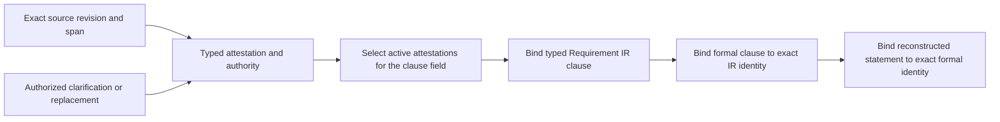

# RT-02 — Separate source location, meaning and authority for clause provenance

## Question and scope

When a requirement clause cites an existing source, what distinguishes actual support from a stale, unrelated or contradictory source reference? The [RT-02 round-trip study](RT-02-CLAUSE-ROUNDTRIP-AND-MUTATION-2026-11-25.md) checks required reference groups and uses an independent finite trace table to detect semantic mutations. This study uses its synthetic order-confirmation source fragments and examines a separate step: adjudicating evidence for a typed clause field. It uses a single order scope and the clock-origin field. It also checks exact links between typed IR, formal and reconstructed representations. The baseline is `c43dd79f9c52f61db12ee5a501961769fdcb7a54` on `research/all`. [Artifact lifecycle model](RT-02-ARTIFACT-LIFECYCLE-BINDING-2026-11-25.md) · [Source fixture](RECONSTRUCTION-ROUNDTRIP-01/corpus.json)

## Provenance rules under study

An attestation records an exact source revision and span, a typed proposition scoped to a clause field, the stipulated authority and any exact superseded attestation. Input source revisions are selected separately. A locator uses an inclusive start and exclusive end in Python string indices and identifies the exact excerpt. Locators establish traceability to bytes through the source revision. The typed proposition states the interpretation that needs authority or independent validation. The prototype takes those interpretations and stakeholder authority as fixture inputs.

For a given field, a clause cites its active supporting attestations. The checker verifies the cited references and examines all selected active attestations for that subject, including any the clause omitted. Equivalent active attestations can coexist. Different active values for one subject produce a conflict. An authorized replacement can remove the earlier decision from current support when it identifies the exact earlier record for the same subject. The two records are still available for historical traceability. Using a replaced record as current support gives a separate disposition.



The typed chain compares the exact parent identities and the claimed statement meaning. A fresh parent reference does not guarantee the meaning was preserved. This fixture uses equality of a simple typed projection across the chain. Supporting formal transformations would require a defined semantic correspondence relation.

## Results

The runner checks 14 source controls and five typed chain controls. The table groups the same results by research implication.

| Check | Result |
|---|---|
| Exact source and scope; equivalent attestations | Both pass. Copies with a different exact source identity can support the same typed proposition. |
| Wrong value or unrelated field | Refused as unsupported even though the reference resolves. |
| Missing reference, missing source, changed revision or invalid span | Four distinct location and binding dispositions. A source revision change invalidates the locator even if the old text remains in place. |
| Unapproved proposed clarification | Refused as unauthorized. |
| Two active contradictory values, only one cited | Conflict. Omitting the other selected source cannot make the clause eligible. |
| Authorized replacement of the exact prior decision | The new attestation supports the replacement value. Copies of the earlier reference remain historical. |
| Replaced support alone, mixed active and replaced support, and cross-scope replacement | Refused. The cross-scope attempt is classified separately from unsupported current citations. |
| Exact chain, two stale links, two semantic changes | One pass, two stale-clause bindings and two interpretation mismatches with valid identity edges. |

These checks distinguish references that resolve from propositions that support a claim. They also explain why LLMLang needs a selected-scope completeness rule: undiscovered contradictory sources outside the selected set cannot enter the check. The model omits natural-language interpretation, formal support for compound formulas and splits, real grant validation, and independent confirmation of source authority. It supplies bounded provenance evidence and leaves those wider research questions open. [RT-02 tracking](https://github.com/aivibeflow/LLMLang/issues/287)

## Reproduction

Use CPython 3.12.14. The receipt records the exact runner, corpus and shared hash-helper hashes, plus each attestation and observed disposition. Hash seeds 1 and 2 produced byte-identical results. The diagram was checked as Mermaid source. [Runner](CLAUSE-PROVENANCE-01/run.py) · [Evidence ledger](CLAUSE-PROVENANCE-01/evidence.json)

```bash
fixture=research/language-design/RT-02/CLAUSE-PROVENANCE-01
LC_ALL=C PYTHONHASHSEED=1 python3 -B "$fixture/run.py" > /tmp/llmlang-rt02-clause-provenance.json
cmp "$fixture/evidence.json" /tmp/llmlang-rt02-clause-provenance.json
```
