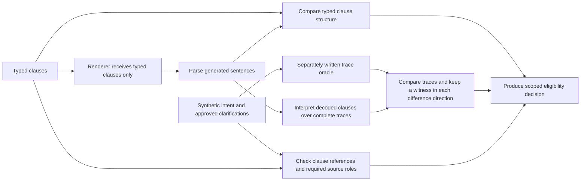

# RT-02 — Clause reconstruction and semantic mutation on a finite order contract

**Scope:** PLAN §1.0 and [#287](https://github.com/aivibeflow/LLMLang/issues/287). Bounded experiments A and B of the [requirement reconstruction proposal](RT-02-REQUIREMENT-RECONSTRUCTION-AND-HUMAN-VALIDATION.md#6-proposed-experiments-and-acceptance-criteria). This is experimental evidence on one curated requirement class.

A reconstruction can accurately describe a formal clause even when formalization changed the requirement. This pilot measures both **renderer fidelity**, meaning recovery of the input typed clauses from the generated sentences, and **source agreement**, meaning equality of allowed traces with a separately adjudicated source interpretation. It also checks whether each typed clause carries the required source and clarification references.

## Fixture and assumptions

The [corpus](RECONSTRUCTION-ROUNDTRIP-01/corpus.json) records a synthetic order request, hypothetical clarifications and a two-clause model. For retail orders, a successful reservation requires automatic confirmation during the inclusive five-second interval starting at payment registration. A failed reservation forbids confirmation throughout the observed interval. Notification is a separate outcome with no obligation in the source. Wholesale orders are outside both requirements.

Every complete trace begins with payment registration at second zero. Reservation has a final outcome of succeeded or failed, with its observation timestamp fixed at second two. The final outcome selects the clause for the whole trace. This retrospective fixture does not impose an additional ordering between reservation observation and confirmation. An independent workflow contract could impose such ordering. Each event, automatic confirmation or notification, is either absent through second nine or observed once at an integer second from zero to nine. The cross-product of two order classes, two reservation outcomes and 11 choices for each event contains 484 complete traces. Absence through that horizon is a negative observation. An incomplete observation with unknown reservation is a separate control.

The typed model supports a scope, reservation condition, required or forbidden mode, observed action and an inclusive window. The trace oracle is a separately written decision table derived from the synthetic clarifications. For retail with successful reservation, it allows a confirmation at seconds zero through five. For retail with failed reservation, it requires absence. For wholesale it imposes no condition. The trace oracle does not call the renderer or clause evaluator.

## Comparison procedure



The [renderer](RECONSTRUCTION-ROUNDTRIP-01/render.py) runs in a separate process. The wrapper sends semantic fields and opaque clause IDs over standard input. It withholds the source text and clarification records. A controlled-language decoder reconstructs the clause records from the result. The source-side gate checks that required source roles are represented and all referenced fragments exist and are authorized within the scenario. The raw text is not parsed by the oracle. The fixture author explicitly chose its interpretation and coded it independently of the typed evaluator.

`ELIGIBLE` means this fixture's reconstruction, provenance and finite trace checks agree. `DIFFERENT` carries a trace newly allowed or newly forbidden relative to the source table. `UNKNOWN` retains unsupported clauses, unreadable output, an unfinished observation or a provenance gap. A case with a semantic difference can also record a provenance gap. Eligibility is a technical result of the harness. Human acceptance, general contract validity and implementation conformance have separate evidence requirements.

## Observations

| Seeded difference | Newly allowed traces | Newly forbidden traces |
| --- | ---: | ---: |
| Omit failed-reservation exception | 110 | 0 |
| Require unrequested notification | 0 | 30 |
| Weaken five-second deadline to seven seconds | 22 | 0 |
| Strengthen the deadline to three seconds | 0 | 22 |
| Flip the failed-reservation prohibition to a requirement | 110 | 11 |
| Move window origin to reservation observation | 22 | 22 |
| Expand the deadline clause to all orders | 0 | 55 |
| Shift deadline trigger to failed reservation | 55 | 11 |
| Change only reconstructed wording from five to seven seconds | 22 | 0 |

Each row compares the same 484 complete traces. For example, the weak deadline allows confirmation at second six on a successful retail order. Moving the origin to second two also rejects a confirmation at second zero. Changing the clock origin can therefore add and remove behaviors. The ledger records exact phrases, reference lists, directional counts and the first distinguishing trace in each direction.

All four baseline or semantics-preserving cases were eligible, including reordered clauses, extra whitespace and a recorded copy of the authorized clock decision. The baseline reconstructs both clauses exactly and links both to all their required source roles. All eight model mutations round-trip faithfully. Seven would also pass the provenance-only checks because their references still exist and have the required roles. The added notification has no supporting references. The source table rejects all eight and detects the additional rendering-only mutation. The latter decodes to a different deadline despite the unchanged typed input.

Six controls remain unknown. Three retain absent, dangling or unapproved conflicting provenance as a reason to withhold eligibility even though the traces match. The other three cover an unsupported action, an unrecognized timing phrase and an incomplete reservation observation. Across the prelisted 19 cases, the combined gate reports 4 eligible, 9 different and 6 unknown. No seeded semantic mutant is accepted. These are exact results for the listed controls. They do not estimate the rate of missed defects in natural-language requirements, uncontrolled LLM output or human review.

## Trade-offs and remaining research

A structural round-trip check makes the renderer accountable to the formal model and enables deterministic coverage measurements. It can pass even when a candidate requirement is wrong. A reference-presence check catches missing links and unresolved authority but cannot establish entailment from arbitrary intent. Adding a separately adjudicated trace oracle exposes semantic changes on the finite domain, at the cost of obtaining an independent interpretation and a complete domain model.

This fixture uses one hand-curated order contract and a small controlled language. Temporal behavior beyond integer seconds and the nine-second horizon, missing payments, multiple or overlapping events, general formal backends, free-text and LLM reconstruction, source-to-model extraction and stakeholder review remain open. The incomplete observation control exercises the boundary decision without claiming temporal monitoring for arbitrary partial traces. The pilot leaves the human approval protocol and language architecture undecided.

## Reproduce

Use CPython 3.12.14. The baseline before the experiment is `e2e41096c5eeaba8bd35f7aa94e31eea02a45ca7`. The [runner](RECONSTRUCTION-ROUNDTRIP-01/run.py) records SHA-256 for itself, the corpus and the independent renderer. There is no randomness or timing measurement. Mermaid syntax was inspected directly. The table expresses the exact trace counts and their interpretation.

```sh
fixture=research/language-design/RT-02/RECONSTRUCTION-ROUNDTRIP-01
LC_ALL=C PYTHONHASHSEED=1 python3 -B "$fixture/run.py" > /tmp/llmlang-roundtrip.json
cmp "$fixture/evidence.json" /tmp/llmlang-roundtrip.json
```

[Machine-readable cases and results](RECONSTRUCTION-ROUNDTRIP-01/evidence.json)
