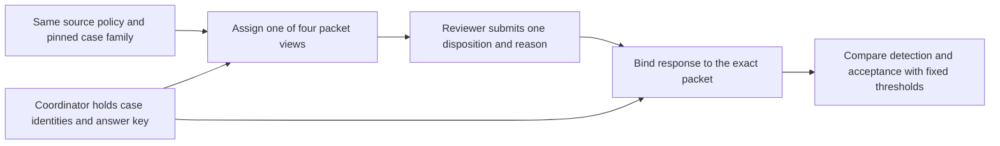

# RT-02 — Protocol for a controlled human review comparison

**Scope:** PLAN §1.0 and [#287](https://github.com/aivibeflow/LLMLang/issues/287). Protocol preparation and synthetic instrument check. Human observations collected to date: zero.

The [deterministic round-trip pilot](RT-02-CLAUSE-ROUNDTRIP-AND-MUTATION-2026-11-25.md) distinguishes reconstruction fidelity from source agreement. The human study asks whether supplying fixed scenarios and clause provenance alongside a reconstructed candidate helps reviewers detect a real discrepancy before approving it. This protocol pins the instruments and evaluation thresholds before collecting results. It uses the retail order fixture as a pilot. The results would need replication on more than one requirement class before supporting a general choice of review process.

## Materials and allocation

The study has 19 fixed cases from `b7b1d63dfcde9f3cadf5a0c8b1b8e8cdc82b12e1`: four eligible controls, nine observable differences and six incomplete controls. Each reviewer receives one case. Every case supplies the same source policy card and applicable observation completeness fields. The experimental arm changes what evidence about the candidate is available.

| Arm | Candidate material |
| --- | --- |
| Prompt only | The source policy card is the entire semantic material. It estimates decisions when the candidate itself is hidden. |
| Formal only | Typed clauses of the candidate, with the same policy card available as the common task context. |
| Reconstruction only | The deterministic controlled-language description of the candidate. |
| Reconstruction plus scenarios and provenance | The same description, eight fixed queries with outcomes under the candidate model, and the named source excerpts attached to the clauses. |

The prompt-only arm is a limited-information baseline. It cannot expose a hidden change to the candidate. A renderer-only mutation is likewise invisible in an arm that sees only the typed clauses. Cross-arm differences can reflect access to evidence as well as ease of reading. The primary comparison is reconstruction plus material versus reconstruction alone. Both receive the same rendered text.

Allocate two domain stakeholders and two engineering or verification reviewers to each arm/case cell, for 76 independent participants per arm and 304 participants overall. An individual appears once. The coordinator assigns the next opaque slot in the role's pre-shuffled list. Only the assigned packet goes to the reviewer. The answer key stays with the coordinator during collection. The pilot is openly reproducible, so prior access to this corpus and its answers affects eligibility for a blinded run. Recruitment and participant observations are the remaining human work.



Expanded packets show the same eight scenario inputs for every interpretable candidate. The builder does not pick differences using the answer key. A row says whether the candidate permits a trace. The reviewer compares that result with the authorized policy. This is distinct from supplying a pre-scored defect label.

## Predeclared scoring

The response records `ACCEPT`, `REVISE`, `CLARIFY` or `REJECT`, plus one reason code. There are 36 mutant responses, 16 eligible responses and 24 unknown responses per arm at full allocation. The scorer separately records optional elapsed review seconds.

- **Mutant detection:** `REVISE` or `REJECT` with the prelisted reason on a differing case. Report the count and rate over 36 per arm.
- **Unsafe acceptance:** `ACCEPT` on any differing or unknown case. Report the count and rate over 60 per arm.
- **Eligible acceptance:** `ACCEPT` on an eligible control, over 16 per arm. This checks that indiscriminate rejection does not pass the pilot.
- **Unknown handling:** count `CLARIFY` on unknown controls, over 24 per arm. Review-time information is exploratory and includes the number of timing records.

Success for this pilot requires all three conditions: expanded detection exceeds reconstruction alone by at least 15 percentage points and the lower bound of its 95% Newcombe interval (based on Wilson intervals) exceeds zero, the expanded unsafe-acceptance Wilson upper 95% bound is at most 10%, and the expanded eligible-acceptance rate is at least 75%. These thresholds govern this pilot only. The sample and intervals characterize participant responses to the fixed cases. They do not estimate between-requirement variation. Results by role and secondary arms describe coverage. The scorer reports partial cohorts without evaluating the full-cohort criteria.

## Packets and dry check

Use CPython 3.12.14 and Git 2.52.0. The [protocol data](CONTROLLED-REVIEW-01/protocol.json) binds the pilot to its exact Git revision, allocation seed and scoring rules. The [builder and scorer](CONTROLLED-REVIEW-01/study.py) check pinned source bytes and record each packet's SHA-256 in the coordinator key. Scoring refuses an unrecognized, repeated or mismatched packet response. The fixture checks identities for reproducibility. It does not authenticate who completed a questionnaire.

```sh
fixture=research/language-design/RT-02/CONTROLLED-REVIEW-01
out=$(mktemp -d)
LC_ALL=C PYTHONHASHSEED=1 python3 -B "$fixture/study.py" build "$out"
cmp "$fixture/dry-run.json" "$out/dry-run.json"
```

Each reviewer receives one file from `packets/`. The coordinator assigns slots using `allocation.json`, keeps `coordinator-key.json` private during the run, and stores responses as a JSON array with `slot`, `packet_sha256`, `decision`, `reason` and optional `review_seconds`. The SHA-256 is computed over the delivered packet bytes. The response file needs no participant names. To score it locally, run:

```sh
python3 -B "$fixture/study.py" score "$out/coordinator-key.json" "$out/responses.json"
```

The [dry-run ledger](CONTROLLED-REVIEW-01/dry-run.json) contains synthetic controls only. The perfect synthetic set detects all 36 mutants per arm and has no unsafe acceptances. An always-accept control has 60 unsafe acceptances per arm. A partial response set leaves criteria unevaluated and a wrong packet digest is refused. The assignment keys and packets are generated artifacts. The repository holds their inputs and builder for reproducibility.

The study has no measured human performance, no claim of statistical power across domains, and no adopted review threshold. The actual participant study remains `[human wip]`. Mermaid syntax was inspected directly.
