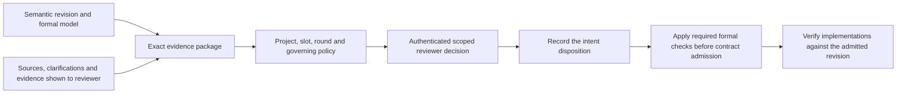

# Bind a human decision to the exact requirement review

**Scope:** PLAN §1.0, [#287](https://github.com/aivibeflow/LLMLang/issues/287). Candidate protocol and finite executable controls. The base repository snapshot is `2d557b45d54aa9b2ac892ca1c3d116a937083a4f` on `research/all`.

## Problem and inputs

A stakeholder can approve one interpretation of a requirement while a different reconstruction, assumption, or analysis is later selected for the same requirement. An evaluator needs to distinguish the approved semantic revision, the specific evidence shown to the reviewer, the scope of review, and the authority to record a decision. [Scenario 15](RESEARCH-SCENARIO-15-BUSINESS-INTENT-TO-FORMAL-CONTRACT.md) separates intent from implementation, and the [review workflow proposal](RT-02-REQUIREMENT-RECONSTRUCTION-AND-HUMAN-VALIDATION.md) already defines four decisions. This study specifies their exact binding in a small model using the existing finite tax example.

The review package binds the semantic revision, formal model, source and clarification record, clause provenance, reconstruction, scenarios, formal analysis result, and assumptions. The review subject additionally binds the project, requirement slot, review round, and governing decision policy. The authenticated reviewer confirms the subject identity, decision, and rationale. The decision action binds these fields and the exact grant revision. The evaluator receives authenticated actor and active grant state as external inputs.



A digest commits to an identity under the model's hashing convention. The digest does not authorize the person submitting it or prove that a trusted producer accurately computed the package fields. In this model, evidence validation and authorization happen at their inputs. No signature, transport or user interface is implemented.

## Review protocol

Before showing the card, freeze the subject and the review package. Make the approved semantic revision, unresolved assumptions, formal status, source citations, and scenario coverage inspectable. Persist the review action with an immutable result. Record who supplied each decision and keep the person who can confirm intent distinct from the actors who can admit contracts or implementations.

| Decision | Intent disposition | Contract admission |
| --- | --- | --- |
| `ACCEPT` | Record semantic acceptance for the exact complete review package. Missing provenance, an unresolved business question, or an unsupported clause blocks acceptance. | Admit only after the configured checks pass for that same package. Retain formal refutation, unknown, and unsupported checks as distinct blocked dispositions. |
| `REVISE` | Record needed changes and their rationale. A new candidate or evidence package opens a fresh review. | Block this subject. |
| `CLARIFY` | Record the question needing an authorized clarification and the rationale. | Block until the clarified package is reviewed. |
| `REJECT` | Record that the submitted candidate was rejected and retain the rationale. | Block this subject. |

At submission and application, compare the authorized subject with the current selection. Durable integration should serialize the selection of one effective disposition per round with the current subject and grant revision. An identical retry can return the stored disposition. A new-round decision supersedes an earlier one only for current applicability. Historical records remain inspectable. The executable model evaluates an already selected action without implementing that storage, concurrency or conflict policy.

The conservative binding requires a new approval after any reviewed evidence item changes. A provenance-only citation repair keeps the same semantic revision and can preserve a separate semantic proof under the conditions in [Scenario 18](RESEARCH-SCENARIO-18-REQUIREMENT-EVOLUTION-AND-SEMANTIC-IMPACT.md). It still changes the material the stakeholder reviewed. An alternative could define an independently checked review-equivalence rule for presentation-only changes. That would reduce review cost while adding a verifier obligation for the equivalence. Approving by the semantic hash alone would leave the evidence the stakeholder saw ambiguous. Binding an entire project snapshot would force reapproval after unrelated changes.

## Results

The [fixture](REQUIREMENT-APPROVAL-01/run.py) ran 28 deterministic controls over one reviewed business rule. Both the fresh decision and its identical repetition are eligible for admission. Twenty-three other cases block, covering changed semantic/evidence identities, changed project/slot/round/policy, impersonation in the supplied authentication input, unavailable or wrong-scope grants, incomplete material, and the three nonaccepting decisions. Three further exact packages record intent acceptance but separately block admission for formal refutation, unknown, or unsupported checks. The [ledger](REQUIREMENT-APPROVAL-01/evidence.json) preserves case-level subject and action identities and both outputs.

The existing [Scenario 15 prototype](../../PROTOTYPES/DEPENDENCY-GRAPH-01/src/business_intent.py) accepts a candidate and an authority indication. When the candidate stays identical and only the external reconstruction changes, its API has no field for that change and yields the same approval identity. In the candidate protocol, the semantic identity remains the same, the package/subject identities change, and applying the earlier approval is refused. This is a scope comparison between the two interfaces, well within the original prototype's declared limits.

The controls validate exact applicability under the supplied identity and grant assumptions. They do not measure human review quality, establish source-to-formal fidelity, handle real reviewer revocation and concurrent decisions, or prove implementation conformance. Human review and production policy selection remain open.

## Reproduce

Run with CPython 3.12.14 and Git 2.56.1. Overlay this experiment onto the exact baseline so the legacy comparison and digest helper are pinned.

```sh
set -eu
scratch=$(mktemp -d)
baseline=2d557b45d54aa9b2ac892ca1c3d116a937083a4f
git archive "$baseline" research | tar -x -C "$scratch"
fixture=research/language-design/RT-02/REQUIREMENT-APPROVAL-01
cp -R "$fixture" "$(dirname "$scratch/$fixture")/"
python3 -B "$scratch/$fixture/run.py" > "$scratch/evidence.json"
cmp "$scratch/evidence.json" "$fixture/evidence.json"
(
  cd "$scratch/research/PROTOTYPES/DEPENDENCY-GRAPH-01"
  python3 -B -m unittest discover -s tests -p 'test_business_intent.py'
)
```

The comparisons are case enumerations for this fixture. The Mermaid source was checked directly.
