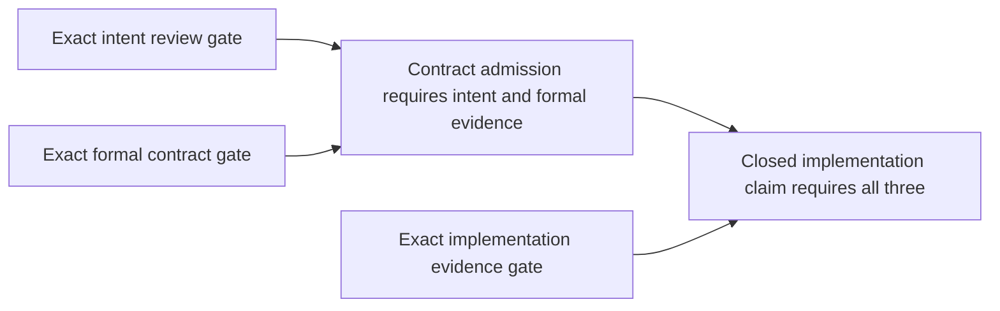

# RT-02 — Keep intent, contract and implementation evidence gates separate

## Question and method

How can LLMLang preserve useful partial evidence while withholding claims whenever a required check is unresolved? This exploratory study composes separate gates for the intent review, formal contract and implementation. It uses a finite prerequisite model at `6b9febfaf97a2fd88f70cb4a56664a4a67b0ccad` on `research/all`. Exact subject identifiers, authorized review and checker outcomes are fixture inputs. [RT-02 worked lifecycle](RT-02-REQUIREMENT-RECONSTRUCTION-AND-HUMAN-VALIDATION.md) · [Exact approval study](RT-02-EXACT-HUMAN-APPROVAL-2026-11-25.md) · [Evidence identity boundaries](RT-02-ARTIFACT-LIFECYCLE-BINDING-2026-11-25.md)

| Gate | Subject and required evidence | Examples that keep the gate open |
|---|---|---|
| Intent | Exact reconstruction/review package, valid reconstructed representation, sufficient source coverage and provenance, and authorized `ACCEPT`. | Missing span, incomplete coverage, reconstruction failure, stale or unauthorized review, request to clarify. |
| Formal contract | Exact model, admitted constructs, discharged required assumptions, and completed applicable formal analysis. | Unsupported construct, unresolved assumption, analysis unknown or reported refutation. |
| Implementation | Exact selected execution tuple and evidence of the required kind. The fixture assumes this profile requires checked proof. | Stale tuple, only bounded tests, conditional proof, or reported implementation refutation. |



Each gate reports its original evidence outcome and all unmet prerequisites. Admission requires every relevant gate to be satisfied. An earlier gate's outcome cannot substitute for a later one's evidence. Retaining a local result during composition preserves its scope and helps explain the next action. In particular, a reported formal refutation under open assumptions is recorded with those assumptions. Its applicability to the intended requirement remains open.

## Results

The fixture exhausts all 64 combinations of the six named defects: unsupported constructs, unresolved assumptions, missing provenance, incomplete source coverage, analyzer unknown and reconstruction failure. It checks every recorded blocker and gate. Only the no-defect case satisfies all three gates. None of the defects converts a current, independently checked execution artifact into an approved contract. The exit criterion for the resulting closed claim is the conjunction, irrespective of the order in which results arrive.

| Additional control | Observed outcome |
|---|---|
| Current intent review alone | Intent gate passes. The stale formal and implementation subjects keep both later gates open. |
| Current formal result alone | Formal gate passes. The stale intent package and execution tuple keep admission open. |
| Exact implementation evidence with a request to clarify, or with an unauthorized review | Implementation gate passes locally. Neither case admits a contract or a closed implementation claim. |
| Admitted contract with bounded tests, conditional proof, or implementation refutation | Contract admission remains available. Each implementation evidence type retains its own disposition, and the closed claim is withheld. |
| Formal refutation and an unresolved assumption | Both reasons are retained, with the original scoped reported outcome. |

The eight extra cases include separate checks for each grouped disposition in the table. A single readiness Boolean could control admission, but would lose the distinction between e.g. unclear business meaning and a refuted model. A rule that infers adjacent gates from a successful check would also accept the wrong subject. The independent gates retain reasons and let later evidence close only the prerequisite it actually addresses. [Full control data](EVIDENCE-GATES-01/evidence.json)

The gate policy is an executable candidate, with synthetic outcomes and a single implementation evidence requirement. Real source completeness, authentication, proof checking, multiple review roles, and evidence strength profiles outside the checked-proof case still require evaluation. The study supplies a failure-handling protocol for the fixture without assigning any new architecture status. [RT-02 tracking](https://github.com/aivibeflow/LLMLang/issues/287)

## Reproduction

Use CPython 3.12.14. The [runner](EVIDENCE-GATES-01/run.py) asserts all 72 outcomes and source-hashes itself in the ledger. Hash seeds 1 and 2 produced identical bytes. The Mermaid source was checked without local rendering.

```bash
fixture=research/language-design/RT-02/EVIDENCE-GATES-01
LC_ALL=C PYTHONHASHSEED=1 python3 -B "$fixture/run.py" > /tmp/llmlang-rt02-evidence-gates.json
cmp "$fixture/evidence.json" /tmp/llmlang-rt02-evidence-gates.json
```
