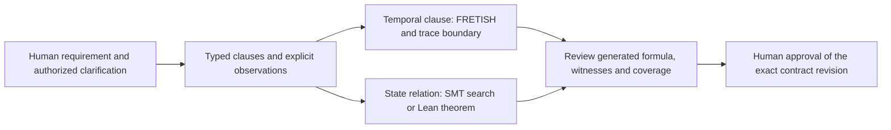

# Compare FRETISH, SMT and Lean for requirement classes

**Scope:** PLAN §1.0, [#287](https://github.com/aivibeflow/LLMLang/issues/287). Bounded backend comparison during requirements research. The input plan revision is `71645b78d5f40ca4cf6239727fc6319cbb111c98`. LLMLang field schemas and review policy remain candidates.

## Question and assumptions

Can a readable requirement be lowered without silently changing what must happen at a deadline, at a call boundary, or across a collection? [Scenario 17](RESEARCH-SCENARIO-17-TYPED-REQUIREMENT-IR.md) proposes a typed IR with specialized backends. This comparison tests FRET's native compiler on exact input sentences, independently compares finite temporal interpretations with cvc5, and checks mathematical integer call contracts in cvc5 and Lean. It treats time as discrete ticks and starts each trace at tick zero. The arithmetic fixture uses unbounded signed integers and an explicit success Boolean.



The arrows describe a candidate workflow. Formalization consumes already chosen predicates and semantic boundaries. It cannot discover whether the stakeholder meant a trace prefix, a closed operation, an assertion over all accounts, or a single observation.

## Native FRET compiler observations

The test invokes the same [compiler function](https://github.com/NASA-SW-VnV/fret/blob/58db455be35182a015e607232d9f4e3c86731932/fret-electron/app/parser/FretSemantics.js) used by the native formalize command. Of eight exact inputs, six produce formulas, one returns trailing unparsed input, and one is stored as free-form text without a formula. The [recorded outputs](REQUIREMENT-BACKENDS-01/evidence.json) retain the compiler's finite/infinite formulas and its explanations.

| Requirement class | Observed support | Evidence boundary |
| --- | --- | --- |
| Respond within two ticks from start or approval | FRET emits finite and infinite temporal formulas for both patterns. The triggered form fires on transition from false to true and at tick zero if already true. | An approval level held true does not itself create another request. A request identifier or occurrence needs an explicit representation if obligations can overlap. |
| Success equivalence, success update and failure frame | All three [CF-006 illustrative clauses](../../formal-verification/CONTRACT-FORMALIZATION-CORPUS/cases/CF-006-bank-withdrawal.md#illustrative-fretish-style-decomposition) compile unchanged to invariant-like temporal formulas over observed values. | Pair the old and new observations with the same operation, and check sampling scope. The FRET output does not bind those names to pre-state and post-state automatically. |
| Hoare-style `old(balance)` | The sample parses and emits an eventual formula retaining `old(balance)`. The compiler lists `old` with the variables. | Acceptance of the spelling supplies no call-entry binding or proof of equality at return. Use explicit typed pre- and post-state values for this claim. |
| Quantification and free-form language | The tested `forall account : ...` spelling fails with trailing syntax. The quoted sentence is stored without a formula. | This is a result for the tested spellings. A finite domain can use explicit expansion, or a separately scoped formal language can bind a quantified variable. |

### Finite trace boundaries

The unconditional input emits `((F[0,2] posted) | (F[0,1] LAST))`, where `F[0,2]` means sometime within two steps inclusive, and `LAST` marks the final point. The second disjunct excuses a missing reply when the trace ends before the due tick. The same exception applies to each trigger of the guarded input. The infinite formula has no `LAST` boundary.

We checked the emitted formula trees for the exact two cases before unrolling their supported pattern into SMT. We compared it with a closed-operation rule requiring a reply no later than the deadline and before the final observation ends. Finite enumeration independently counts every Boolean assignment in the stated range. cvc5 checks whether the formulas can disagree at each length.

| Trace length in ticks | Unconditional differences / traces | Approval-triggered differences / traces |
| ---: | ---: | ---: |
| 1 | 1 / 2 | 1 / 4 |
| 2 | 1 / 4 | 4 / 16 |
| 3 | 0 / 8 | 11 / 64 |
| 4 | 0 / 16 | 42 / 256 |
| 5 | 0 / 32 | 165 / 1,024 |

The 225 differences across 1,426 traces are cases where the FRET finite formula returns true and the closed rule rejects the trace. A one-tick trace with approval true and no reply distinguishes the rules. A late approval can distinguish them even when the total trace is longer than the deadline. A trace known to be a prefix can instead leave the pending operation inconclusive in the surrounding contract evidence. We did not rebuild FRET's simulator. The comparison uses the two compiled formula strings, their explicit unrolling, and independent enumeration.

### Integer call relation

For balance `before`, requested `amount` and resulting `after`, define a valid request by `0 < amount ≤ before`. Bind success by equivalence and require either subtraction on success or an unchanged balance on failure. cvc5 found no model distinguishing this contract from its total reference function. It found a model for each of three weakenings:

| Weakened clause | Witness found by cvc5 |
| --- | --- |
| Necessity only | Balance 1 and amount 1 are reported as failed with balance 1. |
| Sufficiency only | Balance 0 and amount 0 are reported as successful. |
| Omitted failure frame | A failed zero-amount request changes balance from 0 to −1. |

Lean checks four theorems about the separately written typed relation, including exact success behavior and preserved failure state. The nonnegative result explicitly assumes a nonnegative pre-state and pertains to this operation. The checked theorem does not infer an unrestricted global account invariant. The artifact records each theorem's axiom list. The SMT answers have no independently checked UNSAT certificates in this experiment. The Lean terms and the SMT model were written independently of FRET's code-generation path. Correspondence for a general IR or compiled program is a separate obligation.

## Candidate routing and remaining evidence

FRET provides native readable temporal templates, formulas and explanations when the observation model and end-of-trace rule are explicit. SMT supports consistency and mutation witnesses for the tested finite temporal and integer models. Lean supports checked proofs of the typed call relation under explicit assumptions. A model checker such as TLC is also a candidate when interleavings or multi-step state evolution are the required observation. This comparison did not run a new TLC model. Expanding every requirement into low-level logic would improve control over semantics but make human review harder. Requiring FRET for every clause would move important meaning into unverified observation adapters.

Keep the typed clause, reference to the original intent, backend version, exact formalization and observed obligation scope in the evidence package. Fail closed when the adapter cannot bind an observation or encode a clause. Controlled human review, source-to-formula correspondence, richer quantification and representative lifecycle models remain open. No backend or language semantics is selected by this comparison.

## Reproduce

Observed with CPython 3.12.14, Node v24.22.3 and npm 11.19.1, FRET v3.1.0, cvc5 1.4.2 at `282d5e0c84baf49c780704c532f87ba66d8b513d` and Lean 4.36.0 at `611c117bfaf7b7ae1cfcf246ce6fba31e8f509e9` on Linux x86-64. Set `CVC5` and `LEAN` to the pinned executables. The cvc5 binary SHA-256 was `6aecddf466552b83bb5883756c7955e0c9d5ddcc6d7f45b48c2f6e06a741b102`. The dependency lock pins the headless compiler imports used here. The runner checks the FRET commit and the absence of tracked edits.

```sh
set -eu
fixture=research/language-design/RT-02/REQUIREMENT-BACKENDS-01
scratch=$(mktemp -d)
mkdir "$scratch/deps"
cp "$fixture/package.json" "$fixture/package-lock.json" "$scratch/deps/"
npm ci --prefix "$scratch/deps" --cache "$scratch/npm-cache" --ignore-scripts --no-audit --no-fund
git clone --depth 1 --single-branch --branch v3.1.0 https://github.com/NASA-SW-VnV/fret.git "$scratch/fret"
NODE_PATH="$scratch/deps/node_modules" python3 -B "$fixture/run.py" \
  --fret-root "$scratch/fret" --cvc5 "$CVC5" --lean "$LEAN" > "$scratch/evidence.json"
cmp "$scratch/evidence.json" "$fixture/evidence.json"
```

The counts enumerate fixed inputs and do not estimate general requirements coverage. Mermaid source was checked directly.
