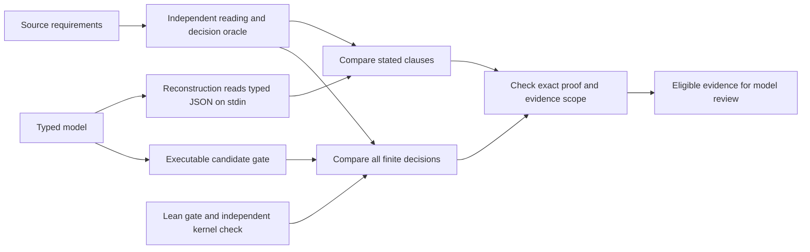

# Requirement validation with revocable release authority

[Tracking issue #287](https://github.com/aivibeflow/LLMLang/issues/287) · [Earlier requirement classes and risk scopes](RT-02-REQUIREMENT-CLASS-AND-RISK-COVERAGE-2026-11-25.md)

The earlier comparison covers deadline, numeric and relational state requirements. Those finite cases intentionally withhold a result for the illustrative proof-required profile. This study adds a scoped requirement with two different access predicates, a reusable operation receipt and revocation between preparation and decision. It asks which evidence can support a reviewer under a proof-required policy.

The [synthetic source requirements](RELEASE-REQUIREMENT-01/requirements.txt) define release for a current principal holding a release grant for the exact workspace, artifact, revision and epoch. With an existing receipt, a current observation grant can return an exact retry without a new effect. The receipt binds operation, workspace, artifact, revision and payload. A caller with insufficient observation authority receives the same denial whether the receipt matches or conflicts. The active policy concerns only the gate decision. It leaves distributed grant propagation and external effects to a separate implementation contract.



The [controlled reconstructor](RELEASE-REQUIREMENT-01/reconstruct.py) receives only the typed JSON via stdin. The comparison process retains the source text, pinned reading and independent decision function. The reconstructor is deterministic and uses a small controlled vocabulary. This setup tests separation of inputs and detection of specific field changes. It does not evaluate an LLM, reviewer comprehension or untrusted generator isolation.

The bounded corpus crosses 65 grant states with 33 receipt states. The grant is absent or has one of two roles and one of the 32 independent binding mismatch masks. The receipt is absent or uses one of 32 independent mismatch masks. The typed Python evaluation, direct source oracle and executable Lean gate agree on all 2,145 cases. The disposition counts are 2,112 denials, 31 authorized conflicts, one release and one exact replay.

| Seeded semantic change | Different outcomes out of 2,145 |
| --- | ---: |
| Drop principal binding | 33 |
| Drop current epoch binding | 33 |
| Drop payload from the receipt comparison | 1 |
| Require release instead of observe for retries | 64 |
| Report conflict before checking observation authority | 1,953 |

The reconstructed text exposes each of these model changes. The final mutation discloses that an existing receipt conflicts even though the requester cannot observe it. A separate six-case epoch suite compares current decisions with a prepared-epoch mutation. Four outcomes disagree under the mutation, including a stale grant that can publish after revocation and a current observer who loses valid access to an existing receipt.

The Lean model uses natural numbers for identities and the epoch. The kernel checks five theorems without axioms. They characterize exact new release and replay, eliminate a repeated effect for an existing receipt, deny a stale release grant and prevent unauthorized receipt disclosure. Two direct false claims, one permitting a stale grant and one permitting replay of a changed payload, are refused. The finite cross-comparison checks the Python candidate's correspondence to the Lean gate for the enumerated fragment. The general Lean theorems concern the named Lean model and do not prove correspondence to arbitrary Python runs or production enforcement.

A proof-required receipt in this fixture binds the exact canonical typed model, Lean formalization, checker binary, scope and five declarations. The checked case reaches `eligible-for-review-in-checked-model`. Finite results alone withhold eligibility. Five altered proof receipts with wrong model, theorem set, checker, formalization or scope also withhold it. A changed reconstructed reading or semantic mismatch requests revision. Eligibility here describes evidence for the model. A real approver, a bound implementation, operative authority and the production policy remain separate gates.

The combined work now exercises temporal, numeric, relational state and revocable authority examples under finite and proof-required fixture policies. Unrestricted eventual completion, human and live-model assessment, general source-to-model correspondence and deployment-level concurrency remain open. The results leave transfer to `draft/` subject to their separate review and approval requirements.

## Reproduce

Use CPython 3.12.14 and Lean 4.36.0 at [`611c117`](https://github.com/leanprover/lean4/tree/611c117bfaf7b7ae1cfcf246ce6fba31e8f509e9). The [runner](RELEASE-REQUIREMENT-01/run.py) records exact source, oracle, model, formalization and checker fingerprints. It checks the declarations and prints the finite Lean tally, then independently compares each result and records mutation differences and evidence decisions. The [observations](RELEASE-REQUIREMENT-01/observations.json) preserve the full finite outcome vector and all changed observations. The table shows counts, with no runtime or human effectiveness claim.

```sh
study=research/language-design/RT-02/RELEASE-REQUIREMENT-01
PYTHONHASHSEED=1 python3 -B "$study/run.py" --lean "$LEAN_EXE" --out /tmp/rt02-release.json
cmp "$study/observations.json" /tmp/rt02-release.json
```
