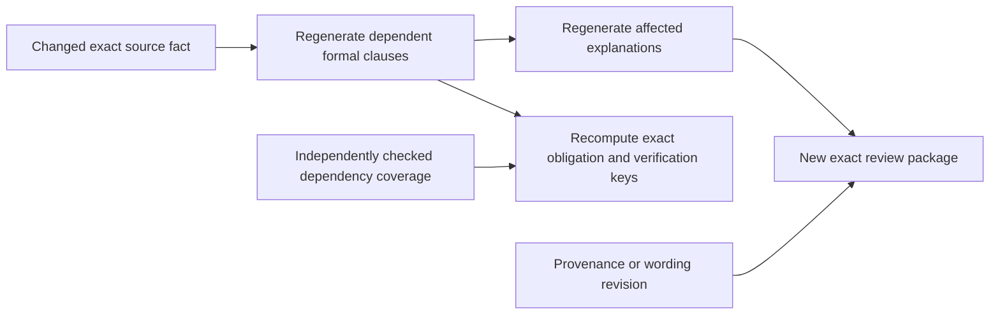

# RT-02 — Scope revision impact to the property and review package

## Question and method

When a requirement changes, which explanation and verification artifacts must be regenerated, and when does the stakeholder need to review a new package? I reused the Scenario 18 content store, dependency impact and verification-key functions to model three properties with partially shared source facts. The exploratory baseline is `fc419a4bd94a432cf58aa4dbdf71b7674ddf1ada` on `research/all`. [Scenario 18 evolution](RESEARCH-SCENARIO-18-REQUIREMENT-EVOLUTION-AND-SEMANTIC-IMPACT.md) · [Lifecycle evidence binding](RT-02-ARTIFACT-LIFECYCLE-BINDING-2026-11-25.md) · [Exact stakeholder approval](RT-02-EXACT-HUMAN-APPROVAL-2026-11-25.md)

The deadline and reservation exception both depend on the meaning of confirmation. The deadline also consumes the clock and bound; the exception consumes the failure condition. A separate notification property consumes its own source fact. Each property has immutable formal, explanation and implementation-obligation objects. The verification key names the exact obligation and declared closure with fixed checker and settings. The review package binds all explanations and the currently selected provenance record. The example keeps a separate bookkeeping fact outside both scopes.



The observation records which IDs change and compares the active impact set from the graph. A previously applicable proof can be a reuse candidate only when its key and dependency coverage still support the selected property. The experiment tests key applicability; it does not generate the underlying implementation proof.

## Results

| Revision | Formal clauses changed | Explanations changed | Eligible retained keys | Fresh package review |
|---|---|---|---|---|
| No change | None | None | All three | No |
| Deadline 5 → 6 seconds | Deadline | Deadline | Exception, notification | Yes |
| Failure condition changes | Exception | Exception | Deadline, notification | Yes |
| Shared meaning of confirmation changes | Deadline, exception | Deadline, exception | Notification | Yes |
| Provenance locator only | None | None | All three | Yes |
| Wording of deadline only | None | Deadline | All three | Yes |
| Unrelated bookkeeping fact | None | None | All three | No |

The seventh variant changes a source value outside the exact review and semantic closures, so the current review applies. A provenance change within the package creates a new review subject and leaves all three semantic keys available. These results show why an approval ID and a verification key need separate applicability tests, even if the project publishes them together.

The omitted-edge control removes the exception's dependency on confirmation from both baseline and candidate graphs. Following the declared graph misses the exception impact, and its verification key stays the same after the semantic edit. An independent fixture coverage table detects this missing edge and withholds reuse for the exception. Full invalidation could avoid this reuse error but would also discard the unaffected notification evidence. The scoped comparison depends on complete effect and dependency coverage. Discovering that coverage from general source requires separate evidence. [Full revision data](REVISION-IMPACT-01/evidence.json)

This is an identity and applicability experiment for three properties. It leaves unaffected proof reuse candidates to the applicable proof policy and leaves real behavior, concurrent review, authorization expiry, cross-package review policy and independently complete dependency extraction open. [RT-02 tracking](https://github.com/aivibeflow/LLMLang/issues/287)

## Reproduction

Use CPython 3.12.14. The [runner](REVISION-IMPACT-01/run.py) records hashes of itself and the reused prototype modules. It asserts the seven revision cases and the missing-edge control. Hash seeds 1 and 2 produced byte-identical results. The diagram was checked as Mermaid source.

```bash
fixture=research/language-design/RT-02/REVISION-IMPACT-01
LC_ALL=C PYTHONHASHSEED=1 python3 -B "$fixture/run.py" > /tmp/llmlang-rt02-revision-impact.json
cmp "$fixture/evidence.json" /tmp/llmlang-rt02-revision-impact.json
```
