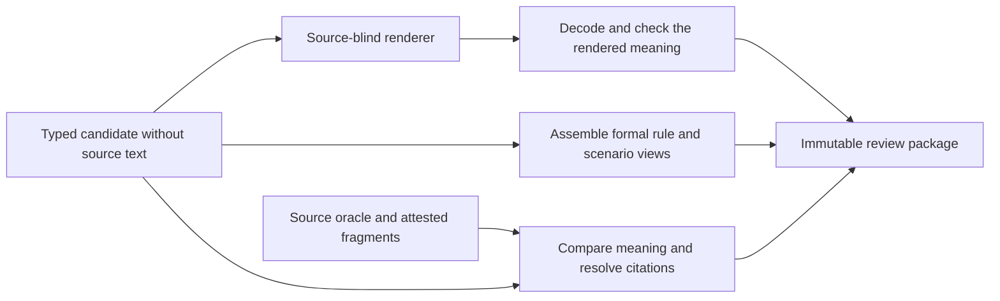

# RT-02 — Assemble the requirement reconstruction review package

## Question and method

Can LLMLang assemble the seven proposed review outputs while keeping the generated explanation independent of the original prompt? This bounded study uses the order-confirmation corpus and the existing controlled-English renderer. It assembles new outputs and tests five dispositions. The baseline is `9358f4b731b7f0b058deb1ef0a827edebfe43b12` on `research/all`. [Worked requirement reconstruction](RT-02-REQUIREMENT-RECONSTRUCTION-AND-HUMAN-VALIDATION.md) · [Controlled renderer and round-trip study](RT-02-CLAUSE-ROUNDTRIP-AND-MUTATION-2026-11-25.md) · [Directional trace comparator](RT-02-SEMANTIC-DIFFERENCE-DIRECTION-2026-11-25.md)

The renderer receives only typed clauses with source references omitted. A separate assembler reads the source fixtures and authority markings, runs the independent trace comparison, decodes the rendered text for this grammar, and binds the outputs. The package identity covers all outputs and the exact formal input identity. A presentation or provenance change can create a new package without changing the formal identity.



| Output role | Contents and authority |
|---|---|
| Human-readable contract | Controlled prose from typed clauses, with IDs retained for review. |
| Business-rule table | Scope, condition, required or forbidden action, clock source and deadline from the typed model. |
| Temporal and scenario explanations | Applicable intervals and fixture verdicts for a satisfying trace, a deadline violation, a prohibition violation and an incomplete observation. |
| Counterexamples | Concrete violations of candidate rules and directional traces newly allowed or excluded relative to the source oracle. |
| Semantic differences | Trace-set relation, counts, typed edits and directional witnesses over the declared finite population. |
| Unresolved questions | Missing or unsupported inputs and reconstruction mismatches. An incomplete observation is identified in the scenario output. |
| Provenance links | Per-clause source fragment references, exact fragment identities where resolved and scope-limited authority markings from the fixture. |

The roles separate what the formal candidate states, whether a scenario satisfies it, and how it differs from the independent source interpretation. A trace can satisfy the candidate while serving as a counterexample to its agreement with the source. A scoped missing observation appears as `UNKNOWN` in scenarios without fabricating an event or claiming a business clarification.

## Controlled outcomes

| Input | Observed package disposition |
|---|---|
| Original typed clauses | Eligible for human review, with all seven output roles. The incomplete reservation observation remains unknown. |
| Shift the clock origin | Needs revision, with concrete witnesses in both directions. |
| Cite a missing source fragment | Unknown, with the unresolved source reference retained. The formal identity still matches the original clauses. |
| Unsupported action | Unknown. The package leaves contract text and behavioral analysis empty and states the unsupported construct. |
| Change the displayed deadline without changing the formal input | Needs revision. The round-trip comparison exposes the changed deadline in the text even though the formal comparison still agrees with the source oracle. |

The five package identities are distinct. Eligibility is a fixture result for review, with no human approval or implementation guarantee inferred. LLMLang would need independent evidence for open-ended generation, source coverage and authority, semantic alignment beyond this grammar, and effectiveness in stakeholder review. [RT-02 tracking](https://github.com/aivibeflow/LLMLang/issues/287)

## Reproduction

Use CPython 3.12.14. The [runner](RECONSTRUCTION-PACKAGE-01/run.py) and [full outputs](RECONSTRUCTION-PACKAGE-01/evidence.json) retain the inputs, hashes and dispositions. Hash seeds 1 and 2 produced byte-identical ledgers. The diagram was checked as Mermaid source.

```bash
fixture=research/language-design/RT-02/RECONSTRUCTION-PACKAGE-01
LC_ALL=C PYTHONHASHSEED=1 python3 -B "$fixture/run.py" > /tmp/llmlang-rt02-review-package.json
cmp "$fixture/evidence.json" /tmp/llmlang-rt02-review-package.json
```
