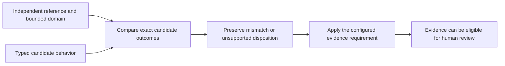

# RT-02 — Compare bounded workflow evidence across requirement classes

## Question and method

How far do the current reconstruction and evidence gates extend beyond one deadline clause? This exploratory comparison applies the formal-candidate/independent-reference portion of the workflow to three distinct bounded requirement classes and one unsupported class. It uses the research baseline `11b6e6a2a5d98c6bea2d9793f68ac97ecf2aaeff` on `research/all`. The candidate functions and reference functions are written separately. Checks enumerate the complete stated finite populations before applying three synthetic evidence policies. [RT-02 backend comparison](RT-02-FRETISH-REQUIREMENT-BACKEND-COMPARISON-2026-11-25.md) · [RT-02 independent evidence gates](RT-02-FAIL-CLOSED-EVIDENCE-GATES-2026-11-25.md)

| Class | Observation space and independent rule | Seeded defect |
|---|---|---|
| Temporal scope, deadline and prohibition | The existing order fixture enumerates both scopes, both reservation results and arrival or absence of confirmation and notification. The independent trace table preserves the failed-reservation prohibition. | Omit the prohibition. |
| Numeric precondition | Test amounts and balances 0 through 5 with both account states. The reference explicitly checks membership in the active account's allowed positive range. | Treat zero as an allowed amount. |
| Relational state transition | Test capacity 0 through 4, current allocation and observed allocation 0 through 5, and requested seats 0 through 4. The reference checks the remaining slots and the exact post-state. | Compare the request with total capacity while ignoring the already allocated seats. |
| Unbounded eventual completion | The source requires eventual completion over unrestricted traces. The finite compare-and-enumerate backend has no applicable analysis for this property. | This is an unsupported-class control. |

The routine policy permits complete finite enumeration on the declared domain. The stateful policy additionally requires an independent oracle for finite evidence. The high-assurance policy requires checked proof. These labels describe illustrative fixture policies. Domain stakeholders would need to set production risk thresholds and admit evidence for specific requirements.



## Results

| Class | Complete observations | Baseline mismatches | Mutant mismatches |
|---|---:|---:|---:|
| Temporal scope and deadline | 484 | 0 | 110 |
| Numeric precondition | 72 | 0 | 6 |
| Relational state transition | 900 | 0 | 20 |
| Unbounded eventual completion | None | Unknown | Unknown |

The omission admits forbidden confirmations. The numeric mutant additionally admits an active account's zero request at each of six balances. For the state mutant, the first false acceptance has capacity one, one seat already booked, one requested, and two booked after the action. At each capacity `c` from one through four and each positive request at most `c`, there are `5 − c` old allocations for which the candidate's total exceeds capacity while its observed value remains in the domain. The sum of `c × (5 − c)` is 20.

The three supported baselines produce eligible evidence for routine and stateful review. Their finite evidence remains insufficient for the high-assurance profile. Removing the independent oracle makes the stateful profile withhold eligibility. Every detected defect requests revision under all three policies. The unsupported requirement stays unknown under all policies. [Raw outcomes and distinguishing cases](REQUIREMENT-CLASS-COVERAGE-01/evidence.json)

The study exercises multiple requirement shapes and how evidence can meet a configured threshold. Only the temporal case reuses the existing controlled reconstruction and source oracle. The numeric and state controls are separately authored bounded functions. Human comprehension, broad requirement representation, organization-specific risk thresholds, and implementation correspondence remain open. [RT-02 tracking](https://github.com/aivibeflow/LLMLang/issues/287)

## Reproduction

Use CPython 3.12.14. The [runner](REQUIREMENT-CLASS-COVERAGE-01/run.py) records exact file hashes and checks all mismatch counts and policy outcomes. Hash seeds 1 and 2 produced the same bytes. The Mermaid source was checked without local rendering.

```bash
fixture=research/language-design/RT-02/REQUIREMENT-CLASS-COVERAGE-01
LC_ALL=C PYTHONHASHSEED=1 python3 -B "$fixture/run.py" > /tmp/llmlang-rt02-class-coverage.json
cmp "$fixture/evidence.json" /tmp/llmlang-rt02-class-coverage.json
```
