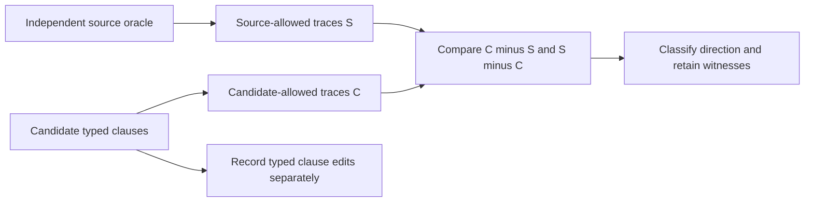

# RT-02 — Classify the direction of requirement changes

## Question and method

A difference between an original intent and a formal requirement can admit new behaviors, exclude intended behaviors, or do both. Which classification follows from the existing order-confirmation corpus, and what can be concluded with incomplete coverage? This study extends the [existing round-trip pilot](RT-02-CLAUSE-ROUNDTRIP-AND-MUTATION-2026-11-25.md) by adding directional counts, witnesses in both directions, typed edit fields and observed context feasibility. The baseline is `0a576189d080746d352653d3f15a01af079e39cb` on `research/all`.

The independently authored source oracle supplies an admitted set `S`. The clause evaluator supplies the candidate set `C`. The fixture enumerates 484 traces, including both order scopes and both reservation outcomes, and uses the original inclusive deadline and finite event positions. It verifies that the unmodified typed clauses match the source oracle on every trace. Each case records `C − S` and `S − C`, plus the first concrete witness in each nonempty set. Separately, it compares aligned clause IDs and typed fields for presence, scope, condition, polarity, action, clock origin and deadline.



With complete enumeration of the declared domain, a strict superset weakens the contract, a strict subset strengthens it, and nonempty differences in both directions make the sets incomparable. An empty pair of differences establishes equivalence on that domain. With incomplete enumeration, concrete witnesses establish a difference in the observed direction. A missing witness cannot establish the absence of a reverse difference. Two concrete witnesses in opposite directions suffice to establish incomparability. Clause insertion, removal and field edits provide an explanation of the change and do not determine its behavioral effect on their own.

## Results

| Candidate change | Newly admitted | Newly excluded | Observed relation |
|---|---:|---:|---|
| Original typed clauses | 0 | 0 | Equivalent in domain |
| Omit failed-reservation exception | 110 | 0 | Weakened |
| Add required notification | 0 | 30 | Strengthened |
| Change deadline from five to seven seconds | 22 | 0 | Weakened |
| Change deadline from five to three seconds | 0 | 22 | Strengthened |
| Flip the exception from prohibition to requirement | 110 | 11 | Incomparable |
| Move clock origin to reservation observation | 22 | 22 | Incomparable |
| Widen the positive requirement to both scopes | 0 | 55 | Strengthened |
| Move the positive requirement from retail to wholesale | 55 | 55 | Incomparable |
| Change the positive condition from reservation success to failure | 55 | 11 | Incomparable |
| Add an equivalent duplicate clause | 0 | 0 | Equivalent in domain |
| Add an opposite obligation for the same success interval | 0 | 66 | Strengthened and empties the retail-success context |

A shift of clock origin or scope can leave the total count unchanged while changing the contract in both directions. An added clause can leave it equivalent, narrow it or rule out every admitted trace in an affected context. Preserve the emptiness finding alongside the set ordering. The exception omission is a weakening even though the clause's syntactic action was a removal. [Full counts, edits and witnesses](SEMANTIC-DIRECTION-01/evidence.json)

Two incomplete-domain controls remove candidate observation rows without changing the requirements. One hides every witness to the longer deadline. The other hides the reverse witnesses for a change of clock origin, making a mixed change look one-sided. Both report unknown direction and retain any observed witness. This defines a method for the admitted bounded fragment. Unbounded semantic equivalence, alignment of split and merged clauses, unsupported temporal operators and agreement with real stakeholder intent remain open. [RT-02 tracking](https://github.com/aivibeflow/LLMLang/issues/287)

## Reproduction

Use CPython 3.12.14. The runner records the file hashes of the exact source oracle/evaluator module, source corpus and classifier. Analytical counts for all twelve complete-domain cases are asserted before the ledger is emitted. Python hash seeds 1 and 2 produced identical ledgers. The diagram was checked as Mermaid source.

```bash
fixture=research/language-design/RT-02/SEMANTIC-DIRECTION-01
LC_ALL=C PYTHONHASHSEED=1 python3 -B "$fixture/run.py" > /tmp/llmlang-rt02-semantic-direction.json
cmp "$fixture/evidence.json" /tmp/llmlang-rt02-semantic-direction.json
```
