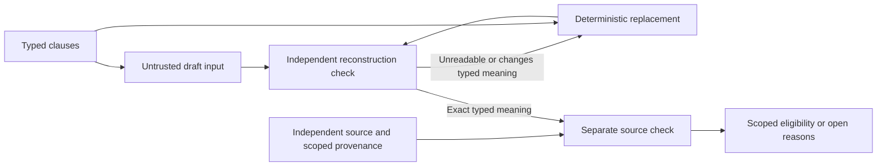

# RT-02 — Compare independent checks and fallback for reconstruction drafts

## Question and method

Can a reconstruction pipeline recover a bad draft without admitting a wrong formal model? This study compares a checked deterministic renderer, an independent check of untrusted drafts and a checked fallback that invokes the deterministic renderer when a draft is unreadable or changes the typed meaning. The draft inputs are ten seeded controls. No model produced them. The baseline is `5317a6a66c53886d5d8885b7262d07ad0a3e79fa` on `research/all`. [Controlled renderer](RT-02-CLAUSE-ROUNDTRIP-AND-MUTATION-2026-11-25.md) · [Source comparison](RT-02-SEMANTIC-DIFFERENCE-DIRECTION-2026-11-25.md)

The renderer receives typed clauses only. The separate checking pass decodes the proposed text against the typed model, then checks the existing provenance constraints and compares behavior with the independent source oracle over the finite fixture. The fallback is permitted for a draft-level defect. It runs the same checks again on the replacement text. A source discrepancy in the formal model or unresolved provenance stays visible for revision or clarification. A parse-only control checks how many drafts fit the grammar without those additional checks.



## Results

| Route | Observed disposition on ten fixtures |
|---|---|
| Parse only | Eight drafts parse. Six of those are ineligible under the independent checks. |
| Checked deterministic rendering | Seven eligible packages. Wrong formal input, unresolved provenance and the unsupported action remain blocked. |
| Checked seeded draft | Two eligible drafts, covering the unchanged rendering and a formatting-only variant. |
| Checked fallback | Seven eligible packages. Five draft failures recover with current typed inputs, and a sixth fallback reaches an unsupported formal construct and stays blocked. |

A readable draft can omit the exception, insert notification, print the wrong deadline, describe a wrong formal input accurately, omit required source support, or describe a different supported action while its formal input remains unsupported. These six variants explain the parse-only gap. The hybrid route recovers the wrong text, omission, insertion, malformed output and missing output using the deterministic renderer. A faithful reconstruction of a semantically wrong model does not trigger fallback. It carries the directional source difference. [Case-by-case outcomes](RECONSTRUCTION-ROUTING-01/evidence.json)

This comparison tests routing and admission behavior for fixed drafts. It leaves actual LLM drafting fidelity and style, token cost, latency, and reviewer benefit unmeasured. A model comparison needs pinned provider and model revisions and a source-blind input boundary supplying only the typed clauses. The separate checker can consume the source and structured trace reference, with the model output, settings and review package retained for evaluation. The tested routes supply the same check and fallback controls for both deterministic and model-produced inputs. [RT-02 tracking](https://github.com/aivibeflow/LLMLang/issues/287)

## Reproduction

Use CPython 3.12.14. The [runner](RECONSTRUCTION-ROUTING-01/run.py) records exact inputs and dependency hashes. Hash seeds 1 and 2 produced identical ledgers. The diagram illustrates the candidate pipeline and was checked as Mermaid source.

```bash
fixture=research/language-design/RT-02/RECONSTRUCTION-ROUTING-01
LC_ALL=C PYTHONHASHSEED=1 python3 -B "$fixture/run.py" > /tmp/llmlang-rt02-routing.json
cmp "$fixture/evidence.json" /tmp/llmlang-rt02-routing.json
```
