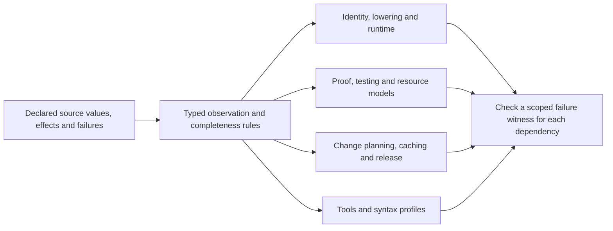

# RT-03 downstream dependency evidence

Which downstream decisions have a checked example that depends on the chosen meaning of a program? This audit enumerates the direct outgoing RT-03 edges in the exact dependency register and maps each to a concrete comparison or an explicit proxy. It identifies what available evidence can support when the semantic candidates are combined later. It does not infer production completeness from the presence of an experiment.



## Directed edge crosswalk

A scoped check denotes existing executable or formal evidence for the stated narrow dependency. Some witnesses compare alternative profiles and others show a rejection when an exact observation or scope is missing. The bootstrap entry is a proxy because the tested workload is a candidate implementation, outside a selected LLMLang-authored development tool.

| Edge | Target | Evidence | Checked scope and remaining boundary |
|---|---|---|---|
| DEP-004 | RT-04 | [Scoped check](../RT-04/RT-04-QUEUED-FOREIGN-OWNERSHIP-2026-11-25.md) | A foreign descriptor has an ownership interval before a receipt. Treating the receipt as the only boundary loses a native lock observation. General concurrent ownership model open. |
| DEP-005 | RT-05 | [Scoped check](../../semantic-representation/RT-05/RT-05-NORMALIZATION-BOUNDARIES-2026-11-25.md) | Field-map identity collapses 228 pairs with different ordered or failing observations. Whole-language normalization remains open. |
| DEP-007 | RT-07 | [Scoped check](../../formal-verification/RT-07/RT-07-OBSERVABLE-REWRITE-CORRECTNESS.md) | Ordered effects distinguish rewrites that result-only checks admit. General end-to-end correspondence remains open. |
| DEP-010 | RT-06 | [Scoped check](../../semantic-representation/RT-06/RT-06-CONDITIONAL-DEPENDENCY-CLOSURE-2026-11-25.md) | Exact dependency closure needs a state-sensitive path in the bounded flag-changing cycle. Source completeness remains open. |
| DEP-013 | RT-08 | [Scoped check](../../research-management/RT-00/RT-00-OBSERVATION-EVIDENCE-DEPENDENCY-RECHECK-2026-11-25.md) | Different observation projections and input coverage change which mutants the fixture can detect. General test adequacy remains open. |
| DEP-016 | RT-09 | [Scoped check](../../compiler-and-translation/RT-09/RT-09-13-MUTABLE-BYTE-VIEW-PRESERVATION.md) | The transformation evidence depends on reads through aliases and exact effect ordering. General IR semantics remain open. |
| DEP-018 | RT-10 | [Scoped check](../../runtime-and-systems/RT-10/RT-10-RESUMABLE-EXECUTION-2026-11-25.md) | Runtime checkpoints preserve scoped source effects, outcomes and fuel. General runtime correspondence remains open. |
| DEP-028 | RT-14 | [Scoped check](../../toolchain-and-collaboration/RT-14/RT-14-OBLIGATION-ROSTER-AND-INSPECTION-2026-11-25.md) | The task-completion gate needs exact independently scoped obligation results and separates those from action authorization. Real end-to-end action integration remains open. |
| DEP-036 | RT-11 | [Scoped check](RT-03-HANDLER-DOWNSTREAM-2026-11-25.md) | Equal static call projections hide 1,256 cross-profile changes in observed values, rejections or writes. Production caching is open. |
| DEP-037 | RT-15 | [Scoped check](RT-03-HANDLER-DOWNSTREAM-2026-11-25.md) | Equal scalar projections hide 214 composition-order differences. Distributed whole-graph merge remains open. |
| DEP-038 | RT-16 | [Scoped check](RT-03-HANDLER-DOWNSTREAM-2026-11-25.md) | A rejected guarded write can terminate the composed action and prevent a later write. Enforcement outside the finite model remains open. |
| DEP-039 | RT-18 | [Scoped check](RT-03-HANDLER-DOWNSTREAM-2026-11-25.md) | Compatible static shapes hide 256 handler behavior changes. A general versioning profile needs checked observable obligations. |
| DEP-086 | RT-24 | [Scoped check](../../toolchain-and-collaboration/RT-24/RT-24-CANONICAL-GIT-LAYOUTS-2026-11-24.md) | The closed inventory gives one exact semantic root across 24 layout/input combinations. Full repository reconstruction is separate. |
| DEP-094 | RT-21 | [Proxy](../RT-01/RT-01-TYPED-CLI-VERTICAL-SLICE-2026-11-25.md) | The finite executable recipe checks a CLI against byte and arithmetic observations. The LLMLang-authored tool and full bootstrap dependency still need evidence. |
| DEP-100 | RT-26 | [Scoped check](../../runtime-and-systems/RT-26/RT-26-RESOURCE-AUTHORITY-BOUNDARY-2026-11-25.md) | The metric, scope, effect and epoch changes alter exact authorization. Quantity enforcement and latency remain open. |
| DEP-117 | RT-28 | [Scoped check](../../compiler-and-translation/RT-28/RT-28-MIXED-LANGUAGE-SETTLEMENT-2026-11-25.md) | C and Python agree on 4,356 bounded result/owned-output observations, with isolated source, adapter and mirror faults. General cross-language correspondence remains open. |
| DEP-136 | RT-29 | [Scoped check](../../compiler-and-translation/RT-13/RT-13-BOUND-OWNED-PROVIDERS-2026-11-25.md) | Generated Rust and C need a common exact disposition and resource-observation oracle. The Rust-based production architecture remains open. |
| DEP-148 | RT-30 | [Scoped check](../../compiler-and-translation/RT-30/RT-30-SHARED-C-RUNTIME-2026-11-25.md) | The backend comparison uses the same declared ordered dispatch effects across four adapters. The receiver model is finite and serialized. |
| DEP-162 | RT-31 | [Scoped check](../RT-31/RT-31-SYNTAX-AND-SEMANTIC-LAYER-BOUNDARIES-2026-11-25.md) | Four syntaxes preserve 224 observations under identical binding. Holding source fixed while changing binding changes meaning. Whole frontend coverage remains open. |
| DEP-178 | RT-32 | [Scoped check](../../formal-verification/RT-32/RT-32-SOURCE-CLEANUP-KERNEL-2026-11-25.md) | Kernel replay compares source guard, cleanup and staged return observations, tied to exact spans. General extraction and correspondence remain open. |
| DEP-191 | RT-33 | [Scoped check](../../formal-verification/RT-33/RT-33-SMT-ARTIFACT-REPLAY-2026-11-25.md) | Source and regenerated query bind certificate applicability. Metadata-only change and assertion change have different replay implications. Broader proof rules remain open. |
| DEP-201 | RT-34 | [Scoped check](../../formal-verification/RT-34/RT-34-RESOURCE-AWARE-LOWERING-2026-11-25.md) | Declared logical work and cost bounds distinguish resource-valid lowerings from observationally similar ones. Native physical limits remain separate. |
| DEP-212 | RT-35 | [Scoped check](../../semantic-representation/RT-35/RT-35-HARD-COMPATIBILITY-AND-AMBIGUITY-2026-11-25.md) | Seven typed contract facets determine compatibility independently of similarity. Full-language behavior extraction and representative discovery remain open. |
| DEP-245 | RT-37 | [Scoped check](../../runtime-and-systems/RT-37/RT-37-CORTEX-M3-FREESTANDING-CLOSURE-2026-11-24.md) | Two freestanding routes share a fixed-width controller's failure and state traces in the emulator. Physical target scope remains open. |

The 24 outgoing edges have 23 scoped checks and one proxy. An edge can guide subsequent research without granting a general proof of the entire downstream subsystem. The most common missing condition is independent source and environment coverage. The bootstrap edge requires a selected executable subset and a tool built within it. Reversing a feedback edge or extending any experiment to an unmodeled profile needs separate work.

## Verify

The [script](DOWNSTREAM-EDGE-01/check.py) checks exact coverage and target IDs against the old map at `5254e1a74ae4aff6d820e3b36c8a651e7dd59db4`. It records Git object IDs for each cited report in the [ledger](DOWNSTREAM-EDGE-01/evidence.json). Curated scope notes record the evidence interpretation. The script checks references and classes without rerunning native experiments. The results use CPython 3.12.14 and Git 2.56.1.

```bash
fixture=research/language-design/RT-03/DOWNSTREAM-EDGE-01
LC_ALL=C PYTHONHASHSEED=37 python3 -B "$fixture/check.py" > /tmp/llmlang-rt03-deps.json
cmp "$fixture/evidence.json" /tmp/llmlang-rt03-deps.json
```
