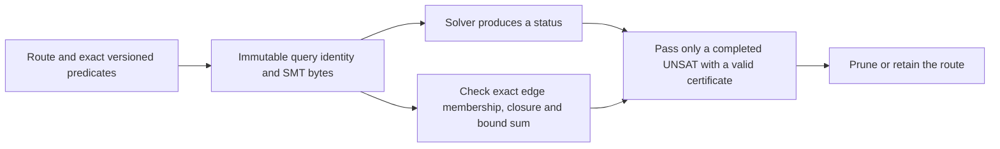

# Check a negative certificate before pruning an integer route

**Scope:** PLAN §1.4 and [#291](https://github.com/aivibeflow/LLMLang/issues/291). Candidate certificate for one integer difference-constraint profile on `research/all` at `b8f9b83e93eff62bc73b3deb9537dc3b0dee0f8c`.

## Problem and candidate

The [resource comparison](RT-03-QFLIA-RESOURCE-COMPARISON-2026-11-25.md) retained raw UNSAT reports until an accepted basis is available. A solver result can also refer to a previous version of the same route or to predicates whose interpretations changed. This study exercises a reviewed basis for one arithmetic fragment and binds it to exact route inputs.

The fixture represents a predicate as `x[destination] − x[source] ≤ bound` over mathematical integers. The query identity includes the route revision, interpretation profile, variable domain, the ordered predicate inputs with their versions, and the SHA-256 of the exact SMT bytes. The source route and predicate revisions are supplied by the fixture. It does not extract them from a program.

A certificate selects ordered indices into the exact predicate list. The checker verifies that every selected edge belongs to the query, consecutive edges connect, the walk comes back to its starting vertex, and the sum of selected bounds is negative. Summing the inequalities along a closed walk gives a left-hand side of zero, so a negative right-hand side is impossible. The [Lean model](DIFFERENCE-CERTIFICATE-01/Certificate.lean) checks the telescoping bound and the refutation consequence for arbitrary lists of steps. Both theorems report `propext`, `Classical.choice` and `Quot.sound`.



The existing [outcome mapper](../../PROTOTYPES/RT-04-01/rt03_feasibility_outcomes.py) receives `checked_certificate` only after the candidate validation succeeds. The checker validates a specialized witness constructed in the fixture. It does not parse cvc5 proof objects. An oracle may supply a complete proof even if a solver did not finish. This policy deliberately requires both the completed UNSAT status and the independently checked certificate for pruning.

## Results

The [ledger](DIFFERENCE-CERTIFICATE-01/evidence.json) records 25 two-edge queries, one separate three-edge refutation, and eight rejection controls. The two-edge bounds independently range from −2 to 2. cvc5 returned UNSAT for the ten strictly negative sums and SAT for the 15 nonnegative sums. Before validation the policy retained all 25. With exact certificates, it pruned the ten negative walks and the separate three-edge case. The SAT cases have no replayed model in this experiment, so the policy retains them with `UNKNOWN`.

The rejection cases cover an unchanged formula after a route revision or premise revision change, a loosened bound presented with a refreshed query identity, a missing edge, a noncontiguous walk, an out-of-range index, an unsupported wrapping-arithmetic profile, and an incomplete status. In the loosened control, the constraint sum becomes zero and cvc5 returns SAT. Supplying a claimed UNSAT and a certificate with the correct digest still cannot make the stale argument valid. The same-byte controls demonstrate that formula identity alone would omit important context for using evidence in the route model.

A trusted-solver policy could handle a broader formula fragment with less checker code, while requiring an explicit trust decision and precise binding to the solver invocation. A general proof-checking path can admit more than difference constraints, at the cost of translating and validating the proof format and source correspondence. This checked family needs only a closed witness walk and leaves all other outcomes open.

The Lean theorem establishes the arithmetic rule. The Python checker uses that rule and passes the tested controls. A checked correspondence between the checker, encoder, source CFG and Lean model, generalized solver certificate admission, and an authoritative production trust policy remain open.

## Reproduce

Observed with CPython 3.12.14, Git 2.56.1, cvc5 1.4.2 at `282d5e0c84baf49c780704c532f87ba66d8b513d`, and Lean 4.36.0 at `611c117bfaf7b7ae1cfcf246ce6fba31e8f509e9`. Set `LEAN` and `CVC5` to the corresponding executables.

```sh
set -eu
scratch=$(mktemp -d)
git archive b8f9b83e93eff62bc73b3deb9537dc3b0dee0f8c research | tar -x -C "$scratch"
fixture=research/language-design/RT-03/DIFFERENCE-CERTIFICATE-01
cp -R "$fixture" "$(dirname "$scratch/$fixture")/"
python3 -B "$scratch/$fixture/run.py" --lean "$LEAN" --cvc5 "$CVC5" > "$scratch/evidence.json"
cmp "$scratch/evidence.json" "$fixture/evidence.json"
```

The case counts enumerate the named fixture matrix. Mermaid source was inspected directly.
