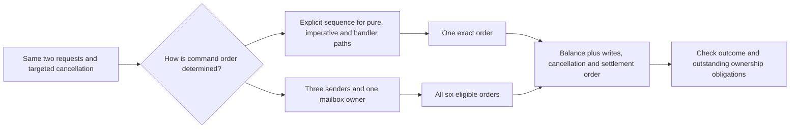

# Four semantic profiles on a common state and resource workload

**Date** 2026-11-25 · **Plan** §1.4 and §6.5 · **Issue** [#291](https://github.com/aivibeflow/LLMLang/issues/291)

Four scoped implementations agree under the same command order for 1,536 inputs and all six schedules. When the schedule is part of the actor profile's semantics, every input has multiple ordered observations. In 936 inputs those observations still have one balance. In the other 600 inputs the final balance can also change.

## Workload and observations

COR-09 compares typed calls over private state, COR-10 varies the handler view, and COR-11 varies delivery outcomes. This experiment compares those distinctions on one fixture with admission, cancellation and resource settlement. It uses a nonnegative integer balance and two independently owned leases initially held by a processing scope. Each lease belongs to a distinct request. A request wants to change the balance by a signed nonzero amount. A separate command requests cancellation for either job. Cancellation before the matching operation prevents the write. A late cancellation produces a rejected event. With no accepted cancellation, an absent grant denies the operation, and an underflow attempt leaves the balance unchanged.

Each request settles after its success, refusal or cancellation. Its input selects whether the lease is released or returned to the owner. A returned lease remains an obligation in the observation. The settlement event pairs the operation outcome with its resource disposition. This closed input rule models two outcomes of cleanup without running a native close, distinguishing partial and exceptional returns, or claiming a runtime revocation protocol. The full observation comprises the final balance, ordered cancellation/write/settlement events, and the outstanding owner obligations.



| Profile | Scoped implementation | Interface obligation |
|---|---|---|
| A · Pure functional | Thread immutable state and produce an ordered effect description | A separate interpreter must realize the described effects and preserve failure, cancellation and settlement. The description is the observation for this fixture. |
| B · Imperative linear | Update a mutable owner through explicit sequential commands | One owner must control balance updates and lease settlement. General mutable aliasing and cleanup failure are outside the fixture. |
| C · Concurrent actor | Deliver three single messages to one state owner | With per-sender FIFO alone, all six orders are eligible. The receiver shares the imperative transition code. Actor comparison tests schedule selection. |
| D · Effectful functional | Yield named requests for cancellation, checked write and settlement to a handler | Handler replies, state and ordered external events are relevant observation inputs. This probe covers one synchronous handler. |

A separate trace checker traverses the commanded order and verifies every expected operation, failure and settlement. It checks for both missing and extra events and checks the outstanding obligations. Per-order agreement exercises three implementations of the resource transitions. The actor variant independently supplies the mailbox order.

## Results and synthesis

The matrix crosses three initial balances, eight choices per job, two cancellation targets and four grant sets. All six command permutations are possible under the actor fixture because each logical sender contributes one message. There are 9,216 input-order pairs and 36,864 profile observations. The fixed representative sequence is request A, cancellation, request B. Its observation is always a member of the actor trace set.

| Discriminator | Observed |
|---|---:|
| Inputs with multiple traces and a single final balance across actor schedules | 936 of 1,536 |
| Inputs with multiple possible balances | 600 of 1,536 |
| Pairs with different full traces but identical balance, across per-input schedule pairs | 17,880 of 23,040 |
| Refused one-trace controls that preserve the balance | 4 of 4 |

The controls reverse write and settlement, discard every event, remove the returned-lease obligation, or drop the cancellation event. Each preserves the scalar while violating the consuming trace contract. The actor set includes the fixed sequence, but a claim that only this sequence will execute needs a delivery restriction. Set inclusion can substantiate membership for one scheduled execution. A guarantee over the schedule set must check the property for every eligible observation.

The cross-profile result supports a shared scoped observation interface and separates choices about purity, mutable state, effect handlers and delivery. A pure description needs an explicit execution boundary. The imperative and handler variants can use the same exact ordered receipt if they independently establish correspondence. An actor run can produce that receipt for its exact delivery order. It needs a trace-set or independently checked invariant if the consumer requires a schedule-independent property. These obligations affect compiler preservation, evidence reuse and authorization checks. The comparison leaves wider expressiveness, concurrency performance, ease of authoring and evolution unmeasured. [Shared semantics corpus](RT-03-04-SHARED-SEMANTICS-CORPUS.md) · [Profile vectors](RT-03-SEMANTIC-PROFILES-FOR-SYNTHESIS-2026-11-25.md)

## Reproduce

Use CPython 3.12.14 and Git with the pinned research/all revision available in the checkout. The ledger records source blobs, aggregate counts, a per-input digest and complete sample observations in schedule order. Replays with different Python hash seeds match byte-for-byte.

```sh
fixture=research/language-design/RT-03/COMMON-RESOURCE-PROFILES-01
PYTHONHASHSEED=23 python "$fixture/check.py" --out /tmp/llmlang-common-resource-profiles.json
cmp "$fixture/evidence.json" /tmp/llmlang-common-resource-profiles.json
```

[Executable profiles and trace checker](COMMON-RESOURCE-PROFILES-01/check.py) · [Finite comparison ledger](COMMON-RESOURCE-PROFILES-01/evidence.json)

The profiles use constructed inputs and a finite admitted command interface. No LLMLang parser, source-effect compiler, distributed transport, native FFI, timing, real resource acquisition or process authority participates. Multiple messages per sender, blocking and fairness, asynchronous release failure, whole-language source correspondence and general independent review remain exit conditions. This study informs DEP-004, DEP-007, DEP-016 and DEP-019. [Dependency map](../../research-management/RESEARCH-DEPENDENCY-MAP.md)
