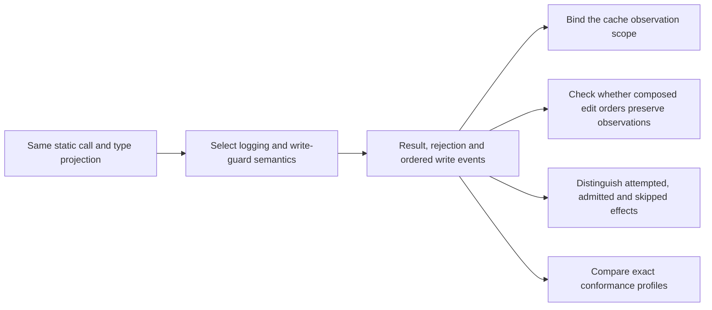

# RT-03 State-handler observations across downstream decisions

**Issue** [#291](https://github.com/aivibeflow/LLMLang/issues/291)

The meaning of an effect handler can affect cache reuse, edit composition, runtime enforcement and profile compatibility even when static call signatures are unchanged. This study tests four direct dependency-map edges using the same stateful program and an independent arithmetic and trace model. It extends the [COR-10 scoped-handler fixture](RT-03-04-SHARED-SEMANTICS-CORPUS.md#8-cor-10--what-a-state-handler-exposes) without selecting an RT-03 profile.

## Model and observations

The entry opens a scoped integer handler with an initial value. It calls one function twice with independently chosen adjustments. That function reads the handler state and requests a write equal to current state plus the adjustment. The entry returns the final state when both calls succeed. Two handler flags independently control whether write attempts are observed and whether a request for a negative value produces a terminal rejection. An observed write event records the prior state, requested value and acceptance. An unobserved write still updates the handler when accepted. A rejection prevents the later call if it occurs first. The diagnostic invocation list is checked separately from the semantic observation of result, rejection and ordered write events.

The four configurations have the same static RT-04 projection for this program. The interpreter runs the typed Profile D fixture with RT-04 checker B. The independent finite model uses integer addition and direct recurrence over the ordered adjustments. The runner checks every initial value and both adjustments from −2 through 2, both adjustment orders and all four profiles, for 1,000 interpreted observations.



The diagram shows the scope shared by the downstream comparisons. The cache control uses static metadata and the inputs. The order comparison models two proposed compositions and checks the final observation. The guard and conformance comparisons vary the same handler policy. A coarse result projection may be appropriate when a contract explicitly permits it. Reuse and merge decisions that promise the full observation need its complete boundary.

## Dependency-map evidence

| Edge | Checked comparison | Scoped finding |
| --- | --- | --- |
| DEP-036, RT-03 to cache | 1,500 cross-profile comparisons for equal typed call projection and equal action inputs | 1,256 pairs disagree on result, rejection or writes. The shared static projection cannot identify a cache entry for the full observation. |
| DEP-037, RT-03 to merge | 500 pairs of adjustment orders | 214 pairs share a returned scalar or both have no scalar yet differ in full observation. With total logging, all 125 scalar results agree and 100 pairs still differ in ordered events. |
| DEP-038, RT-03 to enforcement | 500 total-versus-guarded observations | 256 guarded calls terminate early at a rejected write. In 200 of these cases the first rejection prevents the second call. A logged rejection remains an observed effect. |
| DEP-039, RT-03 to conformance | Evaluate both guard profiles for the same call and inputs | The exact total and guarded observations agree in all 244 cases without guard rejection and differ in all 256 rejected cases. This is an operation and observation scope distinction even with identical static signatures. |

The [ledger](HANDLER-DOWNSTREAM-01/evidence.json) records all observations, static projection, configuration flags and denominators. The evidence is finite and categorical. It does not measure latency or attempt native security validation. The [dependency map](../../research-management/RESEARCH-DEPENDENCY-MAP.md) retains the broader hypotheses and links the corresponding witnesses.

A cache may use an exact handler and observation identity or a checked projection-specific equivalence. A graph edit system may require an ordering law or explicit conflict resolution when effects can be reordered. A runtime effect gate needs to define what a denied action leaves observable and whether later work runs. A conformance claim must identify the applicable handler profile and its assumptions. These are scoped implications from one bounded, sequential model. General handler identity, shared mutable state, persistent cache integration, real graph merge, authenticated runtime authority, source correspondence and language profile adoption remain open.

## Reproduction

Use CPython 3.12.14 and Git in the repository root. The runner verifies the evaluator and checker against `4f64b33a5e1712435972a82348a79ea347cceb9b`. Two runs with hash seeds 1 and 2 reproduced the ledger byte for byte. Relative links and Mermaid source structure were checked. GitHub visual rendering was not manually verified.

```sh
study=research/language-design/RT-03/HANDLER-DOWNSTREAM-01
PYTHONHASHSEED=1 python -B "$study/run.py" >/tmp/llmlang-handler-downstream.json
cmp "$study/evidence.json" /tmp/llmlang-handler-downstream.json
```
