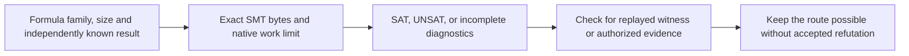

# Compare SMT work limits and conservative path retention

**Scope:** PLAN §1.4 and [#291](https://github.com/aivibeflow/LLMLang/issues/291). Closed QF_LIA controls on `research/all` at `9358f4b731b7f0b058deb1ef0a827edebfe43b12`.

## Question and design

Can one fixed solver work limit predict which route queries will finish? How should a route be classified if the solver reports an incomplete outcome or an unverified UNSAT? The [one-shot worker audit](../../research-management/RT-00/RT-00-C-SOLVER-WORKER-PROTOCOL-AUDIT-2026-11-25.md) checks transport, process termination and conservative failure handling in a different SymPy implementation. This study varies the formula family and checks the existing conservative admission policy on the resulting diagnostic classes.

The fixture contains 24 quantifier-free linear integer arithmetic queries. For each of three families it covers sizes 4, 8, 16 and 32 and one feasible and infeasible case. The verdict oracle follows directly from the intended constraints:

- **Difference cycle.** The chain requires at least `n − 1` total increment. Its closing upper bound permits exactly `n − 1` in the feasible case, witnessed by consecutive integers. The other case permits only `n − 2`.
- **Pigeonhole.** Distinct integers must occupy `n` slots between zero and `n − 1`. With `n` variables an enumeration supplies a witness. With `n + 1` variables distinct assignment is impossible.
- **Weighted subset.** Select among even integer weights. The feasible target is the sum of the weights at every second index. The infeasible target adds one, so it is odd.

Each query runs under both solvers at four work limits. The total is 192 invocations before any diagnostic replay. The solver-specific limit units do not measure an equivalent amount of work across tools. The five-second host deadline bounds each invocation. A separate synthetic sleeping process checks the host termination path without relying on a slow formula.



## Observations

Every completed SAT or UNSAT answer matched the expected result for its generated formula. The solvers completed at different settings, and several cases remained unresolved at the largest limit.

| Work limit | cvc5 completed / 24 | Z3 completed / 24 |
| ---: | ---: | ---: |
| 1 | 4 | 0 |
| 100 | 4 | 0 |
| 10,000 | 15 | 15 |
| 100,000 | 18 | 19 |

Across all four limits, cvc5 reports 19 SAT, 22 UNSAT and 55 UNKNOWN. Z3 reports 20 SAT, 14 UNSAT and 62 UNKNOWN. All four low-limit cvc5 completions at each of limits 1 and 100 are inconsistent difference cycles. Each solver returned 24 of 32 pigeonhole invocations as UNKNOWN across all limits. Z3 returned `max. resource limit exceeded` and `canceled` in its reason field. No host deadline occurred in these solver runs, and the injected host deadline is recorded separately. Those diagnostic strings describe the tested invocations and do not identify an external cancellation.

Under an exit-or-status-only policy, the 36 raw UNSAT outcomes could be taken as unconditional pruning decisions. We passed each raw outcome without a replayed model or an authenticated UNSAT evidence basis through the [existing feasibility policy](../../PROTOTYPES/RT-04-01/rt03_feasibility_outcomes.py). It retained all 192 routes as possible. This exercises the policy's empty-evidence path. Its Booleans-only witness decoder does not check the integer SMT models in this study. An implementation-level typed receipt still needs to bind a verified witness, checked certificate or accepted trusted backend to the exact query and route constraints.

The [ledger](QFLIA-RESOURCE-CONTROLS-01/evidence.json) records each formula hash, work limit, status, reason and admission result. It distinguishes the bounded analytical oracle used to check this experiment from any production proof rule.

## Reproduce

Observed on Linux x86-64 with CPython 3.12.14 and Git 2.56.1. Use cvc5 1.4.2 at `282d5e0c84baf49c780704c532f87ba66d8b513d` and Debian Z3 4.13.3. The ledger pins their binary SHA-256 values. Set `CVC5` and `Z3` to the exact executables.

```sh
set -eu
scratch=$(mktemp -d)
git archive 9358f4b731b7f0b058deb1ef0a827edebfe43b12 research | tar -x -C "$scratch"
fixture=research/language-design/RT-03/QFLIA-RESOURCE-CONTROLS-01
cp -R "$fixture" "$(dirname "$scratch/$fixture")/"
LC_ALL=C PYTHONHASHSEED=1 python3 -B "$scratch/$fixture/run.py" \
  --cvc5 "$CVC5" --z3 "$Z3" > "$scratch/evidence.json"
cmp "$scratch/evidence.json" "$fixture/evidence.json"
(
  cd "$scratch/research/PROTOTYPES/RT-04-01"
  python3 -B -m unittest discover -p 'test_rt03_feasibility_outcomes.py'
)
```

The counts describe only the named small formula families and configurations. They do not measure production latency, memory limits, general solver efficiency, CFG-to-query binding or certified negative evidence. Mermaid source was inspected directly.
