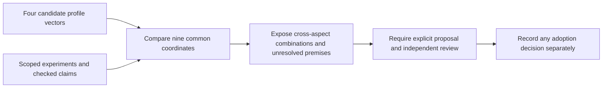

# RT-03 semantic profile vectors for whole-specification synthesis

The four surviving semantic candidates need comparable inputs for cross-aspect design. This note aligns the proposal's nine dimensions and pairs each profile with representative bounded findings and its outstanding dependencies. It carries all four candidates forward. [Core semantics survey](CORE-LANGUAGE-SEMANTICS.md)

## Common coordinates

| Dimension | A · Pure functional | B · Imperative linear | C · Concurrent actor | D · Effectful functional |
|---|---|---|---|---|
| Value and computation | Immutable values and pure functions | Commands and owned mutable store | Isolated actors with local state | Immutable values and described effects |
| Evaluation | Strict call by value | Explicit strict sequencing | Asynchronous scheduled steps | Functional composition and explicit effect order |
| State | Pure core with an explicit external boundary | Owned local mutation and scoped borrows | Actor-local mutation and typed messages | State mediated by declared handlers |
| Failure | Explicit result values | Typed outcome, ownership disposition and cleanup | Message, cancellation and supervision outcomes | Typed outcome plus handler and cleanup failures |
| Determinism | Fixed sequential observations for fixed inputs | Fixed transitions for a declared environment | Trace set under declared scheduling premises | Fixed observations under an exact sequential handler environment |
| Observation | Result, typed failure and divergence | Ordered effects, final state and ownership disposition | Sends, receives, terminal outcomes and progress | Results, ordered effect requests and handler-visible state |
| Concurrency | Sequential meaning and observationally preserving implementation parallelism | Sequential core with separate synchronization rules | Asynchronous isolated actors | Sequential effect core with optional asynchronous effects |
| Termination and resources | Explicit partiality, with fuel and resources as separate extensions | Lifetime, transfer and cleanup | Termination, progress, fairness and task resources | Acquisitions, release and effect-specific budgets |
| Composition | Immutable imports and explicit external contracts | Imported state and ownership obligations | Protocol contracts and authority boundaries | Imports declare handled and propagated effects |

The [machine-readable vectors](PROFILE-SYNTHESIS-01/profiles.json) carry all 36 coordinates, bounded check references and unresolved dependencies. Each cell is a candidate commitment for synthesis. The exact details inside each coordinate are still subject to the related research.



## Evidence and integration constraints

- The pure profile simplifies local reasoning when fixed inputs determine observations. Treating all pure executions as total would erase the recursion and fuel distinction. Result-only equivalence remains too weak at a boundary where an ordered effect is visible. [Recursion and fuel](RESEARCH-SCENARIO-36-RECURSION-TERMINATION-AND-FUEL.md) · [Observable rewrites](../../formal-verification/RT-07/RT-07-OBSERVABLE-REWRITE-CORRECTNESS.md)
- The imperative profile supports direct in-place updates. That choice requires a joint account of mutable aliases, transfer, rollback and cleanup failure. The resource-return and cleanup-composition fixtures delimit different loss-of-ownership cases. General alias analysis and complete paths remain open. [Resource return](../RT-04/RESEARCH-SCENARIO-35-RESOURCE-RETURN-AND-CLEANUP.md) · [Cleanup composition](../RT-04/RESEARCH-SCENARIO-97-CLEANUP-ERROR-COMPOSITION-AND-OWNERSHIP.md)
- The actor profile adds source-visible scheduling and protocol obligations. Weak, strong and bounded fairness differ in checked finite cases, while step-boundary cancellation changes who must clean up an acquired resource. Neither test selects full actor scheduling or supervision. [Fairness](../../runtime-and-systems/RT-10/RESEARCH-SCENARIO-112-WEAK-STRONG-AND-BOUNDED-FAIRNESS.md) · [Async resource cancellation](../RT-04/RT-04-ASYNC-RESOURCE-CANCELLATION-2026-11-25.md)
- The effectful profile keeps a pure sublanguage and introduces explicit interaction. The handler comparison keeps the static projection fixed and changes observed outcomes. The source cleanup fixture tracks conditional paths, effects and release with a finite source schema. Whole-language handler laws and asynchronous effects remain open. [State handlers](RT-03-HANDLER-DOWNSTREAM-2026-11-25.md) · [Source cleanup CFG](RT-03-SOURCE-CLEANUP-CFG-2026-11-25.md)

When combining profiles, require the shared semantics to state which observations are preserved and what changes when a construct crosses into another profile. Sequential source meaning permits parallel implementation only with a scoped preservation argument. Effects mediated through a handler need exact order, inputs, authority and cleanup wherever those alter observations. Timing out analysis and exhausting source fuel are distinct. Retaining comparable vectors avoids excluding a profile merely because another has more fixture coverage.

## Verify and limits

The [checker](PROFILE-SYNTHESIS-01/check.py) verifies profile and coordinate coverage, confirms the absence of an adopted profile in the manifest and pins nine report blobs at `2ab654158352cd356ff3b577d82735816e86293e`. The [ledger](PROFILE-SYNTHESIS-01/evidence.json) uses Git 2.56.1 and CPython 3.12.14. The checks validate traceability and alignment. They do not re-run the underlying experiments or establish comparable production performance.

```bash
fixture=research/language-design/RT-03/PROFILE-SYNTHESIS-01
PYTHONHASHSEED=37 python3 -B "$fixture/check.py" > /tmp/llmlang-rt03-profile-synthesis.json
cmp "$fixture/evidence.json" /tmp/llmlang-rt03-profile-synthesis.json
```

Cross-aspect establishment of authority, source correspondence, scheduler effects and an agreed observation profile remains necessary before a specification decision. That decision and draft transfer require independent review and approval.
