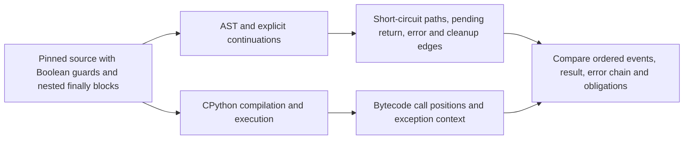

# RT-03 — Compare source-derived control flow for guards and cleanup

A source-derived control-flow graph matches all 128 executions of guarded return and nested cleanup on CPython. Correct return values alone miss 80 changed effect traces under eager guard evaluation. A graph that bypasses cleanup on return publishes a handle in 48 cases where execution instead raises and leaves the staged handle pending.

## Question and scope

The shared reference semantics already cover nested resource scopes and outcome propagation in a structured model. The owned-call checker lowers a separate typed tree. This study tests whether a concrete source fragment can supply the call positions, evaluation order and exceptional continuations used in a resource observation. [Prior cleanup composition](../RT-04/RESEARCH-SCENARIO-97-CLEANUP-ERROR-COMPOSITION-AND-OWNERSHIP.md) · [COR-13 owned-call boundary](../RT-04/RESEARCH-COR-13-TYPED-OWNERSHIP-ACROSS-CALLS.md#8-cfg-caller-flow-extension)

The fixtures use a restricted Python syntax so that CPython can execute the same text. Two Boolean parameters feed effectful leaf probes under short-circuit `and` and `or`. Each function acquires two abstract resource slots in nested scopes and either raises a primary error or stages a handle as its return value. Each finally block tries to close one slot. Close can fail and leave a debt. A successfully staged return still has to finish cleanup before the caller obtains the handle. The resource adapter records a staged handle as pending when CPython raises instead of returning it. That pending obligation is a fixture contract rather than a built-in Python ownership guarantee.

## Method

The source lowering builds an acyclic control-flow graph with separate continuations for normal completion, pending return and exceptional exit through each finally block. It records the full source position of each call. The independent execution harness runs the generated source directly on CPython with fixed resource primitives. It derives executed call positions from the active bytecode instruction, including inline cache offsets, and walks the interpreter's exception context chain for error causes. Positions record start line, end line, start byte column and end byte column in that order. A single condition can contain several distinct positions on the same line.



Four guard shapes and two placements of the return branch yield eight source programs. Each program takes 16 combinations of Boolean parameters and inner/outer cleanup failures. Ordinary acquisition, instrumentation and Boolean probes are infallible in the fixture. The comparison varies one rule at a time, including eager evaluation of otherwise skipped operands, routing return past cleanup, and retaining only the latest failure. Six extra inputs use syntax-valid but unsupported constructs and are refused before execution.

## Results

| CFG comparison | Any | Trace | Return | Error causes | Resource state | Handle owner |
| --- | ---: | ---: | ---: | ---: | ---: | ---: |
| full | 0 | 0 | 0 | 0 | 0 | 0 |
| eager | 80 | 80 | 0 | 0 | 0 | 0 |
| return_bypasses_cleanup | 64 | 64 | 48 | 48 | 64 | 48 |
| last_error_only | 64 | 0 | 0 | 64 | 0 | 0 |

Each row covers the same 128 executions. One execution can disagree in multiple columns. The exact graph and interpreter observations agree as tuples, including all ordered source spans. Across the eight programs the independent traces collectively reach all 84 syntactic call spans. The 16 successful returns deliver a handle, while another 48 executions stage a handle and fail cleanup. Sixteen executions preserve a primary error plus two cleanup causes. Last-error-only recording preserves the terminal error position and resource state while losing cause information in half the cases.

## Implications and limits

A graph or summary that informs ownership checking needs explicit continuations for pending returns, control-flow edges around effectful guards and a declared policy for error-chain observations. Boolean equivalence does not imply effect-trace equivalence. A return-shaped expression by itself does not establish the caller's ownership when cleanup can prevent delivery. The complete error chain and the staged handle state are separate observations. LLMLang can use a typed error product instead of Python exception chaining if it represents the same distinctions for the chosen profile.

The fixture covers eight generated source programs and two abstract synchronous resources. General LLMLang grammar, typing and FFI admission, acquisition failure, cancellation and divergent cleanup remain open. The coverage check is exhaustive for the stated finite inputs. It does not prove correspondence for all syntax accepted by the experimental extractor or select implementation semantics.

## Reproduction

Use CPython 3.12.14. The ledger includes source text and hashes, reconstructed graph digests, full compared source observations and the six unsupported-source cases. The experiment enumerates all inputs in its finite domain and uses no sampling.

```sh
fixture=research/language-design/RT-03/SOURCE-CLEANUP-CFG-01
output=$(mktemp)
python3 -B "$fixture/run.py" > "$output"
cmp "$fixture/evidence.json" "$output"
python3 "$fixture/chart.py"
```

[Ledger](SOURCE-CLEANUP-CFG-01/evidence.json) · [CFG extraction](SOURCE-CLEANUP-CFG-01/flow.py) · [Independent execution](SOURCE-CLEANUP-CFG-01/reference.py)
