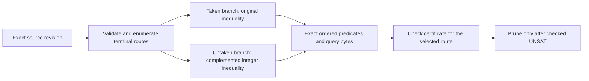

# Bind extracted integer routes to versioned guards and checked refutations

**Scope:** PLAN §1.4 and [#291](https://github.com/aivibeflow/LLMLang/issues/291). A closed source control-flow fragment at `11b6e6a2a5d98c6bea2d9793f68ac97ecf2aaeff` on `research/all`.

## Source model and route identity

The [difference-certificate study](RT-03-EXACT-DIFFERENCE-CERTIFICATES-2026-11-25.md) validates exact arithmetic queries using caller-supplied route and predicate versions. This study tests where those inputs can come from for one acyclic source grammar. The fixture uses Python syntax as a carrier and a mathematical integer model for the parameters. It accepts one undecorated function with immutable positional input parameters, nested `if` statements, literal returns, and guards of the form `destination − source ≤ bound`. Every branch must reach a return. An assignment, call, loop or uncovered exit refuses extraction.

The extractor parses the exact source bytes, validates the admitted syntax, and walks the control-flow alternatives. It creates a distinct predicate record at each source guard and branch polarity. Each record binds the exact source revision, byte-column span, variables, bound and taken branch. A route binds its ordered guard records and terminal occurrence, then builds an exact integer query. No source spans or predicate versions are inferred from SMT result text.



The false edge reverses the subtraction and changes the bound to `−bound − 1`. Lean checks that over integers, `¬(destination − source ≤ bound)` is equivalent to `source − destination ≤ −bound − 1`. The [theorem](SOURCE-DIFFERENCE-ROUTES-01/Polarity.lean) reports `propext`, `Classical.choice` and `Quot.sound`. Fixed-width or real arithmetic would require different proof input or complement rules.

## Results

The [source fixture](SOURCE-DIFFERENCE-ROUTES-01/source.txt) has three nested conditions and four terminal routes. We compared the emitted route predicates with a separate direct condition evaluator on 343 assignments of three integers from −3 through 3, for each of three source revisions. Exactly one route matched every assignment, and its return matched the direct condition result. cvc5 completed all 12 route queries.

| Source revision | Target route | Target hits / 343 | Fallback route hit counts |
| --- | --- | ---: | --- |
| Original | UNSAT | 0 / 343 | 35, 112, 196 |
| Comment inserted | UNSAT | 0 / 343 | 35, 112, 196 |
| Final bound loosened from 1 to 2 | SAT | 5 / 343 | 30, 112, 196 |

A checked negative cycle allows pruning the original target route. The comment version emits identical SMT bytes but rejects the original receipt because its source and route identities differ. A freshly bound certificate on those same inequalities is admitted. In the loosened version the same edge selection has sum zero. Even with its current query identity, the alleged refutation is rejected and the route is retained. Four unsupported-source controls reject a loop, a call in a guard, an input assignment, and an uncovered exit before a query is returned.

A formula-only proof cache could reuse the mathematical refutation after the comment edit without repeating arithmetic. Applying it to a new route would need a separate check that the selected source still maps to the same premises. This fixture binds the exact subject conservatively, so even an edit to a comment creates a new subject. A production source-aware incremental policy will need to define when to retain proof artifacts and when to refresh route correspondence.

The [ledger](SOURCE-DIFFERENCE-ROUTES-01/evidence.json) records all route/predicate digests, solver statuses, finite hits and unsupported dispositions. It demonstrates extraction and exact binding for this closed grammar, plus a separately checked integer complement theorem. It does not prove the Python extractor against a general source semantics, support mutable variables, exceptions, loops, aliases, or address machine-integer lowering and an authoritative proof policy.

## Reproduce

Use CPython 3.12.14, Git 2.56.1, cvc5 1.4.2 at `282d5e0c84baf49c780704c532f87ba66d8b513d`, and Lean 4.36.0 at `611c117bfaf7b7ae1cfcf246ce6fba31e8f509e9`. Set `CVC5` and `LEAN` to the pinned executables.

```sh
set -eu
scratch=$(mktemp -d)
git archive 11b6e6a2a5d98c6bea2d9793f68ac97ecf2aaeff research | tar -x -C "$scratch"
fixture=research/language-design/RT-03/SOURCE-DIFFERENCE-ROUTES-01
cp -R "$fixture" "$(dirname "$scratch/$fixture")/"
python3 -B "$scratch/$fixture/run.py" --cvc5 "$CVC5" --lean "$LEAN" > "$scratch/evidence.json"
cmp "$scratch/evidence.json" "$fixture/evidence.json"
```

The counts enumerate the declared input cube. Mermaid source was inspected directly.
