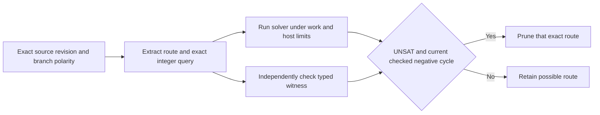

# RT-03 source-bound route feasibility under solver work limits

A solver's negative answer can remove a feasible execution path when it belongs to the wrong source revision or is not independently justified. This study combines the restricted CFG extractor, a checked integer difference certificate, and solver work limits into one bounded route pipeline. It checks 18 source-derived formulas across two solver versions and three limits. The existing wider SMT study supplies additional difficult formula families.

## Exact route and evidence

The extractor accepts a Python-shaped function with immutable integer arguments, nested difference guards and explicit exits. It binds each guard's polarity and occurrence to exact source contents, span and predicate bounds. It supplies a route identity distinct from the SMT byte digest. An integer negative edge uses the complemented bound. The [source binding study](RT-03-SOURCE-DIFFERENCE-ROUTES-2026-11-25.md) gives the checked Lean rule for that complement and compares 1,029 concrete assignments against the extracted routes.

The formula families are a directed ring, the ring augmented with consistent forward chords, and the ring augmented with tight reverse edges. Each family has three, five or eight vertices and both feasible and infeasible versions. The largest has 29 predicates. The feasible formula accepts the increasing valuation (0,1,ldots,n-1). Tightening the closing bound by one makes the selected ring's sum negative. The [independent certificate checker](RT-03-EXACT-DIFFERENCE-CERTIFICATES-2026-11-25.md) validates the exact closed ordered walk and the negative sum. Its Lean theorems justify the integer contradiction. The experiment generates the witness separately from the solver. It does not decode a solver-produced proof or rely on a solver model for satisfiability.



The candidate retains routes after any incomplete answer and requires both UNSAT and an exact checked certificate to prune. Bare UNSAT and checked evidence for a different route do not authorize removal. A feasible witness independently establishes reachability in the integer model. This policy labels a run possible-verified when it also returned SAT. If a solver stops early, the selected policy keeps the conservative observation even if the separate fixture already knows the feasible valuation.

## Results

The matrix contains 108 invocations. Each row below has 18 queries. Work units are solver-specific and do not establish comparable runtime. No invocation reached the five-second host deadline.

| Solver | Limit | SAT | UNSAT | Unknown |
|---|---:|---:|---:|---:|
| cvc5 | 1 | 0 | 9 | 9 |
| cvc5 | 100 | 0 | 9 | 9 |
| cvc5 | 100,000 | 9 | 9 | 0 |
| Z3 | 1 | 0 | 0 | 18 |
| Z3 | 100 | 0 | 0 | 18 |
| Z3 | 100,000 | 9 | 9 | 0 |

The pipeline prunes 36 runs, labels 18 possible with a verified witness, and retains 54 unresolved outcomes. All 108 bare answer controls keep the route. All 108 format-only revision controls keep the route when given a receipt for the previous rule, even though the emitted SMT bytes match. The certificate checker also distinguishes each feasible ring from its negative counterpart independently of the backend. Relying on an unrestricted UNSAT status would bypass this binding. Requiring a replayable solver proof for every theory would cover more cases but needs a checked conversion and supported proof rules.

The earlier [broader SMT work-limit comparison](RT-03-QFLIA-RESOURCE-COMPARISON-2026-11-25.md) includes difference cycles, pigeonhole encodings and other integer constraints. All 36 raw UNSAT outcomes there remain unprunable without accepted evidence. The synthetic host control and [Scenario 103 solver timeout](../../semantic-representation/RT-06/RESEARCH-SCENARIO-103-REAL-SOLVER-TIMEOUT-ISOLATION.md) separately exercise termination. This study adds end-to-end source binding only for the exact integer difference subset.

## Verify and limits

The [runner](ROUTE-RESOURCE-GATE-01/check.py) and [ledger](ROUTE-RESOURCE-GATE-01/evidence.json) use CPython 3.12.14, cvc5 1.4.2 at `282d5e0`, and Debian Z3 4.13.3 on Linux x86-64. The ledger pins exact executable and source hashes. The study baseline is `787aaf5e41975e99a68e56383b57dcb010560442`. Hash seeds 37 and 71 give identical output. The table summarizes categorical completion rather than speed.

```bash
fixture=research/language-design/RT-03/ROUTE-RESOURCE-GATE-01
LC_ALL=C PYTHONHASHSEED=37 python3 -B "$fixture/check.py" --cvc5 "$CVC5" --z3 "$Z3" \
  > /tmp/llmlang-rt03-route-resource.json
cmp "$fixture/evidence.json" /tmp/llmlang-rt03-route-resource.json
```

General CFG extraction, fixed-width arithmetic, richer theories, memory and worker concurrency limits, production proof backend selection and full source correspondence remain independent work. The finite checked pipeline preserves all possible routes when the required exact evidence is absent.
