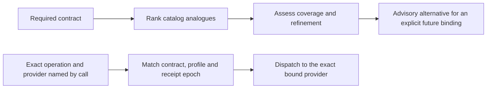

# Contract analogue ranking, refinement and exact dispatch

## Candidate score and exact call

The fixture ranks contract analogues by the Jaccard similarity of admitted input and observation pairs. A discovery result records similarity. Exact refinement additionally requires coverage of every requested input and inclusion of the candidate's allowed observations for those inputs. The runner checks this criterion independently by enumerating all concrete providers conforming to the candidate and verifying that each conforms to the requested contract. It only samples candidate contracts that have a conforming provider. [Joint conformance and native reference](RT-04-JOINT-CONTRACT-CONFORMANCE-2026-11-25.md)



The dispatch input binds one exact operation and implementation together with the requested contract, profile and receipt epoch. The model compares five controlled mismatches of that binding. The experiment assumes the authority and contents of the exact receipt have already been established. Candidate rank does not enter this lookup. To test the difference, the comparison also takes the highest- and lowest-ranked suggestions and uses the first native provider that conforms to each proposed contract.

## Results and limits

The runner samples 32 catalogs of 12 candidates for each of 27 requested contracts using seed 290. The result/marker truth table comes from the native joint-contract fixture, which matches both GCC optimization profiles. All 10,368 exact refinement checks agree with the provider enumeration plus input coverage. [Evidence ledger](ANALOGUE-DISPATCH-01/evidence.json) · [Table generator](ANALOGUE-DISPATCH-01/chart.py)

| Comparison | Count |
| --- | ---: |
| Scored candidate occurrences | 10368 |
| Sampled catalogs | 864 |
| Catalogs with a refining candidate | 277 |
| Top-ranked contract fails refinement | 660 |
| Top-ranked contract fails despite a refining alternative | 73 |
| All refining candidates outside top three | 16 |
| Unfiltered proposals violate the required contract | 1200 |
| Unfiltered proposals change the exact provider | 1310 |

The last two rows are out of 1,728 proposed dispatches. The exact lookup continues to select the declared provider while the comparison considers both placements from each catalog. The controlled changes reject a different operation, a different provider that also satisfies the required contract, a stale receipt epoch, a different target profile and a different contract receipt. The highest score alone can pick an incompatible contract even when a relevant option exists, and filtering only the first three results can still miss all refining options.

The experiment defines separate research roles for ranking, refinement and exact authorization. It uses two admitted input values, a Boolean result and a single event observation. Production similarity profiles, large retrieval indexes, receipt authority, full provider ABI and source correspondence remain open. [Conformance class, discovery and evidence identity](../../semantic-representation/RT-05/RT-05-CONFORMANCE-CLASS-IDENTITY-2026-11-25.md)

## Reproduction

Run from the repository root with CPython 3.12.14 and GCC Debian 14.2.0-19 on x86-64 Linux.

```sh
set -eu
fixture=research/language-design/RT-04/ANALOGUE-DISPATCH-01
out=$(mktemp)
trap 'rm -f "$out"' EXIT
python3 -B "$fixture/run.py" > "$out"
cmp "$fixture/evidence.json" "$out"
python3 -B "$fixture/chart.py"
```

[PLAN §1.3](../../../PLAN.md#13-contracts-and-compatible-implementations) · [Issue #290](https://github.com/aivibeflow/LLMLang/issues/290)
