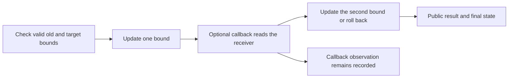

# Contract invariants at callback observation points

## The contract under test

An operation replaces a receiver's lower and upper bounds. The precondition admits a valid old pair and a valid target pair. Success restores the target pair as the public state. A modeled error after the first write instead restores the old pair and returns a distinct error. The invariant requires the lower value to stay at or below the upper value at each public observation. A declared callback effect can call the receiver's public accessor after the first write. The callback returns its observation before the operation either completes or rolls back. The model assumes a single thread, a read-only observer and infallible individual stores. [Component and runtime state boundary](../../research-management/RT-00/RT-00-B-COMPONENT-IMMUTABILITY-AND-RUNTIME-COMMIT-2026-11-25.md)



Checking only the entry and final state accepts either update order. The observer can see `(new lower, old upper)` when the lower bound is written first, or `(old lower, new upper)` in the opposite order. Lean checks these exact obligations, proves that a valid update always has at least one safe order, and shows that rollback leaves the earlier observation breach in scope. The endpoint and rollback results use no axioms. The order and observation equivalence lemmas use `propext`. [Lean source](CALLBACK-INVARIANT-01/Bounds.lean) · [Axiom ledger](CALLBACK-INVARIANT-01/axioms.txt)

## Finite native comparison

The runner crosses every old and target endpoint from zero through three with both update orders, callback settings and failure settings. GCC `-O0` and `-O2` each match all 2,048 reference rows. The native callback reads the same receiver through a separate public accessor. The fixture records one optional callback observation alongside success, modeled error or admission refusal. [Machine-readable evidence](CALLBACK-INVARIANT-01/evidence.json) · [Table generator](CALLBACK-INVARIANT-01/chart.py)

| Check | Count |
| --- | ---: |
| Valid source/target pairs | 100 |
| Both update orders safe at an observer | 70 |
| Exactly one safe update order | 30 |
| Admitted transition profiles | 800 |
| Invalid endpoint profiles refused | 1248 |
| Endpoint-only false admissions | 60 |
| False admissions despite rollback | 30 |

A transition from bounds `[0, 0]` to `[1, 1]` with a lower-first update exposes `[1, 0]` through the callback. A successful return ends at the required target and a later failure returns the old pair. Neither final-state check accounts for the exposed invalid midpoint. Updating the upper bound first makes the callback observation valid.

This fixture lets the contract carry separate admission, result, transition, invariant, error and effect obligations with explicit observer assumptions. Other invariants, mutating or concurrent reentrancy, resource effects and source correspondence require separate validation.

## Reproduction

Use CPython 3.12.14, GCC Debian 14.2.0-19 and Lean 4.36.0 revision `611c117bfaf7b7ae1cfcf246ce6fba31e8f509e9` from repository root.

```sh
set -eu
fixture=research/language-design/RT-04/CALLBACK-INVARIANT-01
out=$(mktemp -d)
trap 'rm -rf "$out"' EXIT
lean -DwarningAsError=true "$fixture/Bounds.lean" > "$out/axioms.txt"
cmp "$fixture/axioms.txt" "$out/axioms.txt"
python3 -B "$fixture/run.py" > "$out/evidence.json"
cmp "$fixture/evidence.json" "$out/evidence.json"
python3 -B "$fixture/chart.py"
```

[PLAN §1.3](../../../PLAN.md#13-contracts-and-compatible-implementations) · [Issue #290](https://github.com/aivibeflow/LLMLang/issues/290)
