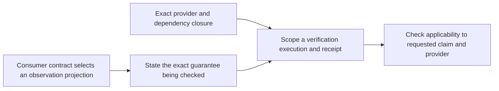

# Check which cleanup observations must bind a verification receipt

**Scope:** PLAN §1.4.1 and [#292](https://github.com/aivibeflow/LLMLang/issues/292). Cross-check of exact cleanup evidence at `5317a6a66c53886d5d8885b7262d07ad0a3e79fa` on `research/all`. Candidate identity boundaries remain open.

## Question and evidence

A caller may observe a cleanup error, an owned result that remains usable, and the outcome of a subsequent resource admission. Which distinctions need to appear in its contract and in a proof receipt? We use the [owned-return comparison](RT-04-OWNED-PROVIDER-CONTRACT-REPLAY-2026-11-24.md) and the [checked source-cleanup model](../../formal-verification/RT-32/RT-32-SOURCE-CLEANUP-KERNEL-2026-11-25.md) as separate inputs. The first compares two transfer policies in generated Rust. The second checks a finite source-derived model with a staged handle and an explicit observation mapping. The Lean input is a distinct fixture and does not prove the Rust implementations.



The observation projection determines which effects and outcomes the claim compares. A proof or execution receipt must carry that choice independently of the exact implementation and the source-to-model correspondence it uses.

## Observations

The exact archived Rust replay reproduces all 256 generated traces and the published ledger byte for byte. The separate Lean replay reproduces its full ledger, with eight source-agreement theorems, eight resource-completion theorems, and four altered-graph inequalities. Its span-only control changes the source-bound observation without changing the program's modeled behavior. This distinguishes a source correspondence receipt from an operation observation.

The paired resource analysis covers the 24 rows requesting an owned result whose local cleanup fails. The [comparison ledger](CLEANUP-IDENTITY-01/evidence.json) counts equality between the early and staged transfer variants.

| Fields compared | Equal pairs / 24 |
| --- | ---: |
| Cleanup error reported | 24 / 24 |
| Cleanup error and usable caller-owned result | 0 / 24 |
| Cleanup error and subsequent admission | 18 / 24 |
| Cleanup error, usable owned result and subsequent admission | 0 / 24 |

A claim about the error flag can be valid for both providers. Treating that result as evidence about all three fields would wrongly accept 24 cases. Comparing subsequent admission alone misses 18 of the ownership differences in this fixture. The full trace and terminal resource-state models may still carry distinctions beyond this three-field comparison.

We exercised the existing `verification_key` using the same logical subject and case but changing one input at a time. Replacing the provider changes the dependency-closure digest. Changing the observation projection changes the verifier configuration. Both edits change the key in all 24 cases. This is an identity sensitivity check for the supplied fields; it does not show that a general verifier discovers every relevant input automatically.

## Candidate boundary

Record owned-return and release obligations when they form part of the caller-required semantics. An operation whose required behavior admits both providers can still use a common semantic address. A caller that requires one of the distinguishing behaviors needs a contract and evidence that actually express it. Keep the exact provider and proof proposition in the verification receipt, and keep source-location correspondence in the receipt that claims source correspondence. Adding all diagnostic source spans to a semantic operation address would create invalidations for edits outside that operation's observed behavior.

A cache keyed only by the operation address or a Boolean status would be smaller, while permitting one provider's verification to be substituted for another's or a weak proposition to stand in for a strong one. Exact receipt reuse misses after the tested provider and projection changes. A broader reuse rule would require a separate implication check and applicable evidence. The experiment leaves production hash fields, general history and alias completeness, native foreign behavior, and independent review open.

## Reproduce

Use CPython 3.12.14, Git 2.56.1, Rust 1.85.1 at `4eb161250e340c8f48f66e2b929ef4a5bed7c181` with LLVM 19.1.7, and Lean 4.36.0 at `611c117bfaf7b7ae1cfcf246ce6fba31e8f509e9`. Set `RUSTC` and `LEAN` to the exact executables.

```sh
set -eu
scratch=$(mktemp -d)
git archive 5317a6a66c53886d5d8885b7262d07ad0a3e79fa research | tar -x -C "$scratch"
native="$scratch/research/language-design/RT-04/owned-contract-replay"
proof="$scratch/research/formal-verification/RT-32/SOURCE-CLEANUP-KERNEL-01"
python3 -B "$native/run.py" --rustc "$RUSTC" --output "$scratch/native.json"
cmp "$scratch/native.json" "$native/results.json"
python3 -B "$proof/run.py" --lean "$LEAN" > "$scratch/proof.json"
cmp "$scratch/proof.json" "$proof/evidence.json"
fixture=research/language-design/RT-04/CLEANUP-IDENTITY-01
cp -R "$fixture" "$(dirname "$scratch/$fixture")/"
python3 -B "$scratch/$fixture/run.py" > "$scratch/observations.json"
cmp "$scratch/observations.json" "$fixture/evidence.json"
```

The counts enumerate the stated scope. Mermaid source was checked directly.
