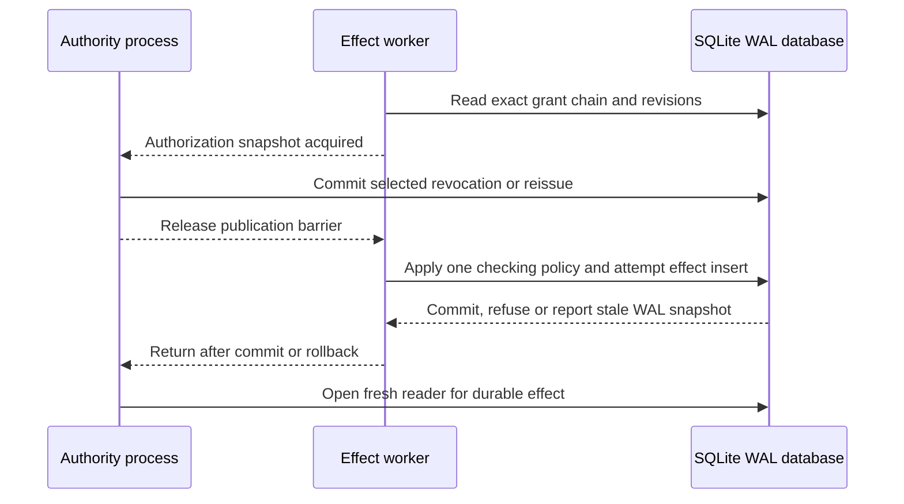

# RT-04 — Compare concurrent grant revocation and effect commit in SQLite

Rechecking an issued grant's complete ancestry in the effect transaction avoids stale admissions in 45 native process-pair runs. Rechecking only the child still admits effects after ancestor changes. A global epoch prevents those admissions and refuses one unaffected operation.

## Question and candidate contract

The [static capability probe](../../PROTOTYPES/RT-04-01/README.md) checks hierarchical grant scope and ancestor revocation over a supplied grant map. This experiment asks which part of that map must stay current between authorization and effect commit. It uses an identified trusted root issuer, one delegating holder, a narrower child scope and a separate unrelated grant. The grant table contains exact monotonically increasing revisions for every row. The claim concerns one issued authorization, whose relevant revisions must still match at the point of effect commit. A reissued grant can support a new authorization.

The scope is a logical path with slash-separated components. The holder and issuer must match the expected chain, and the child and target must stay in the respective prefixes. The trusted issuer name stands for a database-maintained fixture identity. It supplies no external authentication, signature scheme, filesystem path resolution or distribution guarantees.

## Native schedules

One CPython process holds the SQLite authority connection and can revoke a grant. A second process obtains authorization, waits at a barrier and attempts to insert an effect row. Both use SQLite WAL on the same database. Each run uses a fresh database. Mutations either happen before the check, after the check, or after the child reports its completed publication. The nine cases cover unchanged authority, revocation of ancestor or child, unrelated revocation, withdrawal then reissue of the same ancestor name, and initial issuer or scope rejection.



The cached policy reuses the initial decision. The child-only policy checks only the exact child revision and live flag in the write transaction. The ancestor policy compares every relevant exact revision and checks the full live chain inside the same transaction as the effect. The epoch policy additionally requires that the global policy state did not change. The WAL-upgrade policy keeps the read transaction open. On a real `SQLITE_BUSY_SNAPSHOT` it rolls back and acquires a new write transaction with exact ancestor validation. [SQLite isolation and stale snapshots](https://www.sqlite.org/isolation.html)

## Results

| Policy | Effects committed | False admissions | False refusals | WAL snapshot conflicts |
| --- | ---: | ---: | ---: | ---: |
| cached | 6 | 3 | 0 | 0 |
| child_only | 5 | 2 | 0 | 0 |
| ancestors | 3 | 0 | 0 | 0 |
| global_epoch | 2 | 0 | 1 | 0 |
| wal_upgrade | 3 | 0 | 0 | 4 |

Each row covers nine schedules. A false admission is an inserted effect whose initial authorization lacked current exact authority at commit. A false refusal would reject an operation that still has its exact scoped authority. The cached policy permits both revocations and the withdrawal/reissue case. The child-only policy catches revocation of the child, while missing the two ancestor changes. A global epoch blocks the request when an unrelated grant changes even though its whole chain still matches.

The held read transaction fails with `SQLITE_BUSY_SNAPSHOT` after each of the four concurrent writes. Reacquiring a write transaction accepts the unrelated change and refuses the three stale authorizations. The ancestor and WAL paths agree with the independent schedule oracle. Revocation after a successful commit leaves the earlier effect intact. A fresh reader observes the exact expected effect row or its absence in every run.

## Implications and limits

A cached or leaf-only permit can outlive its ancestor authority. A scoped transaction can check the entire relevant chain and serialize authorization with an effect inside the same write authority. The global epoch is conservative at coarser scope. A retry after a stale snapshot needs the relevant authorization check before writing.

The comparison covers one local SQLite store and an effect implemented as an insert in that store. It does not establish atomicity with native file, device or network effects. Transactional checks need a separately defined reservation or fencing policy when the effect commits outside the authorization store. General grant graphs, shared issuers, arbitrary concurrent histories, recovery, external effects and independent review remain open. No production authorization protocol is selected.

## Reproduce

Use CPython 3.12.14 with SQLite 3.53.1. The ledger records authorization revisions, snapshots, oracle comparisons and durable rows. The fixture uses barriers and enumerates all listed schedules without sampling.

```sh
fixture=research/language-design/RT-04/GRANT-REVOCATION-01
output=$(mktemp)
python3 -B "$fixture/run.py" > "$output"
cmp "$fixture/evidence.json" "$output"
python3 "$fixture/chart.py"
```

[Native process runner and oracle](GRANT-REVOCATION-01/run.py) · [Machine-readable observations](GRANT-REVOCATION-01/evidence.json)
