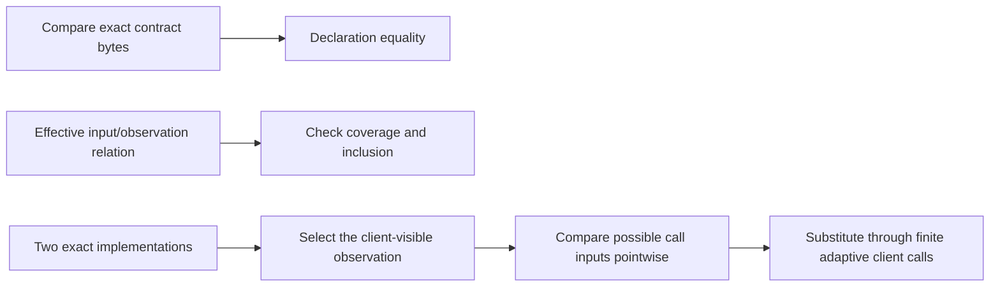

# Contract identity, refinement and substitution in adaptive clients

## Judgments

This study distinguishes four judgments for total deterministic providers. Exact contract equality compares the fixture's declaration bytes. Extensional contract equality compares the effective eligibility and allowed observations at each input. Refinement gives the requested input coverage and a subset of the required observations. Provider behavioral equivalence compares what the declared observer can see from two actual providers. A client can substitute providers throughout this model when their projected observations agree on every callable input. [Finite contract refinement](RT-04-CONTRACT-RELATIONS-FINITE-COMPARISON-2026-11-25.md) · [Joint provider conformance](RT-04-JOINT-CONTRACT-CONFORMANCE-2026-11-25.md)



A client either returns its current answer or calls a provider and chooses a continuation using the declared observation. Lean proves that pointwise equality of the projected provider functions implies equality in every such client. Conversely, a client that calls once and returns its observation identifies any pointwise difference. All three theorems, including the value-only equality and the complete-observation counterexample, use no axioms. [Lean source](CONTEXTUAL-SUBSTITUTION-01/Context.lean) · [Axiom ledger](CONTEXTUAL-SUBSTITUTION-01/axioms.txt)

## Controls and coverage

The exact C observation probe from the joint-contract study supplies 16 provider functions under both GCC profiles. The client checker crosses every ordered provider pair with each nonempty input subset, each of the three projections and every one- and two-call client selected by this finite grammar. A two-call client can choose its second input by any table over the first observation. In all 16,896 comparisons, the finite clients and the pointwise projection rule agree. [Evidence ledger](CONTEXTUAL-SUBSTITUTION-01/evidence.json) · [Table generator](CONTEXTUAL-SUBSTITUTION-01/chart.py)

| Profile | Provider/domain pairs | Client comparisons | Observationally indistinguishable |
| --- | ---: | ---: | ---: |
| `complete` | 768 | 9728 | 144 |
| `result_only` | 768 | 3584 | 320 |
| `event_only` | 768 | 3584 | 320 |

Two declarations differ in the raw postcondition of an ineligible input and have different fixture hashes. Their effective contracts agree. The contract requiring silence refines the result-only contract, and the reverse refinement fails. Both a silent and an eventful provider satisfy the identical result-only contract. A client allowed to see the marker takes a different second branch for these providers and ends with different Boolean results. A client limited to the returned Boolean sees no difference in the same provider pair.

Refinement permits a caller to rely on the promises in a required contract within its scope. Reusing a concrete provider observation needs a corresponding client-equivalence argument or exact provider identity there. This study covers finite deterministic clients over a declared observation projection. State-dependent providers, externally observable effects, concurrency and production call-site correspondence remain open.

## Reproduction

Use CPython 3.12.14, GCC Debian 14.2.0-19 and Lean 4.36.0 revision `611c117bfaf7b7ae1cfcf246ce6fba31e8f509e9` from repository root.

```sh
set -eu
fixture=research/language-design/RT-04/CONTEXTUAL-SUBSTITUTION-01
out=$(mktemp -d)
trap 'rm -rf "$out"' EXIT
lean -DwarningAsError=true "$fixture/Context.lean" > "$out/axioms.txt"
cmp "$fixture/axioms.txt" "$out/axioms.txt"
python3 -B "$fixture/run.py" > "$out/evidence.json"
cmp "$fixture/evidence.json" "$out/evidence.json"
python3 -B "$fixture/chart.py"
```

[PLAN §1.3](../../../PLAN.md#13-contracts-and-compatible-implementations) · [Issue #290](https://github.com/aivibeflow/LLMLang/issues/290)
