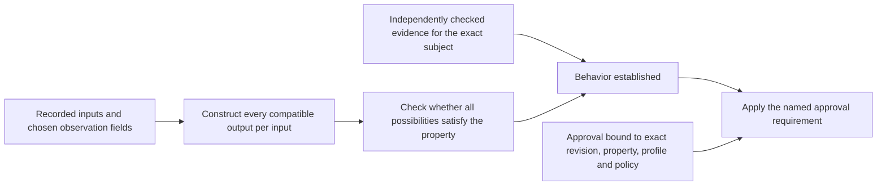

# Contract inference from partial observations

## Exact inference under the model

A finite observed trace can leave behavior underdetermined even if every input was exercised. This study assumes total deterministic implementations over one fixed input and observation domain. At a sampled input, any output with the recorded projection remains possible. At an unsampled input, every output remains possible. Lean proves that an observation property follows from this evidence exactly when it holds for every compatible output at every input. Its necessity proof replaces one output in the reference implementation while retaining the entire observed record. [Joint provider model](RT-04-JOINT-CONTRACT-CONFORMANCE-2026-11-25.md)



With a complete observation at every input, Lean proves extensional equality with the reference. With only the Boolean result, an eventful implementation and a silent one can agree at every input. The exact inference theorem uses `propext`, and function equality uses `Quot.sound`. The projection counterexample uses no axioms. [Lean source](CONTRACT-INFERENCE-01/Inference.lean) · [Axiom ledger](CONTRACT-INFERENCE-01/axioms.txt)

## Finite and policy controls

The experiment replays 16 native provider modes on two inputs under the pinned GCC profiles. It crosses every anchor provider and sampled input set with all 256 pointwise observation properties and three projections. The direct consequence test agrees with exhaustive provider enumeration on all 49,152 claims. [Machine-readable evidence](CONTRACT-INFERENCE-01/evidence.json) · [Table generator](CONTRACT-INFERENCE-01/chart.py)

| Projection | Claims | Entailed | Existential false admissions | True of anchor but unestablished with every input recorded |
| --- | ---: | ---: | ---: | ---: |
| `complete` | 16384 | 1296 | 7168 | 0 |
| `result_only` | 16384 | 400 | 11264 | 768 |
| `event_only` | 16384 | 400 | 11264 | 768 |

Picking one compatible implementation falsely admits 29,696 claims. A result-only record can cover both inputs for the silent identity provider and still admit its eventful counterpart. The no-event property for the silent provider holds on the exact two-input native table. Its result-only evidence leaves that property unestablished.

Nine approval controls bind an example decision to the exact revision, property, target and policy. A recorded approval leaves an unestablished property unresolved. A discharged property still requires approval when the selected policy calls for it. A wrong-revision check and a wrong-property approval each fail their respective gate. A modeled policy without approval accepts the exact checked property. These controls exercise the separation of behavior and authorization. They use local fixture dispositions rather than human responses or a production issuer.

The model supports automatic inference from exact consequence or separate checked evidence at the stated scope. Its proof covers pointwise properties of total deterministic models. It leaves nondeterministic histories, incomplete source/runtime correspondence, authority governance, risk policy and stakeholder validation open.

## Reproduction

Use CPython 3.12.14, GCC Debian 14.2.0-19 and Lean 4.36.0 revision `611c117bfaf7b7ae1cfcf246ce6fba31e8f509e9` from the repository root.

```sh
set -eu
fixture=research/language-design/RT-04/CONTRACT-INFERENCE-01
out=$(mktemp -d)
trap 'rm -rf "$out"' EXIT
lean -DwarningAsError=true "$fixture/Inference.lean" > "$out/axioms.txt"
cmp "$fixture/axioms.txt" "$out/axioms.txt"
python3 -B "$fixture/run.py" > "$out/evidence.json"
cmp "$fixture/evidence.json" "$out/evidence.json"
python3 -B "$fixture/chart.py"
```

[PLAN §1.3](../../../PLAN.md#13-contracts-and-compatible-implementations) · [Issue #290](https://github.com/aivibeflow/LLMLang/issues/290)
