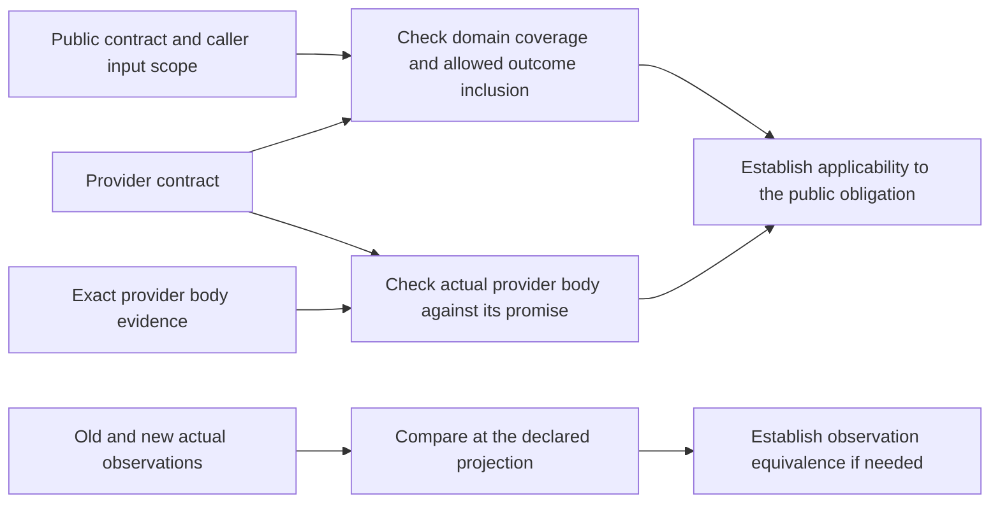

# RT-04 — Contract identity, refinement, and observed substitution

**Scope:** PLAN §1.3, [#290](https://github.com/aivibeflow/LLMLang/issues/290) and [LL-003](../../../TODO.md#ll-003--specify-contract-based-analogue-discovery-and-substitution). The finite model starts from `research/all` at `4132c237b5f60e4326a5d1254a603085dd3cf4e3`.

LLMLang can keep one public operation contract while selecting a different provider. A tool needs to distinguish exact content identity, whether the replacement promises the public behavior, whether the actual body satisfies its promise, and whether a given caller or observation cache can notice the replacement. This study formulates those checks on a bounded relation model and tests shortcuts that conflate them. It complements [Scenario 14](../RT-02/RESEARCH-SCENARIO-14-FORMAL-BEHAVIORAL-CONTRACTS-AND-REFINEMENT.md) and the [public-interface finite refinement pilot](../../semantic-representation/RT-05/PUBLIC-INTERFACE-FINITE-REFINEMENT-PILOT-2026-11-24.md).

## Candidate relations

Let a contract have an explicit set of admissible inputs $P$ and a nonempty set of allowed observations $O(x)$ for each admissible input. Here an observation includes a tagged result and an ordered effect trace. A finite body is conforming when all of its actual observations on each admissible input belong to that set, and the checker has complete evidence for each such input. The model requires at least one outcome on admitted inputs. A real contract admitting nontermination would need to represent that behavior explicitly.

| Relation | Check and consequence |
| --- | --- |
| Exact contract identity | Equality of canonical contract bytes in a specified envelope. The fixture's address test includes a profile field. Two exact values may differ while their denotations coincide on the common test domain. The fixture envelope is outside normative OpHash decisions. |
| Public/provider contract refinement | The provider accepts every public input and its allowed outcomes at each public input are a subset of the public outcomes. A broader provider precondition and a narrower allowed-outcome set can therefore be compatible. |
| Call-site refinement | Check the same conditions on an exact admitted call-site input domain. A caller needs separate evidence that its executions stay in that domain and satisfy the public precondition. It cannot broaden a local result to all public callers. |
| Substitution under the public contract | A proven provider body and compatible contract can discharge the public obligation for a contract-respecting caller in the bound scope. This preserves the guarantees stated by the public contract. The contract may permit more than one observable behavior. |
| Behavioral equivalence | Equality of the actual outcome sets over an input domain and declared observation projection. Equality of returned values can hold when equality of ordered effects fails. Reusing an observation requires equivalence at the boundary the consumer actually observes, or exact applicable execution identity. |

Refinement is directional. If provider B admits all inputs of A, and provider C admits all inputs of B, then C also admits A's inputs. On those inputs, inclusion of C's observations in B's and B's in A's gives inclusion in A's. This argument depends on comparing the same inputs, interpretation and observation boundary. "Compare whatever both providers accept" omits the acceptance obligation.



This diagram separates two claims. A successful refinement and body check can support a substitution justified by the public guarantee. A tool that needs the same actual observations, such as a cache replaying an ordered trace, has a distinct equivalence obligation.

## Finite comparison

The input domain is `−1, 0, 1`. The outcomes are success with result zero followed by `left,right` or `right,left`, and a range error with the `failed` effect. For each input the fixture can explicitly exclude that input or admit one of the seven nonempty outcome subsets. The wholly empty contract is excluded. This produces $8^3-1=511$ tables and $511^2=261{,}121$ ordered public/provider pairs. The runner compares a mask implementation with separate enumeration of input coverage and each inadmissible observation. The declared call-site domain is the singleton `0`.

| Check | Ordered pairs |
| --- | ---: |
| Identical denotation tables, also the count of mutually refining pairs | 511 |
| Public/provider refinement over the full public domain | 19,171 |
| Refinement restricted to input zero | 110,017 |
| Call-site refinement with zero admitted, full-domain refinement rejected | 63,973 |
| Shared-domain-only test accepts despite full-domain refinement failing | 19,110 |
| Of those, public and provider domains share no admitted input | 2,352 |

The call-site-only row requires zero to be admitted by the public contract, so it excludes pairs where zero is outside both sides' relevant comparison. The broad restricted count also includes cases where the contract makes no promise at zero. These counts characterize the deliberately enumerated domain, with no prevalence estimate for production contracts.

The named controls include a provider that accepts a wider input set and returns fewer outcome variants, and a provider that works at zero but excludes an input required by the public contract. Both nonidentical fixture addresses retain the same denotation when only the profile label changes. Two actual bodies each conform to one public table. At zero they return the same success value and reverse the order of effects. The result projection identifies them, while the full observation differs. An absent body observation yields `UNKNOWN`. A recorded outcome outside the contract yields `REFUTED`. A narrower contract alone supplies neither of those body judgments.

## Implications and limits

Contract-based selection can group candidate providers using directional refinement and explicit caller assumptions. Exact operation and provider identities still scope the evidence and the selected binding. Treating full refinement, call-site compatibility and actual observational equivalence as interchangeable can invalidate callers or reuse. A broader observation projection constrains compatibility further and needs correspondingly stronger evidence.

This experiment enumerates complete finite tables. It does not establish production termination, progress, arbitrary temporal effects, concurrency, resource guarantees, unknown assumption entailment, source correspondence, foreign ABI conformance or evidence authorization. It leaves exact contract encoding, general proof machinery and language-level substitutability rules open. The proof argument above concerns set inclusion in the stated model. The finite results corroborate the two implementations within that model.

## Reproduce

Use CPython 3.12.14. The [runner](CONTRACT-RELATIONS-01/run.py) enumerates the full table domain deterministically. The [result ledger](CONTRACT-RELATIONS-01/evidence.json) stores the finite domain, exact counts and the named distinguishing observations. There are no timing measurements. Mermaid syntax was inspected directly.

```sh
fixture=research/language-design/RT-04/CONTRACT-RELATIONS-01
LC_ALL=C PYTHONHASHSEED=1 python3 -B "$fixture/run.py" > /tmp/llmlang-contract-relations.json
cmp "$fixture/evidence.json" /tmp/llmlang-contract-relations.json
```
