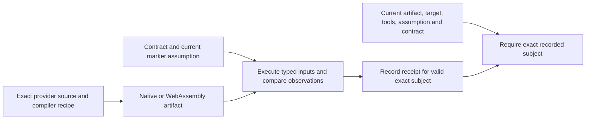

# Conformance evidence for exact native and WebAssembly scopes

## Exact subjects

A finite contract checks a bounded integer routine. It clamps input to zero through three, then records a marker for a clamped input when the observation assumption enables that marker. The replacement variant always erases the marker. The fixture builds both providers with GCC and Clang for native x86-64 and with Clang for WebAssembly. It executes the native shared objects through a C integer signature and the WebAssembly functions through a declared `i32` export. The observation comparison checks the result and optional marker together.



The receipt binds the operation and provider sources, exact input range, contract identifier and reference-relation digest, assumption, target and artifact bytes, compiler, linker, build flags, executor and checker source. It stores the observation digest separately. The local registry contains only the subjects that pass the exact comparison. Reuse requires matching the current subject and a recorded successful check. The schema uses stable fixture bytes and does not propose production trust or serialization rules.

## Results

Four build profiles produce eight artifacts of the exact and marker-erasing providers. Each profile checks both marker assumptions across eight inputs. The marker-erasing variant conforms when marker observation is disabled. When enabled, that variant disagrees at four inputs in each build profile. [Native source](CROSS-TARGET-CONFORMANCE-01/provider.c) · [WebAssembly runner](CROSS-TARGET-CONFORMANCE-01/wasm.mjs) · [Evidence ledger](CROSS-TARGET-CONFORMANCE-01/evidence.json) · [Table generator](CROSS-TARGET-CONFORMANCE-01/chart.py)

| Decision | Count |
| --- | ---: |
| Executed observations | 128 |
| Scopes matching the full observation reference | 12 |
| Scopes with an observed mismatch | 4 |
| Receipt and request combinations | 192 |
| Exact receipt reuses | 12 |
| Matching observation digests with a different scope | 68 |

The 192 reuse comparisons pair each successful receipt with every executed request. The identical observation digests in 68 other-subject pairs allow comparison across profiles. A target change, a different toolchain or a new artifact still needs evidence for its own scope. Ten single-field controls change the exact semantic input, contract, checker, observation assumption, target, artifact, compiler, linker, executor or recipe. All ten refuse reuse of the original receipt.

This study provides finite conformance for the chosen routine and its eight input values. It relies on the pinned toolchain and execution environments. Cross-platform loader behavior, general compiler correspondence, independent authentication of receipts, declared foreign effects, and extension beyond the fixture's profile remain open.

## Reproduction

Use CPython 3.12.14, GCC Debian 14.2.0-19, GNU Binutils 2.44, Clang and LLD Debian 19.1.7, and Node 24.22.3 on x86-64 Linux. Set `CLANG` and `WASM_LD` to their absolute paths with matching shared libraries available. Preserve the linker name `wasm-ld` when invoking the LLD executable. Run from the repository root.

```sh
set -eu
fixture=research/language-design/RT-04/CROSS-TARGET-CONFORMANCE-01
out=$(mktemp)
trap 'rm -f "$out"' EXIT
python3 -B "$fixture/run.py" --clang "$CLANG" --wasm-ld "$WASM_LD" > "$out"
cmp "$fixture/evidence.json" "$out"
python3 -B "$fixture/chart.py"
```

[PLAN §1.3](../../../PLAN.md#13-contracts-and-compatible-implementations) · [Issue #290](https://github.com/aivibeflow/LLMLang/issues/290)
