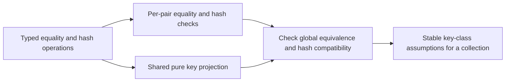

# RT-04 Type, contract and proof boundaries for collection keys

**Issue** [#324](https://github.com/aivibeflow/LLMLang/issues/324)

LLMLang can give an equality operation the type `(Key, Key) → Bool` and a hash operation the type `Key → Nat`. A hashed collection also relies on the relation expressed by those Boolean results and on its agreement with the hash. This study compares type-level admission, pairwise contract checks and global proof obligations for a minimal collection of immutable keys. [Equality, identity and hashing survey](../RT-03/RESEARCH-SCENARIO-63-EQUALITY-IDENTITY-AND-HASHING.md)

## Properties and alternatives

An equivalence relation is reflexive, symmetric and transitive. A compatible hash returns the same hash for any two keys the relation equates. Unequal keys may share a hash, in which case the collection still needs equality. A pairwise check can verify that a particular pair declared equal hashes together, and can compare both directions for that same pair. Even if those checks pass for every pair, they do not express transitivity across a chain of three keys.

One candidate derives equality and hashing from the same mathematical key projection. The projected equality relation compares the results of a pure function to natural numbers. The hash uses a deterministic function of that projection. The other candidate admits custom equality and hash operations and requires explicit evidence for the equivalence and compatibility laws. Custom operations permit richer representations, while projection gives a direct way to establish the laws if it expresses the intended domain equality.



The diagram shows candidate admission routes. Types make the operations callable. Pair checks provide checks about the pairs they cover. Global laws express what a collection assumes about chains of related keys and the hash function.

## Checked evidence

The [Lean source](EQUALITY-KEY-LAWS-01/EqualityLaws.lean) proves reflexivity, symmetry and transitivity for equality through any projection to natural numbers and proves compatible hashing for any subsequent function from natural numbers to natural numbers. It also checks reflexivity and symmetry for the relation “distance at most one” on natural numbers and checks the transitivity counterexample `0 ~ 1`, `1 ~ 2`, `0 ≁ 2`. All five theorem declarations report no axioms. These are facts in the stated Lean model. There is no checked correspondence between arbitrary native collection code and that model.

The independent Python fixture exhaustively enumerates all eight reflexive symmetric relations on three keys and all 27 hash maps with three possible outputs. It evaluates all six insertion orders for each typed relation/hash pair. The collection groups an incoming key with the first matching representative in its hash bucket. The recorded partition ignores group order and representative choice, retaining group membership. The table summarizes the finite results, with no time or resource measurements.

| Admission criterion | Models admitted out of 216 | Admitted models with order-dependent membership |
| --- | ---: | ---: |
| Typed relation and hash in the declared finite profile | 216 | 9 |
| All equal pairs hash together | 66 | 9 |
| Pairwise agreement and transitivity over all triples | 57 | 0 |

For the distance-at-most-one witness with a constant hash, insertion starting with key 1 can form a single group. Starting with 0 can form `{0, 1}` and `{2}`. All pairwise gates still pass. The full [ledger](EQUALITY-KEY-LAWS-01/evidence.json) preserves the 216 models, all 1,296 observed partitions, conflicting pairs/triples and theorem axiom reports.

## Implication and bounds

A collection-key contract can record global law obligations separately from operation types. If LLMLang uses a shared projection, its correctness still depends on whether the projection models the intended equality and is stable for the key's lifetime. Where contracts permit custom operations, a proof or exhaustive check over a finite declared domain can supply the missing global evidence. Pairwise runtime checks can catch actual inconsistent hashes and should be interpreted at their observed scope. This experiment leaves mutable keys, effectful comparisons, floating-point choices, hash cost, adversarial distribution, supported collection algorithms and production policy open.

## Reproduction

Use Lean 4.36.0 at `611c117bfaf7b7ae1cfcf246ce6fba31e8f509e9` and CPython 3.12.14. The work was based on `35f553ae1cd9fdd71c5f882f97a2586424af7be9`. The ledger records fixture digests. Two runs with hash seeds 1 and 2 produced identical output. Relative links and Mermaid source structure were checked locally. GitHub rendering was not manually verified.

```sh
study=research/language-design/RT-04/EQUALITY-KEY-LAWS-01
LC_ALL=C PYTHONHASHSEED=1 python -B "$study/run.py" --lean "$LEAN" >/tmp/llmlang-equality-laws.json
cmp "$study/evidence.json" /tmp/llmlang-equality-laws.json
```
