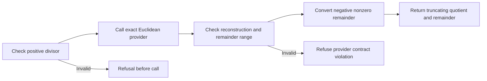

# Verified adapter from Euclidean to truncating division

## Contracts and order of checks

The required operation divides a signed integer by a positive divisor. Its quotient truncates toward zero and its remainder has the dividend's sign or is zero. The provider instead returns a Euclidean pair. It guarantees reconstruction of the dividend and a nonnegative remainder less than the divisor. For a negative dividend and a nonzero Euclidean remainder, the adapter increments the quotient and subtracts the divisor from the remainder. In all other cases it preserves the provider pair. A failed divisor check returns a distinct refusal with zero provider calls. [Earlier verified unit adapter](RT-04-VERIFIED-UNIT-ADAPTER-2026-11-25.md)



Lean checks that the adapter yields the required pair for every integer dividend and positive divisor under the Euclidean relation. It also proves uniqueness for the truncating relation. The third theorem shows the adjustment fits a signed 32-bit quotient and remainder given a negative dividend, a positive in-range divisor, and the provider's in-range quotient and Euclidean relation. The first two theorems use `propext` and `Quot.sound`. The arithmetic bound additionally uses `Classical.choice`. [Lean source](EUCLIDEAN-DIVISION-ADAPTER-01/Adapter.lean) · [Axiom ledger](EUCLIDEAN-DIVISION-ADAPTER-01/axioms.txt)

## Native comparison

The C harness computes its Euclidean pair from unsigned magnitudes and uses a widened reconstruction check. The Python reference uses arbitrary-precision integers and an independent truncating calculation. Every build profile matches all 11,076 reference rows. The profiles are GCC `-O0`, `-O2` and `-O2` with undefined-behavior sanitization and recovery disabled. Inputs span small signed ranges and include both 32-bit endpoints, divisors through the positive endpoint, zero and negative divisors. Each profile refuses all 1,136 nonpositive-divisor rows before the provider call. [Evidence ledger](EUCLIDEAN-DIVISION-ADAPTER-01/evidence.json) · [Table generator](EUCLIDEAN-DIVISION-ADAPTER-01/chart.py)

| Variant | Input pairs | Different required observations |
| --- | ---: | ---: |
| `verified` | 2769 | 0 |
| `return_euclidean` | 2769 | 1097 |
| `stale_truncation_provider` | 2769 | 1097 |
| `shift_only_quotient` | 2769 | 1097 |

For `−32 / 3`, the Euclidean provider returns `(−11, 1)` and the adapter returns `(−10, −2)`. Adjusting only the quotient produces the wrong reconstruction. A stale provider already using truncation supplies a negative remainder in that case, so the old Euclidean admissibility check refuses its output. The stale provider still produces admissible pairs on some inputs. Those cases do not establish that it satisfies the required provider contract across the input domain.

The model checks an exact numerical adapter under a named provider relation and explicit failure semantics. The native harness observes status, one provider call on admitted inputs, and the returned pair. Additional effects, a profile admitting negative divisors, foreign provider authentication and general adapter synthesis remain open.

## Reproduction

Use CPython 3.12.14, GCC Debian 14.2.0-19 with its sanitizer runtime, and Lean 4.36.0 revision `611c117bfaf7b7ae1cfcf246ce6fba31e8f509e9` from the repository root.

```sh
set -eu
fixture=research/language-design/RT-04/EUCLIDEAN-DIVISION-ADAPTER-01
out=$(mktemp -d)
trap 'rm -rf "$out"' EXIT
lean -DwarningAsError=true "$fixture/Adapter.lean" > "$out/axioms.txt"
cmp "$fixture/axioms.txt" "$out/axioms.txt"
python3 -B "$fixture/run.py" > "$out/evidence.json"
cmp "$fixture/evidence.json" "$out/evidence.json"
python3 -B "$fixture/chart.py"
```

[PLAN §1.3](../../../PLAN.md#13-contracts-and-compatible-implementations) · [Issue #290](https://github.com/aivibeflow/LLMLang/issues/290)
