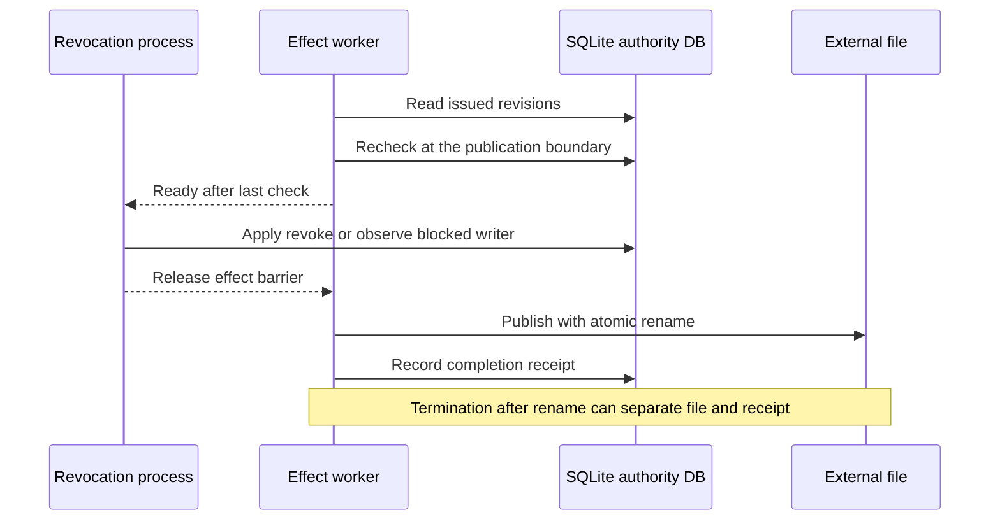

# RT-04 — Compare grant revocation across a database and an external file effect

A fresh grant check before a filesystem replacement still leaves a revocation window. Holding every relevant advisory lock closes the tested window among cooperating writers. A SQLite writer transaction also blocks the uncoordinated authority change, at the cost of blocking unrelated writes. Process termination after the external replacement leaves a file without a database receipt under all five policies.

## Question and scope

[RT-04's static ownership and capability model](RT-04-PROTOTYPE-01-RESULTS.md) distinguishes scope and ancestry. The [RT-16 threat model](../../security/RT-16/RT-16-THREAT-MODEL-01.md) keeps authority and effect publication explicit. This experiment checks the case where grant state and completion records are in a database but the actual effect is a rename in the filesystem.

The candidate contract requires the same active ancestor and child revisions at the exact external effect. In the fixture the policy process can revoke either grant or an unrelated row. Logical identities and their grant relationships are fixed. The experiment does not infer authority from the possession of a filename.

## Native schedules and policies

Two processes use a SQLite WAL database, Linux `flock` and a temporary directory. The worker reads the local authorization, waits for the last-check barrier, and then waits again immediately before publishing a staged JSON file with `os.replace`. The parent invokes a chosen policy update before or after those barriers and independently checks the durable database rows and visible file. The worker normally records a receipt after the filesystem effect. Two separate schedules stop the worker on the two sides of the rename.



The cached policy uses the issued decision. The fresh policy checks exact revisions immediately before the effect barrier with no held serialization. The leaf-lock policy holds one advisory lock. The ancestry-lock policy holds both relevant locks until completion. The fifth candidate holds a SQLite writer transaction while it checks and performs the external effect. For an advisory lock, the revoker must use the corresponding stable lock inode. The uncoordinated control writes through SQLite while omitting that advisory lock. It still encounters SQLite's writer serialization when the worker holds that transaction. [Linux flock semantics](https://man7.org/linux/man-pages/man2/flock.2.html) · [SQLite transaction rules](https://www.sqlite.org/lang_transaction.html)

## Results

| Policy | File replaced | Stale effects | Unrelated revoke postponed | Effect without receipt |
| --- | ---: | ---: | ---: | ---: |
| cached | 7 | 4 | 0 | 1 |
| fresh | 6 | 3 | 0 | 1 |
| leaf_lock | 6 | 2 | 0 | 1 |
| ancestry_lock | 6 | 1 | 0 | 1 |
| db_writer | 6 | 0 | 1 | 1 |

Each row has nine controlled schedules. A stale effect occurs when the worker publishes a file after either exact grant revision changes. The leaf lock defers a cooperating revocation of the child, leaving ancestor revocation unprotected. Holding both locks defers both cooperating relevant changes. Its one stale effect occurs with the uncoordinated revoker. The SQLite writer policy defers every overlapping database write, including the unrelated revocation. The parent applies each delayed revocation after the worker finishes.

No file remains when the worker stops before the rename. When it stops after the rename and before the receipt, an independent reader sees the file and no completion row under every policy. In both stop schedules a fresh authority update succeeds after the worker exits, including when the worker previously held both advisory locks or the database writer transaction.

## Implications and limits

Grant freshness, shared serialization and cross-store recovery address different properties. Rechecking at a point before the effect cannot by itself protect a later syscall. Serialization may use a scope-aware cooperation rule or a coarser database writer fence. A recovery contract still needs a separately verifiable way to reconcile an already visible external effect with an unresolved database receipt.

The test uses pinned local files and one SQLite authority store. It leaves remote authorities, noncooperating effect writers, inode replacement, exactly-once recovery, filesystem power-loss durability, issuer authentication, and independent review open. It does not select a production capability protocol.

## Reproduce

Use CPython 3.12.14 with SQLite 3.53.1 on Linux 6.18.57 and overlayfs. The [ledger](EXTERNAL-REVOCATION-01/evidence.json) records each issued and observed revision, contention result, file effect and receipt. The program runs deterministic barrier schedules without sampling.

```sh
fixture=research/language-design/RT-04/EXTERNAL-REVOCATION-01
output=$(mktemp)
python3 -B "$fixture/run.py" > "$output"
cmp "$fixture/evidence.json" "$output"
python3 "$fixture/chart.py"
```

[Process fixture and schedule oracle](EXTERNAL-REVOCATION-01/run.py) · [Evidence ledger](EXTERNAL-REVOCATION-01/evidence.json)
