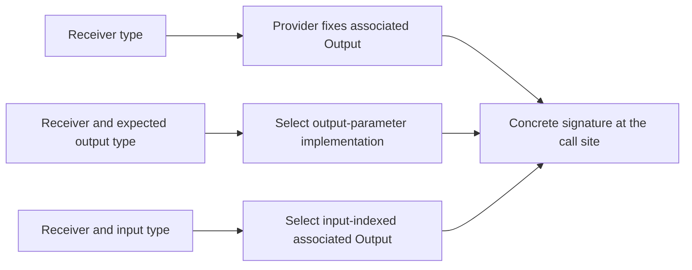

# RT-04 Generic output type relationships at native call sites

**Issue** [#324](https://github.com/aivibeflow/LLMLang/issues/324)

A generic LLMLang interface may need to describe whether a provider determines one result type, the caller selects a supported result type, or the provider and input type together determine the result. This affects call-site type checking, dispatch keys and the type information retained across type erasure. The fixture compares those three relationships in separately compiled Rust libraries and clients on x86-64 Linux. It extends the prior-art taxonomy in [RT-04 generics and dispatch](RESEARCH-SCENARIO-42-GENERICS-CONSTRAINTS-AND-DISPATCH.md).

## Candidates and assumptions

An associated type is a type declared by a trait implementation. The implementation key is the receiver type plus the trait's generic arguments. In the first candidate, `Decode` has no generic argument and the provider fixes its `Output` to `u16`. In the second, `Decode<Output>` has a separate implementation at each supported output type. The receiver and `u8` input are identical, so the caller's expected result can choose either `u8` or `u16`. In the third, `Decode<Input>` supplies an associated type at each input type. The same provider returns `u8` for `u8` input and `u16` for `u16` input. Type erasure behind a trait object hides the concrete provider type. The exposed trait object still needs a concrete callable signature in these examples.



The diagram identifies the type information used to select each implementation. It does not describe binary layout or dictionary construction. The observed signatures are Rust source typing relationships between a provider crate and its clients.

## Native compiler and behavioral checks

Each provider is built as an independent library. Fifteen client programs compile against one of the resulting library files. Nine clients run successfully over the 256 integer values 0 through 255. A narrow result is the input plus one modulo 256 and a wide result is the input plus 256. These results check which admitted implementation was invoked. They carry no performance claim. The [ledger](GENERIC-OUTPUT-KEYS-01/evidence.json) records each exact client source, diagnostic code and all 2,304 runtime outputs.

| Relationship | Clients admitted | Clients refused | Main control |
| --- | ---: | ---: | --- |
| Receiver-associated output | 2 | 2 | The result is inferred as `u16`. A `u8` expectation fails with E0308. An erased `Decode` needs a bound output type (E0191). |
| Caller-selected output parameter | 3 | 1 | Both result annotations select their implementations for the same input type. Dropping result information fails with ambiguity E0283. |
| Input-indexed associated output | 4 | 3 | Input type determines the result. A conflicting output expectation fails with E0308. Erasure without its output binding fails with E0191, and an incompatible binding fails with E0271. |

The input-indexed generic function returns `D::Output` under its `D: Decode<I>` requirement and the native run agrees with the direct `u8` call. The output-parameter form exposes more choices for identical actual input types, but some clients need an annotation to resolve those choices. The receiver-only form expresses a simpler interface when every invocation returns the same result type. The input-indexed association expresses a type relation without asking the caller to choose a conflicting result for a fixed input. Call admissibility does not establish contract conformance beyond the recorded behavior.

For LLMLang, a candidate typed call representation can record the generic argument positions that enter provider selection and the resolved result type required by its consumer. These distinctions matter for a semantic dependency graph that must tell a change to the provider's associated result apart from a change to its body. This experiment does not specify an LLMLang encoding, prove inference soundness, or establish binary compatibility, coherence under ecosystem extension, overload policy or stable semantic cache keys. [Native generic provider binding study](../../semantic-representation/RT-05/RT-05-GENERIC-PROVIDER-BINDING-2026-11-25.md)

## Reproduction

Use rustc 1.85.1 at `4eb161250e340c8f48f66e2b929ef4a5bed7c181` with LLVM 19.1.7 and CPython 3.12.14, at repository root. The work was derived from branch revision `56fbb55f31994ef9a519368131e6b62bff646bdc`. The compiled fixture source hashes are in the ledger. Both hash seeds 1 and 2 produce byte-identical ledgers. Local paths and the Mermaid source structure were checked. GitHub rendering was not manually verified.

```sh
study=research/language-design/RT-04/GENERIC-OUTPUT-KEYS-01
LC_ALL=C PYTHONHASHSEED=1 python -B "$study/run.py" --rustc "$RUSTC" >/tmp/llmlang-output-keys.json
cmp "$study/evidence.json" /tmp/llmlang-output-keys.json
```
