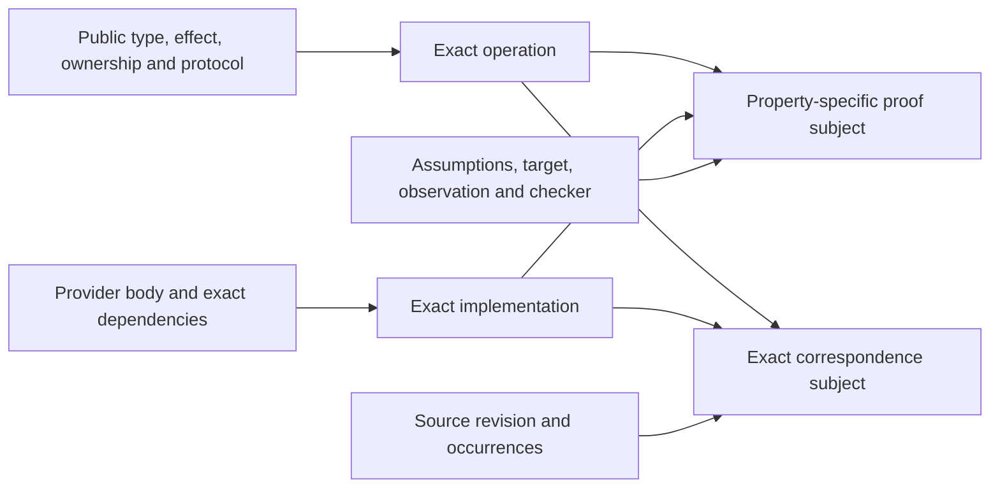

# RT-04 type, effect and ownership identity at the proof boundary

Type, effect, resource and authority choices can change the meaning of an operation, one provider, or the applicability of a claim about either. The same change can affect several exact subjects. This study reconciles the RT-04 distinctions with the RT-05 identity model and RT-07 observation requirements. It supplies a candidate projection and a checked finite receipt matrix.

## Classify the role before hashing

| Semantic or evidentiary fact | Candidate binding |
|---|---|
| Public input/output types, ownership transfer, effects and ordering, failure and allowed cleanup, required authority, state/protocol | Exact public contract and interface in `OpHash` when callers may depend on the distinction |
| Provider body, resolved aliases and private cleanup, exact supplied declaration | `ImplHash` and exact dependencies for its relevant semantic profile |
| Concrete authorization, target/ABI and contextual assumptions | Exact selected runtime or build scope. Include a requirement in the public contract only when it changes the promise |
| Evidence of a property over a chosen set of observations | Exact proof or receipt key over the actual conclusion, subjects, assumptions, observation projection and checker |
| Source spans, labels and correspondence | Exact source-map or correspondence identity scoped to the semantic subjects. Purely descriptive display labels can remain in separate metadata |

A live authorization token is external evidence about whether an operation can execute in a scope. The contract revision may declare which capability or authority the operation demands. A write that becomes caller-observable through an alias must be represented in its semantic subject. A provider-local cleanup that is unobservable under one checked context may still matter to a resource judgment or to another caller that can observe the handle. This is why scope belongs in both behavior and applicability checks.



Proof reuse follows the exact declared properties. A receipt about an error flag cannot establish a correlated statement about error, live resource and later call admission. A broader conclusion can discharge a narrower one only with a checked implication under applicable subject, assumptions and observation correspondence. Structural hash equality gives neither that implication nor completeness of the extracted inputs.

## Archived and candidate comparisons

The [RT-04 cleanup identity study](RT-04-CLEANUP-OBSERVATION-IDENTITY-2026-11-25.md) observes equal cleanup flags in all 24 paired cases and different usable caller-owned results in all 24. Comparing only the next admission misses 18 ownership differences. Its separate verification-key checks change the key whenever the scoped provider or observation projection changes. The [RT-07 joint observation study](../../formal-verification/RT-07/RT-07-JOINT-OBSERVATION-REFINEMENT-2026-11-25.md) checks why independent scalar projections can erase a relevant correlation. The [RT-05 envelopes](../../semantic-representation/RT-05/RT-05-CANDIDATE-IDENTITY-ENVELOPES-2026-11-25.md) distinguish exact operation, provider and class identities. The [public obligation generator](../../semantic-representation/RT-05/RT-05-PUBLIC-BODY-AND-REFINEMENT-OBLIGATIONS-2026-11-25.md) gives separately bound provider and refinement subjects.

The new checker compares 15 exact single-field edits. The six modeled public changes alter operation and downstream proof/correspondence subjects. Three provider-local semantic changes alter implementation and downstream subjects. Four changes specific to the tested proof scope alter proof applicability. A location revision affects correspondence, and a display label does not affect the exact subjects in this fixture. A binding whose target or ABI is part of the public promise would assign that fact to a different role. The test fixes the roles described in its input design.

The checker also crosses three requested projections, three receipt projections, current/stale body and assumptions, and independent acceptance. Of 72 cases, three exact verified cases apply and 69 are withheld. Exact equality is the only reuse route in this fixture. A property-specific checked transfer protocol could add useful applicable cases while preserving the negative controls.

Using an operation identity for all evidence would collapse provider changes. Using only the result flag for proofs would erase ownership and later-admission distinctions. Placing every source and proof field in `ImplHash` would invalidate stable semantic values when only their presentation or proof scope changes. The candidate separates those identities and requires explicit correspondence where a richer claim crosses the boundary.

## Verify and limits

The [runner](IDENTITY-PROOF-BOUNDARY-01/check.py) and [ledger](IDENTITY-PROOF-BOUNDARY-01/evidence.json) use CPython 3.12.14 and Git 2.56.1 with four archived sources pinned at `688fe5dab78c69d495bc7e7d366008f69cbbba58`. Both hash seeds give identical outputs. This checks modeled field influence and applicability. It does not derive a production source dependency set or run a proof kernel.

```bash
fixture=research/language-design/RT-04/IDENTITY-PROOF-BOUNDARY-01
PYTHONHASHSEED=37 python3 -B "$fixture/check.py" > /tmp/llmlang-rt04-identities.json
cmp "$fixture/evidence.json" /tmp/llmlang-rt04-identities.json
```

General ownership and protocol observations, exact producer authority, full lowering correspondence, and an agreed field registry remain open. Production selection requires project approval. [LL-008](../../../TODO.md#ll-008--define-compatibility-evidence-and-evidence-reuse-rules)
