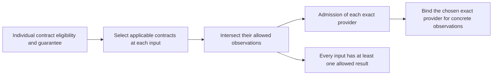

# Joint conformance and multiple providers

## Relation and alternatives

Each contract has an eligibility predicate and an allowed observation relation. A total provider implements a contract when every eligible input yields an allowed observation. For simultaneous conformance, the combined eligibility domain is the union of the domains. At each input, intersect guarantees only from contracts that apply there. Lean checks that satisfying this joint contract is equivalent to satisfying every member. It also checks that a common total implementation exists exactly when every input has an output allowed by all applicable contracts. The latter proof uses `Classical.choice` for arbitrary input and observation types. [Contract refinement experiment](RT-04-CONTRACT-RELATIONS-FINITE-COMPARISON-2026-11-25.md)



Two shortcuts have different errors. Checking only inputs where both contracts apply can drop an obligation on inputs covered by just one. Intersecting both raw postconditions on every input covered by either can impose a guarantee from an inapplicable contract. Checking that both contracts have some provider leaves joint feasibility unresolved.

## Evidence

The fixture uses two input values and four observations consisting of a Boolean result and one recorded event bit. GCC at `-O0` and `-O2` executes 16 provider modes at both inputs. Both match the exact 32-row reference. The finite checker derives each eligible provider set from the native observations and compares 1,048,576 ordered pairs of syntactic contracts. Different encodings can express identical effective guarantees when an input is ineligible. In every pair the pointwise test yields the exact intersection of the provider sets. [Lean source and axioms](JOINT-CONTRACTS-01/Contracts.lean) · [Axiom ledger](JOINT-CONTRACTS-01/axioms.txt) · [Machine-readable evidence](JOINT-CONTRACTS-01/evidence.json) · [Table generator](JOINT-CONTRACTS-01/chart.py)

| Decision | Count |
| --- | ---: |
| Individually feasible pairs | 923521 |
| Pairs with a common provider | 829921 |
| Individually feasible pairs without a common provider | 93600 |
| Pairs with false admissions under overlap-only checking | 674880 |
| Pairs with false refusals under raw postcondition intersection | 515200 |
| Contracts with multiple conforming providers | 945 |
| Contracts allowing same values with different effects | 385 |

An operation requiring only the input's Boolean value as the result admits a silent provider and one that emits the event at every input. Lean checks both conformance proofs and a complete-observation difference without axioms. The finite C fixture records both variants directly. Contract membership can therefore establish the stated guarantee while leaving different behavior observable across conforming providers. Cache and call evidence that relies on the event still needs the chosen exact provider or a proof of observational agreement for that property. [Conformance class identity](../../semantic-representation/RT-05/RT-05-CONFORMANCE-CLASS-IDENTITY-2026-11-25.md)

The model assumes total deterministic behavior and the same input and observation domain for all contracts. The event is an explicit local marker. Protocol transitions, liveness, resource ownership, native source correspondence for arbitrary providers, and project-wide identity policy remain open.

## Reproduction

Use CPython 3.12.14, GCC Debian 14.2.0-19 and Lean 4.36.0 revision `611c117bfaf7b7ae1cfcf246ce6fba31e8f509e9` from the repository root.

```sh
set -eu
fixture=research/language-design/RT-04/JOINT-CONTRACTS-01
out=$(mktemp -d)
trap 'rm -rf "$out"' EXIT
lean -DwarningAsError=true "$fixture/Contracts.lean" > "$out/axioms.txt"
cmp "$fixture/axioms.txt" "$out/axioms.txt"
python3 -B "$fixture/run.py" > "$out/evidence.json"
cmp "$fixture/evidence.json" "$out/evidence.json"
python3 -B "$fixture/chart.py"
```

[PLAN §1.3](../../../PLAN.md#13-contracts-and-compatible-implementations) · [Issue #290](https://github.com/aivibeflow/LLMLang/issues/290)
