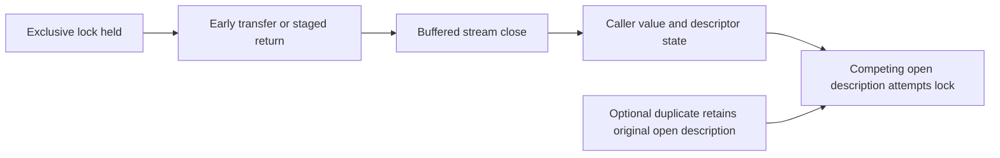

# Linux owned returns after a real stdio cleanup failure

- **Date:** 2026-11-24
- **Research:** RT-03, RT-04, RT-10
- **Baseline:** `895a37cd1801d62c17025d20a34f25f634c331b4`
- **Evidence:** 64 observed native traces checked against a finite reference

A failed cleanup can close its own descriptor and still leave a separate resource usable. In this workload, the early policy forwards the resource after a real `fclose` error. The staged policy closes the original descriptor. A surviving duplicate can retain the underlying Linux file lock in either policy. A contract that predicts subsequent admission therefore needs information about aliases in addition to the returned ownership and cleanup error.

## Workload

The [modeled COR-13 comparison](RT-04-OWNED-PROVIDER-CONTRACT-REPLAY-2026-11-24.md) distinguishes transfer order and alias-sensitive admission in typed source and generated Rust. This experiment exercises the analogous foreign primitives directly in C. The provider owns an exclusively locked file and a separate writable stdio stream backed by a pipe. It writes one buffered byte. With a reader, closing the stream flushes the byte and the reader observes EOF. Without a reader, `fclose` reports `EPIPE` under an ignored `SIGPIPE`. In both cases `F_GETFD` confirms that the stream descriptor is closed before any descriptor may be reused.

The early policy transfers the locked-file descriptor before closing the stream when the caller requests a value. The staged policy transfers only after a successful stream close. The caller tests a competing lock from an independently opened descriptor before releasing any returned owner. For the alias case it opens a different path to the same inode via a hard link. The foreign-alias control leaves a separate `dup` of the original descriptor live. When the competing lock is refused, the harness releases all original aliases and verifies that a retry succeeds.



## Results

The five Boolean dimensions are transfer order, requested value, broken pipe, surviving duplicate, and same-inode contender. C traces match the independent Python event model on all 32 inputs at both optimization levels. In all 16 broken-pipe inputs the cleanup reports `EPIPE` and the stream descriptor closes. The caller receives a usable owned descriptor in the four requested-value inputs under early transfer and zero under staged transfer.

| Requested value, failed cleanup, same-inode contender | Original descriptor at return | First competing attempt |
| --- | --- | --- |
| Early transfer, no duplicate | Forwarded and open | Refused |
| Staged transfer, no duplicate | Closed | Started |
| Early transfer, surviving duplicate | Forwarded and open | Refused |
| Staged transfer, surviving duplicate | Closed | Refused |

A representation that tracks the original descriptor alone would predict admission in the last row. The live duplicate retains the lock of the original open file description. A disjoint inode admits the competing operation in all 16 corresponding inputs. Every refused attempt succeeds after the final descriptor for the original open file description closes.

As a negative check, the runner rejects a mutated C fixture that explicitly unlocks the file before closing the unforwarded descriptor. That mutation allows the competitor to start while the surviving duplicate still holds its descriptor.

The candidate early and staged contracts both preserve the cleanup diagnostic. They offer different ownership on the error path. In the staged policy, a guarantee of subsequent same-inode admission also requires exclusion or reconciliation of foreign aliases. The trace model records the two object identities separately, the original open file description and the inode used to detect a conflict. The native harness checks their relationship through `dup`, independent opens, hard links and lock results. [Linux flock documentation](https://man7.org/linux/man-pages/man2/flock.2.html) · [Linux fclose documentation](https://man7.org/linux/man-pages/man3/fclose.3.html)

## Reproduce and scope

The [ledger](linux-owned-cleanup/results.json) records source hashes, compiler and runtime versions, and all normalized traces. The original execution used Linux 6.18.57, x86-64, overlayfs, glibc 2.41, Debian GCC 14.2.0, and Python 3.12.14.

```sh
pilot=research/language-design/RT-04/linux-owned-cleanup
replay_dir=$(mktemp -d)
python3 -B "$pilot/run.py" --output "$replay_dir/results.json"
cmp "$pilot/results.json" "$replay_dir/results.json"
```

This is a single-process Linux FFI fixture with independent opens and no concurrent I/O. It exercises failure from flushing a buffered stream during `fclose`. Raw `close` interruption, filesystem-specific lock variants, concurrent alias creation and destruction, and general LLMLang source-to-native correspondence remain open. The trace order instruments the C fixture. The fixture has no LLMLang binding or resource representation. Independent review remains pending.
