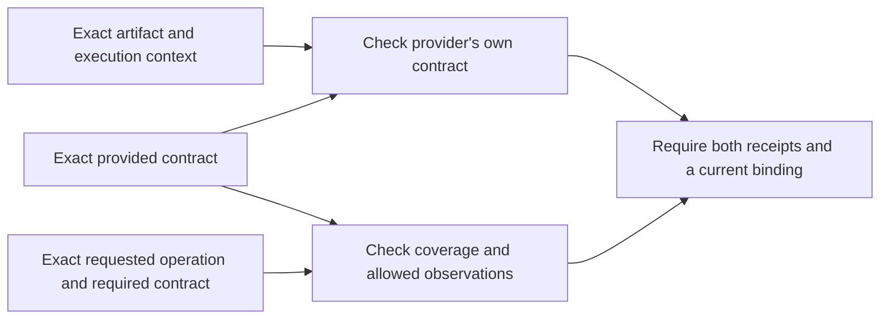

# Evidence for modular substitution at an exact operation

## Claim boundaries

A provider can match an operation's observed contract directly while its own advertised contract gives weaker guarantees. Modular substitution checks two independent obligations. The exact provider body satisfies its own contract, and that precise contract refines the exact requested operation contract. It also needs a current authorization binding the operation, implementation, provided contract and observation context. This study instantiates that rule over the previously checked x86-64 and WebAssembly clamping artifacts. [Cross-target receipt study](RT-04-CROSS-TARGET-CONFORMANCE-RECEIPTS-2026-11-25.md) · [Progress and resource obligations](RT-04-PROPERTY-SCOPED-OPERATION-SUBSTITUTION-2026-11-25.md)



The provider offers one of four contracts over a fixed range. It can promise the exact conditional marker, promise only the clamped value, promise silence, or cover only in-range inputs. The call names one of three required contracts through an exact fixture operation identity. The body receipt names the implementation, provided contract and scope. The refinement receipt names the provided contract, required operation and scope. The shared middle contract must match exactly. The experiment stipulates a trusted local authorization input and verifies its scope.

## Results

The runner rebuilds and reexecutes the earlier eight native and WebAssembly artifacts. It reproduces all 16 scoped comparison records and reconstructs the exact 128 observations against their archived digests. The resulting cross-product checks 192 body and contract pairs. [Evidence ledger](MODULAR-OPERATION-SUBSTITUTION-01/evidence.json) · [Table generator](MODULAR-OPERATION-SUBSTITUTION-01/chart.py)

| Check | Cases |
| --- | ---: |
| Scoped body and contract pairs | 192 |
| Native or WebAssembly behavior conforms directly | 176 |
| Both modular obligations and binding close | 100 |
| Direct conformance with a missing modular obligation | 76 |
| Refinement alone admits a nonconforming body | 20 |
| Body conformance alone admits an inadequate provider contract | 68 |

Where the body meets an exact-marker requirement but advertises only the value, the body and direct checks can pass. The advertised guarantee still fails to refine the marker requirement. Conversely, a promise of silence can refine a value-only requirement while the actual provider emits a marker. All 100 modular admissions also conform directly. The 56 distinct body receipts and 30 refinement receipts retain their exact subjects across the matrix.

The current binding admits the positive control. Five controls refuse a different operation, a changed provider contract for identical body bytes, a changed execution context, a missing refinement receipt and missing authorization. A separate direct checking route could issue evidence for a new exact claim under its own policy. It would need to establish that claim for the new binding.

This evidence covers the finite deterministic contract model and named execution targets. It does not establish production authority, source-to-target proof, general progress or resource accounting, or a normative operation identity envelope.

## Reproduction

Use CPython 3.12.14, GCC Debian 14.2.0-19, GNU Binutils 2.44, Clang and LLD Debian 19.1.7, and Node 24.22.3 with matching shared libraries on x86-64 Linux. Set `CLANG` and `WASM_LD` to the absolute tool paths and keep the linker's invocation name `wasm-ld`. Run from repository root.

```sh
set -eu
fixture=research/language-design/RT-04/MODULAR-OPERATION-SUBSTITUTION-01
out=$(mktemp)
trap 'rm -f "$out"' EXIT
python3 -B "$fixture/run.py" --clang "$CLANG" --wasm-ld "$WASM_LD" > "$out"
cmp "$fixture/evidence.json" "$out"
python3 -B "$fixture/chart.py"
```

[PLAN §1.3](../../../PLAN.md#13-contracts-and-compatible-implementations) · [Issue #290](https://github.com/aivibeflow/LLMLang/issues/290)
