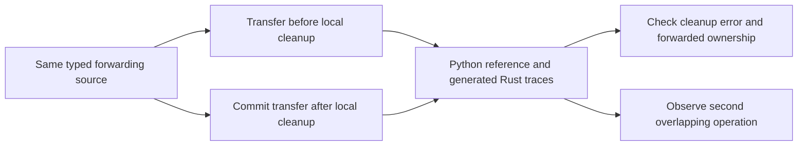

# RT-04 — Distinguish owned-return contracts on cleanup failure

**Status:** Bounded typed-source and generated-Rust comparison complete.

**Baseline:** `f1401e8f278529deb05674830f12be50c983e655` on main.

**Evidence type:** Differential execution and explicit public-contract predicates over finite observations.

**Tracking:** PLAN §1.4.1, [COR-13](RESEARCH-COR-13-TYPED-OWNERSHIP-ACROSS-CALLS.md), and [finite interface refinement](../../semantic-representation/RT-05/PUBLIC-INTERFACE-FINITE-REFINEMENT-PILOT-2026-11-24.md).

## Question and method

A cleanup error can accompany a successfully transferred resource or prevent transfer altogether. We tested the existing COR-13 typed forwarding workload against two possible caller guarantees. The first guarantee forwards the usable owned handle when a requested transfer precedes a failing local cleanup. The second commits a usable owned return only after the local cleanup succeeds. A caller that observes only the presence of a cleanup error has a weaker observation boundary. The experiment checks whether that boundary can distinguish the two policies.



The two policies use explicit transfer timing for the same checked source. Each generated Rust trace is compared with the Python reference before evaluating the caller guarantees.

The [replay driver](owned-contract-replay/run.py) imports the established typed caller and Rust generator. It uses two alias patterns, both return choices, and all four dispositions for the local and handle scopes. One pattern has disjoint resource pairs. The other reuses both identities for the next operation. The forwarding handler retains the result obligation. The caller-release parameter is fixed to `ok` and the forwarding handler has no release action. The 64 inputs per timing are run at Rust optimization levels 0 and 3.

The comparison predicates inspect whether cleanup was reported and whether the terminal forwarded obligations include a usable owned handle. A staged failure can still retain a release or reconciliation obligation. The two predicates track the usable owned result separately from those obligations.

## Results

| Observation under a requested value and failed local cleanup | Transfer before cleanup | Transfer after cleanup |
| --- | ---: | ---: |
| Cleanup error reported | 24/24 | 24/24 |
| Usable owned handle forwarded | 24/24 | 0/24 |
| Second operation started on overlapping pairs | 0/12 | 6/12 |
| Second operation refused on overlapping pairs | 12/12 | 6/12 |

All **256** generated native traces match the Python reference. The two policy results satisfy different caller guarantees. The weaker cleanup-error flag gives the same value for all 24 pairs. A public contract or cache/proof observation that retains only that flag misses the tested differences in ownership and later admissibility. In the overlapping cases, a later operation can start after staged cleanup consumes the original handle. A retained or unresolved original obligation can still refuse it.

The [result ledger](owned-contract-replay/results.json) records the exact input and generated source digests and both traces for each discriminating case. The evidence supports comparing the timing policies with an observation that includes terminal obligations and subsequent admission. It leaves which public contract is appropriate to workload and semantics selection.

## Reproduction and limits

Use CPython 3.12.14 and Rust 1.85.1 at commit `4eb161250e340c8f48f66e2b929ef4a5bed7c181` on x86-64 Linux:

```sh
replay=research/language-design/RT-04/owned-contract-replay
python3 -B "$replay/run.py" --rustc "$(command -v rustc)" \
  --output /tmp/llmlang-owned-transfer-discriminator.json
cmp "$replay/results.json" /tmp/llmlang-owned-transfer-discriminator.json
```

These are exact enumeration counts for the selected fixture. Mermaid source was checked without local rendering. The Rust runtime is the existing modeled resource harness. This comparison leaves integration with immutable public names and live provider binding, arbitrary backend correspondence, concurrent cancellation, real foreign-resource effects, and independent scientific review open. It supplies evidence for the caller observation boundary without adopting either ownership policy.
