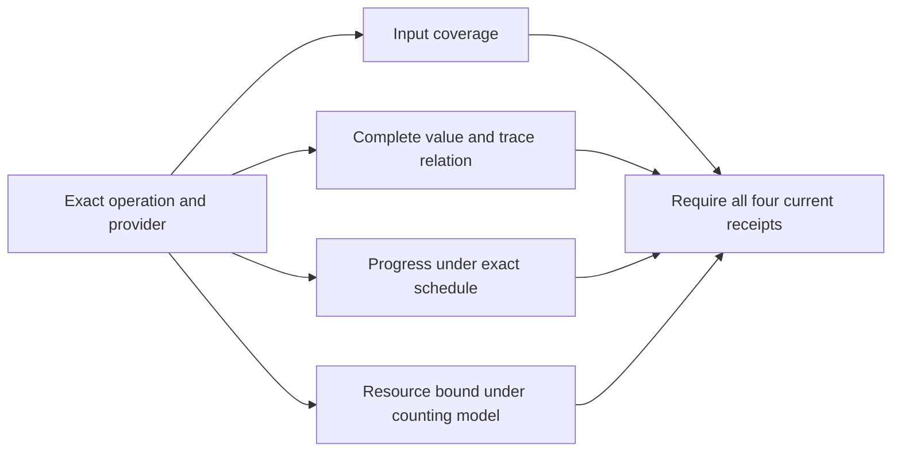

# RT-04 — Require complete scoped evidence for operation substitution

## Question and contract

When two providers compute the same values and traces, what else must be checked before one can serve a particular operation? The [permissive operation study](../../semantic-representation/RT-05/RT-05-PERMISSIVE-OPERATION-IDENTITY-2026-11-25.md) binds complete observable alternatives. This study adds a required-input set, a termination bound and a resource bound, then tests exact receipts for each obligation. The baseline is `7ba217c5ca064cae3e79f62a23141cbb7ca42509` on `research/all`. [Public-interface refinement](../../semantic-representation/RT-05/PUBLIC-INTERFACES-AND-CONTRACT-REFINEMENT.md)

For every input `x` in 0 through 7 the fixture requires a provider that admits `x`, returns `2x` with trace `account`, terminates within `x+3` abstract steps and uses at most `x+2` abstract memory units on completed calls. It enumerates these properties for seven provider profiles. A missing input, absence of terminating output, overrun and trace discrepancy are distinct model outcomes. The observation-only comparison checks the value/trace relation where output is available.

Each receipt binds its obligation, exact operation and provider identities, and its own declared context projection. The modeled provider identity binds the source of the fixture and its named profile. The scope/model identifiers apply to every receipt. Progress additionally binds scheduling context and the resource check binds its counting context. The admission rule enumerates all four required axes independently of supplied receipts. This models receipt applicability with a stipulated trusted issuer; it does not authenticate a real issuer.



## Results

| Provider | Required inputs admitted | Observed value and trace | Progress | Resource bound | Scoped substitution |
|---|---|---|---|---|---|
| Fast | Pass | Pass | Pass | Pass | Eligible |
| Exact limits | Pass | Pass | Pass | Pass | Eligible |
| Late | Pass | Pass | Refuted | Pass | Withheld |
| Memory exceeds bound | Pass | Pass | Pass | Refuted | Withheld |
| One divergent input | Pass | Pass on completed outputs | Refuted | Pass on completed outputs | Withheld |
| Narrower input domain | Refuted | Pass on admitted inputs | Pass on admitted inputs | Pass on admitted inputs | Withheld |
| Extra visible event | Pass | Refuted | Pass | Pass | Withheld |

Checking observation inclusion alone admits four of the five unsuitable profiles. The exact receipt rule also refuses missing resource evidence, duplicate evidence for an axis, an operation mismatch and the same nominal outcome from a different provider. These checks distinguish syntactically successful receipts from applicable evidence. [Per-input observations, exact receipts and controls](OPERATION-SUBSTITUTION-EVIDENCE-01/evidence.json)

Changing the resource-counting context keeps the three other keys and invalidates the resource key. Changing the scheduling context keeps the three other keys and invalidates the progress key. Binding all receipt keys to the whole context invalidates all four for either change. The more selective behavior is sound only when the checker establishes the complete context dependencies for each axis. If the semantics of the public guarantee itself changes, the fixture requires an operation identity change.

This experiment supplies a candidate admission rule for total bounded operations, using finite observations and stipulated dependency coverage. It leaves authority and signatures, general resource accounting, progress guarantees on real runtimes and source-to-native correspondence open. Its abstract units are model inputs for this comparison. [Contract research tracking](https://github.com/aivibeflow/LLMLang/issues/290)

## Reproduction

Use CPython 3.12.14. The [runner](OPERATION-SUBSTITUTION-EVIDENCE-01/run.py) verifies the complete eight-input population, six receipt controls and the context-key effects. Hash seeds 1 and 2 produced byte-identical output. The Mermaid source was checked without local rendering.

```bash
fixture=research/language-design/RT-04/OPERATION-SUBSTITUTION-EVIDENCE-01
LC_ALL=C PYTHONHASHSEED=1 python3 -B "$fixture/run.py" > /tmp/llmlang-rt04-substitution.json
cmp "$fixture/evidence.json" /tmp/llmlang-rt04-substitution.json
```
