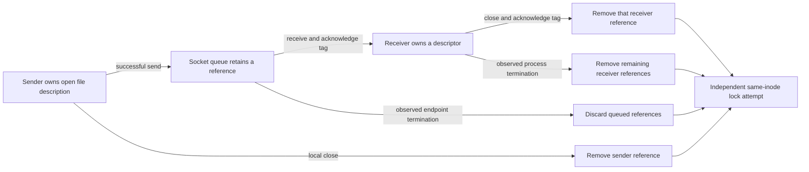

# RT-04 — Compare release evidence for queued foreign ownership

On Linux, a successfully sent file descriptor can keep a lock alive after the sender closes its copy and before the receiver obtains a local descriptor. Tracking any single receipt also misses earlier live copies. A model of local, queued and received references agrees with all 696 native lock observations.

## Question and prior evidence

The [single-process cleanup probe](RT-04-LINUX-OWNED-CLEANUP-2026-11-24.md) shows that `dup` can retain a lock after the original descriptor closes. Message transport raises another question for COR-13 and isolated processes. Can a subsequent operation start when the issuing scope has closed the resource and the provider has reported no outstanding receipts?

Linux `SCM_RIGHTS` transfers a reference to an open file description. A file descriptor is a process-local reference. The open file description represents the shared open instance that owns the `flock` lock. The contender opens the same inode via a hard link, creating a separate open file description, or opens a disjoint inode as a control. [Unix-domain socket semantics](https://man7.org/linux/man-pages/man7/unix.7.html) · [Linux flock description](https://man7.org/linux/man-pages/man2/flock.2.html)

## Method

A parent locks a temporary file and sends one or two tagged descriptor messages over a Unix `SOCK_SEQPACKET` socket. The parent closes its local descriptor before the receiver acts or retains it through receiver termination. The receiver runs in a fresh child process that inherits only its socket endpoint beyond standard I/O. Separate C and CPython implementations check the descriptor's inode/device identity and the close-on-exec flag, and acknowledge explicitly commanded receives and closes. The parent holds no copy of the receiving endpoint once the child starts.

The schedules terminate orderly or kill the receiver while all messages remain queued, kill it after one receipt, close the most recently received descriptor before exit, or close all received descriptors before exit. Process termination is observed by a completed wait with the expected exit status. A fresh, nonblocking independent lock attempt checks admission after every action. Tag numbers identify messages within one experiment and do not identify OS descriptor numbers or permanent resource identities.



The sender and queue can retain references at the same time. Receiving moves only the tagged reference from the queue to the receiver. In the fixture the waited-for child owns the sole receive endpoint, so its exit also disposes of queued references. A competing lock is predicted busy while any relevant reference remains.

The four policies compare different evidence. `sender` uses the original descriptor's state. `last_receipt` also tracks the latest received reference. `all_received` keeps every received reference until close or exit. `including_queue` also records successful sends until each is received or the endpoint's termination is observed. All policies probe the same schedules and know whether the contender is for the same inode.

## Results

| Release evidence | False admissions | False refusals |
| --- | ---: | ---: |
| sender | 20 | 0 |
| last_receipt | 12 | 0 |
| all_received | 10 | 0 |
| including_queue | 0 | 0 |

Each profile checks 232 checkpoints in 40 schedules. The CPython receiver plus two C optimization levels agree at all 696 checkpoints. The table gives mismatches per profile. A false admission predicts that a new same-inode operation can start when its lock attempt is actually refused.

All ten receipt-only errors occur immediately after sender close while one or more messages are queued and no receiver has acknowledged a receipt. In the two-message case, closing the most recently received descriptor leaves the first alive and the lock busy. Closing both releases the lock once the sender's descriptor has also closed. In another two-message case, killing the child after it accepts the first message releases the lock after termination is observed, even with the second message still queued. The disjoint inode admits all its contenders and retaining the sender's descriptor preserves the same-inode lock through receiver termination.

## Implications and limits

An isolation or transfer policy can prohibit exported aliases, track queued and received obligations, or preserve an unresolved obligation until the transport or foreign provider supplies sufficient evidence. The first option removes cross-process sharing. The second preserves it but needs trustworthy transport events, per-transfer identity and an exact endpoint scope. The third avoids premature reuse at the cost of deferring an otherwise admissible operation.

The experiment exercises one Linux kernel and filesystem, one sender and receiver, and schedules with explicit barriers. It does not establish how to prove absence of other aliases, trust acknowledgments from arbitrary providers, handle receiver delegation or recovery, or derive these events from general LLMLang source. Missing or stale evidence about such references leaves availability unresolved. Abrupt termination is evidence only at the tested process/endpoint boundary, where observation occurs after wait, and would not release references held by other processes.

## Reproduction

Use Linux 6.18.57 on x86-64, overlayfs, glibc 2.41, CPython 3.12.14 and Debian GCC 14.2.0-19. The ledger pins the runner and receiver source hashes. The fixed schedule enumeration uses no sampling.

```sh
fixture=research/language-design/RT-04/QUEUED-FOREIGN-OWNERSHIP-01
output=$(mktemp)
python3 -B "$fixture/run.py" --cc gcc > "$output"
cmp "$fixture/evidence.json" "$output"
python3 "$fixture/chart.py"
```

[Ledger](QUEUED-FOREIGN-OWNERSHIP-01/evidence.json) · [Harness](QUEUED-FOREIGN-OWNERSHIP-01/run.py) · [C receiver](QUEUED-FOREIGN-OWNERSHIP-01/receiver.c) · [CPython receiver](QUEUED-FOREIGN-OWNERSHIP-01/receiver.py)
