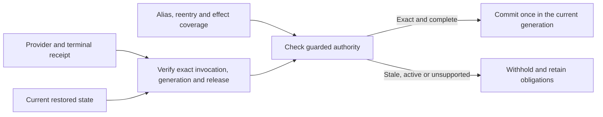

# RT-04 concurrent terminal reconciliation and guard coverage

Foreign ownership can persist after a local handle closes, a cancellation is acknowledged or an old state is restored. This study checks a candidate reconciliation boundary for a specific invocation, then compares it with native C, Python and SQLite evidence about which effects the boundary must cover.

## Terminal receipt and guard

A terminal receipt binds the exact provider, allocation, invocation, current snapshot generation and terminal disposition. The current expected subject comes from the reconciled state after any restore, including a fresh generation. The receiver independently checks the exact terminal scope and provenance. The local replay checks that subject in the same write transaction as the effect. Two identical deliveries can commit at most one completion. If terminal evidence is absent, an acknowledgment or queued acceptance is insufficient. A conflicting producer or earlier generation requires separate reconciliation.

Before treating the resource as gone, verify that the guard covers all live aliases, possible reentry and the relevant effect closure, including queued foreign ownership. Represent missing alias, reentry or effect evidence as unknown. A known active alias, active reentry or a modeled effect outside the allowed scope also withholds release. The finite guard matrix treats incomplete evidence as unknown even when another condition would refuse. Broader analyses can use a separately checked definite failure rule.



A guard restricted to one local lock or one dependent kind may be insufficient. The [SQLite reentry study](RESEARCH-SCENARIO-125-CLOSE-REENTRY-AND-COVERAGE.md) observes that a backup can keep close busy even when statement enumeration is empty. The [queued foreign ownership study](RT-04-QUEUED-FOREIGN-OWNERSHIP-2026-11-25.md) uses independent C and CPython receivers and 696 Linux lock observations. Queued ownership can remain observable after the sender closes and before any receive receipt. Counting all relevant references fits those observations. The [RT-10 cancellation study](../../runtime-and-systems/RT-10/RESEARCH-SCENARIO-129-CANCELLATION-AND-INVOCATION-EVIDENCE.md) distinguishes acknowledgment from terminal evidence, and the [durable invocation comparison](../../runtime-and-systems/RT-10/RESEARCH-SCENARIO-130-DURABLE-INVOCATION-RESULTS.md) records persisted effect-and-result boundaries.

## Checked outcomes

The local SQLite fixture loads a recorded invocation and restores the same provider, allocation and invocation under a different current generation. Two independent threads with separate connections queue deliveries concurrently in WAL mode. Each case has one exact terminal receipt and a second that is identical or differs in exactly one of provider, allocation, invocation, generation or disposition. Across 12 cases covering two separately keyed provider profiles, an exact delivery closes the row once. The duplicate is idempotent in both duplicate cases. The ten mismatched deliveries are withheld irrespective of observed order. Reopening yields exactly one closed current row. The provider identities in these 12 cases are synthetic. Actual provider behavior comes from the separately pinned native receipts above.

The finite coverage check crosses three alias states, three reentry states and three effect scopes. Of 27 cases, one has complete current authority, seven are refused on known conditions, and 19 remain unknown. A known widened effect cannot qualify under the original guard. An unmodeled effect also remains unavailable.

Accepting a provider acknowledgment as terminal can close a still-live resource. Comparing only the provider or restored content can reuse an inapplicable completion after generation changes. The candidate avoids those failures with scope-bound receipts and explicit effect coverage. It costs extra records and a publication check at the actual effect boundary.

## Verify and limits

The [runner](RECONCILIATION-GUARDS-01/check.py) and [ledger](RECONCILIATION-GUARDS-01/evidence.json) use CPython 3.12.14, Git 2.56.1 and SQLite 3.53.1. They pin four prior reports or ledgers at `16f21b6df3ef3668477973bfad94e5974177c2f2`. Hash seeds 37 and 71 produce the same categorical results.

```bash
fixture=research/language-design/RT-04/RECONCILIATION-GUARDS-01
LC_ALL=C PYTHONHASHSEED=37 python3 -B "$fixture/check.py" > /tmp/llmlang-reconciliation-guards.json
cmp "$fixture/evidence.json" /tmp/llmlang-reconciliation-guards.json
```

This is a local durable record of the candidate reconciliation step. External effects and real provider trust are not atomically coupled to this database. Distributed delivery, unsupported resource classes, full alias extraction and authority governance remain open.
