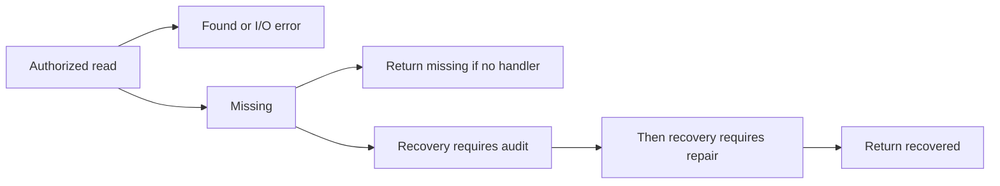

# RT-04 — Local error recovery and capability obligations

Can a local handler eliminate an outward error while adding capability obligations? The fixture compares a read-only summary with a summary derived from the reachable recovery path. It checks exact ordered observations in four native C builds. The branch baseline is `f1debf982b0d784dd86e0abdc7c8ae04cc14fb8d`. [Effects and authority alternatives](RESEARCH-SCENARIO-38-EFFECTS-CAPABILITIES-AND-AUTHORITY.md)

The main operation requires a read grant. The simulated fetch returns found, missing, or I/O error. If the missing case is handled, recovery requests audit and then repair with their own grants. A denied operation stops execution before that operation's observation. The original read and any completed audit stay in the trace. With recovery enabled, the final result never exposes the missing variant. I/O error and authority denial remain distinct outward results.



The runner enumerates three fetch dispositions, two handler settings, and all eight subsets of read, audit and repair permissions. It compares every outcome and trace with an independent Python evaluator that stops at the first unavailable operation. GCC and Clang at `-O0` and `-O2` agree in all 48 cases per build. [Native bridge](RECOVERY-EFFECTS-01/recover.c) · [All observations](RECOVERY-EFFECTS-01/evidence.json)

| Known path and grants | Outcome | Ordered effects |
|---|---|---|
| Missing with handler, read grant only | Denied | read |
| Missing with handler, read and repair grants | Denied | read |
| Missing with handler, read and audit grants | Denied | read, audit |
| Missing with handler, all three grants | Recovered | read, audit, repair |
| I/O error with handler, read grant only | I/O error | read |

The read-only summary misses three incomplete grant sets when the missing handler is reached. In one case a denial occurs after the audit. The exact path summary matches the dispositions of all 48 cases. When the fetch outcome is unknown to the static caller, this experiment's path summary must be lifted to the union of possibilities or checked where the branch is selected.

The C model records effect names in memory and assumes exact grants and deterministic paths. It leaves external I/O, concurrency, grant lifetime, partial repair, and open effect rows out of scope. The result supports carrying outward errors, capability obligations and ordered observations as separate fields of the interface. [Type and data model issue](https://github.com/aivibeflow/LLMLang/issues/324)

## Reproduction

Use CPython 3.12.14, GCC 14.2.0 (Debian 14.2.0-19) and Clang 23.1.1 at revision `6dfe1677ab8dffbc6ec13d53a1e0215d75147689` on x86-64 Linux. Hash seeds 1 and 2 produced identical receipts. The diagram was checked as Mermaid source.

```bash
fixture=research/language-design/RT-04/RECOVERY-EFFECTS-01
LC_ALL=C PYTHONHASHSEED=1 python3 -B "$fixture/run.py" --clang /path/to/pinned/clang > /tmp/llmlang-rt04-recovery-effects.json
cmp "$fixture/evidence.json" /tmp/llmlang-rt04-recovery-effects.json
```
