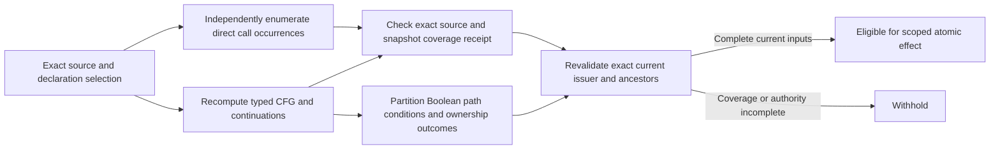

# RT-04 source-bound call coverage, ownership paths and grant admission

An ownership analysis can make an unsafe claim if it omits a call, changes a branch continuation or reuses coverage after a snapshot edit. Its exact source result also cannot authorize an effect after a capability issuer or ancestor has changed. This study connects the restricted source CFG with explicit coverage and grant checks and reconciles prior native revocation evidence.

## Source and path evidence

For the admitted Python-shaped source fragment, derive an exact inventory of direct intrinsic call occurrences using kind and UTF-8 source coordinates. Independently walk the source AST to verify the submitted occurrence inventory. Recompute the recognized CFG and compare its control continuations and node identities against the supplied graph. Bind the receipt to the exact source digest, CFG, ordered guard/cleanup structure and selected snapshot. In this model the snapshot selects one fixed intrinsic declaration per kind. General source interfaces need exact target signatures and declaration revisions in that semantic selection.

The CFG explicitly represents short-circuit guards, the pending return handle, primary errors and nested cleanup. Each path condition is represented as a disjunction of assignments to Boolean inputs and cleanup failure flags. The test groups inputs with the same projected ordered trace, handle disposition and causes. It checks concrete action traces and resource outcomes separately against the existing independent source interpreter. In particular, an acquisition can leave a pending result if cleanup fails, while a clean return moves the result to the caller. Control continuations determine that distinction.



The two checked comparisons answer different questions. An inventory can show all source calls are represented while the CFG still leaves the wrong branch continuation. A complete CFG does not prove the operator has an active grant. A production analysis needs both complete lowering correspondence and current authorization where its result governs an effect.

## Grant issuance and revocation

A candidate runtime grant binds trusted issuer identity and revision, recipient, exact scope and permitted effect, parent/delegation chain, and current lifecycle status. Each child must be within its parent's authority. A checked receipt binds the whole relevant chain and the intended effect. Revalidate the issuer and exact ancestors inside the transaction that publishes the effect, or use a separately checked equivalent protocol. A changed global epoch can conservatively force revalidation even for unrelated changes. An unchanged leaf alone cannot establish inherited rights.

The existing [native SQLite WAL comparison](RT-04-CONCURRENT-GRANT-REVOCATION-2026-11-25.md) covers 45 revoke, reissue and effect process-pair schedules. Checking only the leaf allows two stale effects. The global epoch check refuses one unaffected case. Exact ancestry inspection and checked retry recover local scope. The new fixture models exact revisions and lifecycle flags. It does not issue credentials, authenticate a production issuer or execute an external effect. [Independent native effect study](../../runtime-and-systems/RT-37/RT-37-CORTEX-M3-TRANSITIVE-ISR-EFFECTS-2026-11-24.md)

## Checked observations

Four distinct guards and 16 Boolean assignments per guard yield 64 exact source/CFG observations. All agree with the source reference. Each guard produces 12 projected path classes. Across the complete fixture, eight inputs return ownership to the caller, 24 leave a pending handle and 32 have no staged handle. These are disjoint finite outcome categories.

The separate 32 coverage/authority checks admit four exact cases, keep 20 coverage cases unknown and withhold eight when current authority is unavailable. The coverage controls change the snapshot or exact source, omit an occurrence even after recomputing the submitted digest, substitute an eager CFG with the same call inventory, or use an unsupported intrinsic. Replacing the issuer or revoking an ancestor with an unchanged leaf fails the authority check. Resource outcomes and capability decision remain independently inspectable.

A caller-supplied completeness Boolean cannot detect any of the stale or rehashed CFG controls by itself. The combined candidate rebuilds the limited CFG and refuses unsupported source. This improves trust in the checked fragment at the cost of source and snapshot revalidation. Broader abstractions could avoid recomputing the entire graph if a separately checked proof established exact extraction and preservation.

## Verify and limits

The [runner](SOURCE-OWNERSHIP-GRANT-01/check.py) and [ledger](SOURCE-OWNERSHIP-GRANT-01/evidence.json) use CPython 3.12.14 and Git 2.56.1. The input ledger pins three prior studies at `71dfa62a963c771cfed808e542f08716c28a7413`. Both hash seeds reproduce identical results. The Boolean disjunctions are exact only for the finite source domain.

```bash
fixture=research/language-design/RT-04/SOURCE-OWNERSHIP-GRANT-01
PYTHONHASHSEED=37 python3 -B "$fixture/check.py" > /tmp/llmlang-source-ownership-grant.json
cmp "$fixture/evidence.json" /tmp/llmlang-source-ownership-grant.json
```

General LLMLang parsing, alias escape, asynchronous source paths, authenticated runtime credentials and distributed revocation remain open. The production issuer and trust policy require approval.
