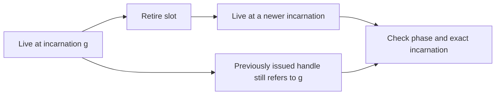

# RT-04 — Typed state and resource incarnation

Can a handle described as live still identify the wrong resource after its slot is retired and reused? The fixture separates the phase of a slot from the incarnation that issued the handle. The branch baseline is `27aabfad87c5bafc1b19dd88a57183e0739f0c85`. [Typestate and external mutation alternatives](RT-04-TYPE-EFFECT-OWNERSHIP-AND-CAPABILITY-ALTERNATIVES.md)

An issued handle identifies a live phase of one resource slot. An external transition can retire that slot and make it live again with a larger incarnation. The fixture allows a stale handle to survive those transitions. A current retired slot always rejects use. For a live slot, the three candidates compare only phase, phase and a wrapping generation tag, or phase and the exact incarnation.



The Lean kernel checks that the exact gate admits the same live incarnation and rejects every positive advance. A modulo comparison admits the incarnation one positive period later. An expected-failure check confirms that a retired handle cannot be passed as the current live handle. The phase type rules out a known retired slot, while the extra relation is needed for two live phases with different histories. [Lean source](STATE-INCARNATION-01/Incarnation.lean) · [Printed axioms](STATE-INCARNATION-01/axioms.txt)

| Policy | Invalid admissions across the finite inventory |
|---|---:|
| Phase only | 16,380 |
| Phase and wrapping counter | 378 |
| Phase and exact incarnation | 0 |

The Python comparison enumerates 33,012 cases over counters 1–6 bits wide, every initial residue, zero through three periods of advance, and both current phases. All three policies accept the 126 live cases with no advance. The wrapping case admits stale handles at each positive multiple of the period. The counts describe the selected inventory and cannot estimate native failure rates. [Finite evidence](STATE-INCARNATION-01/evidence.json)

A finite generation tag can support this relation if the resource protocol proves that no older handle can survive a reuse of its tag. The comparison assumes strictly increasing exact incarnations and a single consistent state observation at the check. Acquisition races, foreign ownership, atomic check-and-use, restart persistence, and the production choice of generation or non-reuse policy remain open. [Type and data model issue](https://github.com/aivibeflow/LLMLang/issues/324)

## Reproduction

Lean v4.36.0 at commit `611c117bfaf7b7ae1cfcf246ce6fba31e8f509e9` accepted the file with warnings treated as errors. One theorem is axiom-free, one uses `propext`, and two use `propext` and `Quot.sound`. On CPython 3.12.14, hash seeds 1 and 2 produced identical receipts. The diagram was checked as Mermaid source.

```bash
fixture=research/language-design/RT-04/STATE-INCARNATION-01
lean -DwarningAsError=true "$fixture/Incarnation.lean" > /tmp/llmlang-rt04-incarnation-axioms.txt
cmp "$fixture/axioms.txt" /tmp/llmlang-rt04-incarnation-axioms.txt
LC_ALL=C PYTHONHASHSEED=1 python3 -B "$fixture/run.py" > /tmp/llmlang-rt04-state-incarnation.json
cmp "$fixture/evidence.json" /tmp/llmlang-rt04-state-incarnation.json
```
