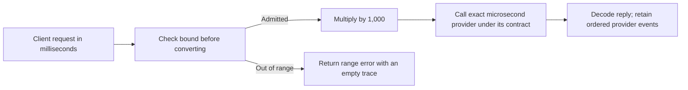

# Verify a unit-conversion adapter with range and trace obligations

**Scope:** PLAN §1.3 and [#290](https://github.com/aivibeflow/LLMLang/issues/290). Closed candidate adapter model at `d244ed4839e9a6037322bd060deeabcacace21ad` on `research/all`.

## Contract boundary

[Scenario 14](../RT-02/RESEARCH-SCENARIO-14-FORMAL-BEHAVIORAL-CONTRACTS-AND-REFINEMENT.md) motivates substitutability under observable effects, errors and state. [Public interface and contract refinement](../../semantic-representation/RT-05/PUBLIC-INTERFACES-AND-CONTRACT-REFINEMENT.md) separates verification of a provider from refinement to the caller-required contract. This study tests a candidate adapter for contracts that expose different units and input domains.

The client passes a natural number of milliseconds. To arm a timer request it must get its original millisecond value back and observe exactly one `arm` event containing the corresponding microsecond value. If the product does not fit an unsigned 32-bit input, the required observation is a range error without events. The provider contract accepts a natural number of microseconds at most `2^32 − 1`; it returns that number and emits exactly one arm event with that number. The model observes the requested value and call trace. It does not model real time or guarantees about when a timer fires.



Direct substitution would pass milliseconds to a microsecond input. A wrapper that just multiplies under a fixed-width machine operation can silently wrap. Comparing only return values can miss a removed or extra event. The candidate adapter checks the bound before multiplication and verifies both the decoded reply and the exact trace.

## Checked evidence

The [Lean model](VERIFIED-UNIT-ADAPTER-01/Adapter.lean) checks that `millis ≤ 4,294,967` is equivalent to `1,000 × millis ≤ 2^32 − 1`. It then proves that the adapter meets the client contract for every natural input and every provider satisfying the exact provider contract. This is a universally quantified result in the model, conditional on the provider premise. It uses the reported axioms `propext`, `Classical.choice` and `Quot.sound`.

Four additional Lean theorems check concrete counterexamples. At 4,294,968 milliseconds the unchecked 32-bit product becomes 704, so the wrapped implementation emits an event where the contract requires an empty trace. At one millisecond the unscaled adapter, a trace-erasing adapter, and an extra provider event each violate the contract. These four counterexample theorems have empty reported axiom lists.

An independent Python predicate checks the exact requested microsecond product and required observation. The runner samples 17 low inputs, 33 values around the boundary, and 15 powers of two. Of the 65 inputs, 38 are admitted and 27 require the range error.

| Executable route | Observations different from the required pair |
| --- | ---: |
| Checked unit adapter | 0 / 65 |
| Unchecked 32-bit wrapping multiplication | 27 / 65 |
| Erase trace | 38 / 65 |
| Wrong input scale | 64 / 65 |
| Provider emits an extra audit event | 38 / 65 |

The [ledger](VERIFIED-UNIT-ADAPTER-01/evidence.json) records replies and ordered events for every route and input, along with the exact theorem axiom lists. The Python wrapping route implements unsigned mathematical truncation. The experiment did not use a native timer or check a compiled register or ABI.

## Evidence required for substitution

Bind an adapter receipt to the caller-required contract, provider contract, adapter implementation, unit and range interpretation, observation projection, and target assumptions. A compile/translation certificate needs to preserve the range guard, error tag and traces. Substituting a new provider requires separately justified conformance to the provider premise. A source-level proof of this adapter cannot supply that provider evidence. Admitting a conversion that adds, hides or reorders effects would require a caller contract whose observation explicitly permits the change.

This fixture does not choose a rule for discovering adapters automatically. It leaves native ABI and lowering correspondence, actual timing, cancellation, concurrency and broader adapter composition open.

## Reproduce

Use CPython 3.12.14 and Lean 4.36.0 at `611c117bfaf7b7ae1cfcf246ce6fba31e8f509e9`. Set `LEAN` to the exact executable. The [runner](VERIFIED-UNIT-ADAPTER-01/run.py) checks the axiom output and reproduces the observations.

```sh
set -eu
fixture=research/language-design/RT-04/VERIFIED-UNIT-ADAPTER-01
out=$(mktemp)
python3 -B "$fixture/run.py" --lean "$LEAN" > "$out"
cmp "$out" "$fixture/evidence.json"
```

The counts are exact for the named directed corpus. Mermaid source was inspected directly.
