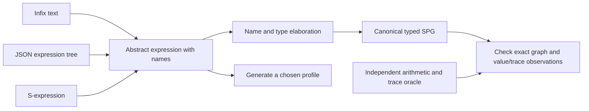

# RT-31 — Three concrete expression profiles over one typed SPG

Three versioned expression profiles compiled to byte-identical typed graphs for each of 32 program configurations. All nine ordered source-to-target conversions agreed with an arithmetic and ordered-trace oracle on 4,032 observations. Syntax defects, unknown names, type errors and observable trace changes reached different validation stages.

## Scope and model

The profiles represent implementation expressions for a common fixture with integer and Boolean scalars, lazy conditional branches, ordered event emission, direct implementation pins and late operation bindings. The operation declarations, trace contracts and binding catalog remain shared inputs. The study extends the existing two-surface SPG experiment by adding an S-expression parser and all-pairs conversion, then exercises nested calls, argument order and lazy branches within the same corpus.

Each parser produces an abstract expression with logical constructors such as `arg`, `sub`, `emit` and `if`. The abstract tree retains parameter names. The existing typed elaborator resolves those names to positions, verifies types and call signatures, and constructs the canonical Semantic Program Graph. Source text digests and the profile version stay in separate provenance records. The experiment uses the common abstract expression as input to the generators. A general generator that reconstructs surface source from an arbitrary SPG is still open.

| Profile | Expression that emits an event and returns the sum |
| --- | --- |
| `infix/1` | `emit("left", (x + 1))` |
| `json-tree/1` | `["emit","left",["add",["arg","x"],1]]` |
| `s-expression/1` | `(emit "left" (add (arg "x") 1))` |



## Results

| Profile | Bodies | Minimum bytes | Median bytes | Maximum bytes |
| --- | ---: | ---: | ---: | ---: |
| `infix/1` | 32 | 98 | 99 | 100 |
| `json-tree/1` | 32 | 150 | 151 | 152 |
| `s-expression/1` | 32 | 128 | 129 | 130 |

The 32 configurations cross call kind, provider binding, four signed offsets and two false-branch adjustments. Across the three source and three target profiles each passes fourteen parameter inputs, giving 32 × 9 × 14 observations. The false branch emits only `fallback`. The true branch emits the two argument events in order, then the selected provider emits `compute`. The independent oracle checks the direct pin and the two selectable provider behaviors without parsing strings or reading the graph.

A formatting change preserves the abstract expression in all profiles. Alpha-renaming the local parameter changes its abstract name and preserves canonical graph bytes for all three profiles. The 96 generated bodies have distinct profile text hashes within each configuration. Their byte counts depend on the generator and delimiters. They provide no measurement of model tokens, authoring effort or reviewer performance.

Truncated input fails at the frontend and records an ASCII offset. An unknown variable and a Boolean operand in integer arithmetic pass parsing and fail elaboration. Reversing equal-valued call arguments preserves the value, reverses two trace events and changes the canonical graph. The narrower contract oracle rejects the reversed trace even though the existing SPG compiler and structural checker can represent the program. Those controls distinguish syntax, typing, semantic equivalence and contract checking.

## Implementation boundary

The experiment supports a shared elaborator and observation oracle with independently versioned source adapters. The JSON tree exposes abstract constructors directly. The infix form reuses the host expression parser for the scoped grammar. The S-expression form exposes explicit nesting and requires its own lexer and parser. Sharing exact graph bytes lets the project evaluate later authoring and review comparisons on the same program behavior. Declaration syntax, module syntax, ownership, diagnostic spans beyond simple lexical errors, an arbitrary SPG-to-source projection and controlled human/model evaluation remain open.

## Reproduce

Use CPython 3.12.14 from the repository root. The runner records the exact SPG hashes, provenance hashes, observation digests and rejection controls.

```sh
fixture=research/language-design/RT-31/CROSS-PROFILE-SPG-01
output=$(mktemp)
python3 "$fixture/run.py" --output "$output"
cmp "$fixture/evidence.json" "$output"
python3 "$fixture/chart.py"
```

[Profile adapters](CROSS-PROFILE-SPG-01/profiles.py) · [Runner](CROSS-PROFILE-SPG-01/run.py) · [Evidence ledger](CROSS-PROFILE-SPG-01/evidence.json) · [Existing typed SPG experiment](../../semantic-representation/RT-05/RT-05-TYPED-SEMANTIC-PROGRAM-GRAPH.md)
