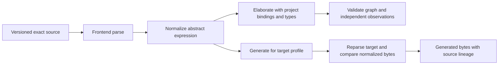

# RT-31 versioned frontend and generator contracts

[LL-029 / #342](https://github.com/aivibeflow/LLMLang/issues/342)

Multiple concrete profiles can share a typed expression fragment while keeping source bytes, generated text, normalized expressions and semantic graphs independently identifiable. The candidate envelope binds the selected profile version and the digest of the exact source bytes. Its frontend result carries normalized abstract expression bytes alongside that source. Generation records the new profile and generated source digest plus the origin profile, origin source digest, and normalized-expression digest. Formatting can change both source provenance and rendered bytes while preserving the normalized and semantic identities.



| Stage | Input and obligation |
| --- | --- |
| Source and profile | Verify the expected digest, decode UTF-8, and resolve the requested profile version. The hybrid envelope also declares its version. |
| Frontend and normalization | Parse the supported concrete grammar, validate the shared abstract expression shape, and encode that shape canonically. |
| Generation | Render for an explicit target version and reparse. Emit an artifact only if normalized expression bytes match. |
| Elaboration | Resolve names, bindings and types in the supplied program environment and build its semantic graph. |
| Semantic validation | Validate the graph and compare its observed value and ordered effects to an independent oracle. |

The adapter keeps the original parsers. Some legacy parsers combine syntax and abstract shape validation. The adapter records their failure at the frontend boundary and provides a distinct normalization diagnostic when an abstract input is passed directly. The existing elaborator combines binding and type checks. Its diagnostics in this fixture carry a phase and exact source digest and omit a location where the elaborator provides none.

## Observations

Eight subjects, four origin and four target profiles, and two source spellings per origin produced 256 routes and 3,584 exact value-and-trace comparisons. Every generated output retained exact source provenance, reparsed to the same normalized expression, and elaborated to the same exact graph as the other routes for that subject. The generated profile does not receive credit for matching text alone. A counterexample uses the name `x-y` in a structured expression. Infix generation would emit those same characters as a subtraction. The contract refused that generation because normalized bytes differed. A separate semantic control preserves the scalar value while reversing the effect order and fails the observation oracle.

Thirty-nine diagnostic controls include a mismatched source digest, an unsupported version, invalid UTF-8, malformed syntax, invalid abstract shape, unresolved arguments, invalid operand types, lossy generation, and an incorrect effect trace. Eight controls locate exact source spans. Coordinates use a zero-based byte range, a one-based line, and a zero-based byte column. The hybrid profile maps its decoded scalar offset back through the enclosing JSON string, so the escaped right parenthesis occupies the actual six source bytes of its escape. The diagnostic also records the enclosing field path. A whole field location is distinguished from a precise parser point. The adapter reports an enclosing field or an unknown location when a more precise mapping is unavailable.

This replay covers the existing ASCII concrete syntax fixture, including some escaped JSON encodings. It depends on the CPython parser's reported offsets. Unicode grapheme positions, general source maps between an elaborated graph and generated output, multiple diagnostics per failed parse, migrations between released profile versions, and interface integration remain open. The four version tags and API are candidate contracts.

## Reproduce

Run from the repository root with CPython 3.12.14. The runner verifies the exact reused parsers, generator, and semantic validation sources against their pinned branch revision. [Contract adapter](FRONTEND-CONTRACT-01/contract.py) · [Replay](FRONTEND-CONTRACT-01/verify.py) · [Evidence](FRONTEND-CONTRACT-01/evidence.json)

```sh
python -B research/language-design/RT-31/FRONTEND-CONTRACT-01/verify.py /tmp/rt31-frontend-replay.json
cmp /tmp/rt31-frontend-replay.json research/language-design/RT-31/FRONTEND-CONTRACT-01/evidence.json
```
