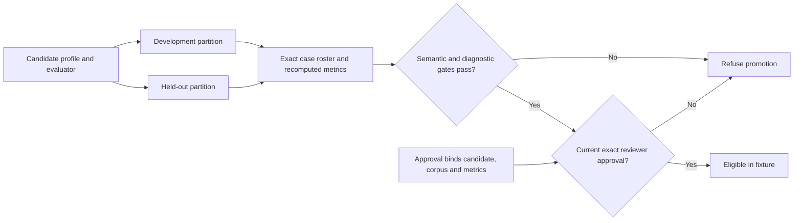

# RT-31 held-out regression and reviewed promotion

[LL-029 / #342](https://github.com/aivibeflow/LLMLang/issues/342)

An offline evaluator compares candidate syntax, instruction, diagnostic, and tooling behavior with a fixed baseline. Its development and held-out partitions have disjoint case IDs and program arguments. Each case declares its expected acceptance disposition and failure stage independently of the evaluated candidate. The evaluator records parse success, integer value, ordered trace, exact source digest and task obligations. Parsing alone cannot determine whether the proposed change preserves the required semantics.

The replay uses the existing versioned infix and hybrid frontends plus the SPG interpreter. The instruction candidate models a scripted response that supplies a missing obligation without verification. The diagnostics candidate relabels a real elaboration error. The Toolchain candidate checks a real execution's scalar result while omitting its ordered trace. The syntax alternatives change source layout or reorder the two emitted events. These are deterministic offline variants with intentionally placed controls.



The report carries both aggregate counts and the complete case roster. The release check recomputes aggregates and requires exact coverage. An approval binds a specific candidate, corpus, evaluation digest and review epoch. The evaluator cannot grant that approval.

## Observations

The replay contains eight development and 12 held-out cases per candidate and 120 case observations across the baseline and five alternatives. Every row passed the expected offline comparison. The baseline and layout-only candidate had zero regressions in both partitions. The other four passed development and failed on held-out cases.

| Candidate | Development regressions out of 8 | Held-out regressions out of 12 | Held-out parses out of 12 |
| --- | ---: | ---: | ---: |
| Baseline | 0 | 0 | 10 |
| Layout only | 0 | 0 | 10 |
| Reordered effects | 0 | 4 | 10 |
| Instruction omits required evidence | 0 | 2 | 10 |
| Collapsed diagnostics | 0 | 2 | 10 |
| Scalar-only Toolchain verdict | 0 | 2 | 10 |

The event-order fixtures make the pre- and post-change scalar result equal. The held-out trace falsifier distinguishes both the order-changing syntax variant and the scalar-only verdict policy. Parsing metrics alone are identical for all candidates. The review gate rejected all four regressions even with modeled approval. For the otherwise eligible layout change, only exact approval passed the ten review controls. Missing or declined review, earlier epoch, wrong reviewer, different metrics or corpus, another candidate, an omitted held-out result and a forged aggregate each failed.

This is a finite, deliberately discriminating corpus. The held-out partition is separate within the replay, and its published cases provide no claim of blind or independent prospective evaluation. Instruction variants and approvals are simulated. No production configuration was promoted. Live model access, held-out workload construction under an independent protocol, authenticated reviewer identity, review effort, and performance comparisons remain open.

## Reproduce

Run from the repository root with CPython 3.12.14. The runner checks exact reused sources at their pinned branch revision. [Replay](HELDOUT-REGRESSION-01/run.py) · [Per-case evidence](HELDOUT-REGRESSION-01/evidence.json)

```sh
python -B research/language-design/RT-31/HELDOUT-REGRESSION-01/run.py /tmp/rt31-heldout-replay.json
cmp /tmp/rt31-heldout-replay.json research/language-design/RT-31/HELDOUT-REGRESSION-01/evidence.json
```
