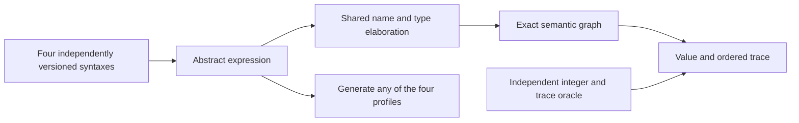

# RT-31. Four expression profiles with a shared semantic graph

The existing expression corpus has textual infix, explicit S-expression and structured JSON adapters. This experiment adds a hybrid adapter that keeps conditionals, calls, effects and effectful arithmetic in structured nodes. Pure scalar fragments use the existing infix grammar. Each profile has a parser and generator over the same abstract expression grammar. [Issue #342](https://github.com/aivibeflow/LLMLang/issues/342) · [Original three-profile archive](RT-31-CROSS-PROFILE-SPG-2026-11-24.md)

The hybrid envelope declares its version, validates exact JSON fields and rejects duplicates. Its scalar nodes allow literals, parameters and pure arithmetic, while calls or effects require structured nodes. An error inside an embedded expression carries its JSON path and relative infix offset. An invalid outer JSON structure carries the outer offset. The experiment keeps these two coordinate systems explicit.

```json
{"profile":"hybrid/1","expression":{"kind":"emit","event":"left","value":{"kind":"scalar","expr":"(x + 1)"}}}
```



## Results

The 32 archived configurations retain their exact graph digests. All 16 ordered source-to-target routes per configuration match the independent value and trace oracle on 14 inputs, giving 7,168 observations. Another 56 observations check arithmetic whose operands deliberately emit ordered effects. Compact and indented hybrid source forms parse to the same abstract expression. [Evidence](HYBRID-PROFILE-01/evidence.json)

| Generated profile | Minimum bytes | Median bytes | Maximum bytes |
| --- | ---: | ---: | ---: |
| Infix | 98 | 99 | 100 |
| S-expression | 128 | 129 | 130 |
| JSON tree | 150 | 151 | 152 |
| Hybrid | 395 | 396 | 397 |

The length is a property of these encodings and their generators. The hybrid representation trades textual compactness for explicit field names around structured constructs. The tests distinguish malformed outer JSON, malformed embedded syntax, unknown names, type errors and wrong traces. Swapping two equal-valued arguments preserves the integer result and changes the event order.

The fixture covers integer and Boolean expressions, direct pins, late operation bindings, ordered effects and conditional evaluation. It leaves declaration/module syntax, source mapping to arbitrary serialized escapes, semantic coverage of larger programs, model token counts and controlled user outcomes open. The verified conversions run through the common abstract expression; they do not synthesize source from an arbitrary semantic graph.

## Replay

Source baseline `180d684` on `research/all`. Replay used CPython 3.12.14. Run from the repository root.

```sh
data=research/language-design/RT-31/HYBRID-PROFILE-01
legacy=research/language-design/RT-31/CROSS-PROFILE-SPG-01
receipt=$(mktemp)
python -B "$legacy/run.py" --output "$receipt"
cmp "$legacy/evidence.json" "$receipt"
python -B "$data/replay.py" "$receipt"
cmp "$data/evidence.json" "$receipt"
rm "$receipt"
```
