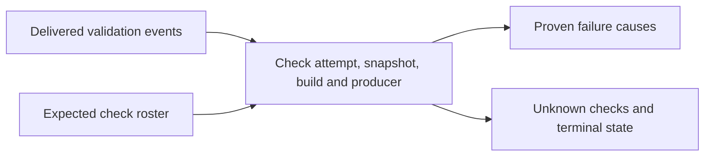

# RT-31 — Failure attribution across MCP attempt evidence

- **Date** — 2026-11-25
- **Tracking** — [PLAN §7.9](../../../PLAN.md#79-ai-oriented-syntax-experimentation-and-mcp-session-observability-rt-31) · [#342](https://github.com/aivibeflow/LLMLang/issues/342)
- **Status** — Reproduced finite model of evidence ingestion and attribution

## Question and setup

Can telemetry retain evidence for simultaneous causes when validation events arrive out of order, are incomplete, or come from another attempt? Each synthetic current attempt expects a source validator, a task context validator, a differential Toolchain checker and an environment probe. A coordinator provides a terminal marker. The fixture assigns each check a stable event ID and binds it to a session, turn, attempt, snapshot and Toolchain build. These checks stand for independent diagnostic producers whose verdicts the experiment supplies. [RT-31 syntax and Toolchain optimization](RT-31-AI-ORIENTED-SYNTAX-AND-TOOLCHAIN-OPTIMIZATION.md)

The first two policies keep one failing check. One uses the last failure delivered from the same session, while the other uses the first failure delivered from the current turn and attempt. The third collects checks by exact binding and expected issuer. It keeps all unambiguous failure verdicts, records missing or conflicting check slots as unknown, and tracks an absent terminal marker separately. An identical repetition is idempotent. Valid failures remain visible when unrelated checks are unknown.



## Observations

The experiment covers all 16 four-category fault masks, nine delivery variants and all their distinct event orders. The independently stated oracle uses the seeded fault mask and the expected unknown checks from each variant.

| Policy | Exact oracle matches across 66,048 schedules |
|---|---:|
| Last failure in the session | 9,600 |
| First failure in the current attempt | 11,400 |
| Exact attempt-bound attribution | 66,048 |

Across the matrix, 43,176 schedules have multiple known causes and 12,288 contain unknown evidence or lack a terminal marker. These are counts over the enumerated schedules, including the different permutation counts of each inventory. They do not estimate rates in live traffic. [Evidence ledger](MCP-ATTRIBUTION-01/evidence.json)

Two valid failures can coexist even when the final delivery mentions only one. An earlier attempt can contribute a stale model failure to a clean current attempt under the last-session rule. Matching turn and attempt also admits false attribution when a report has the wrong build, snapshot or producer. Exact attribution ignores those foreign records and handles a missing or contradictory expected check without suppressing the surviving well-bound causes.

## Limits

A usable schema needs attempt correlation and an expected evidence roster as well as final outcome records. Multiple observed faults, uncertain slots and an unsealed attempt describe different properties. The model trusts producer identities and pins, uses synthetic metadata-only events, and tests arrival order as a finite set. Real MCP integration must authenticate event provenance and decide coverage, terminal-watermark semantics, retention and privacy. Actual classifier accuracy on human-reviewed session samples remains open.

## Reproduction

Run from the repository root with CPython 3.12.14. The runner enumerates the synthetic schedules and emits deterministic counts and witnesses. [Runner](MCP-ATTRIBUTION-01/run.py)

```sh
set -eu
dir=research/language-design/RT-31/MCP-ATTRIBUTION-01
observed=$(mktemp)
trap 'rm -f "$observed"' EXIT
python3 -B "$dir/run.py" > "$observed"
cmp "$dir/evidence.json" "$observed"
```
